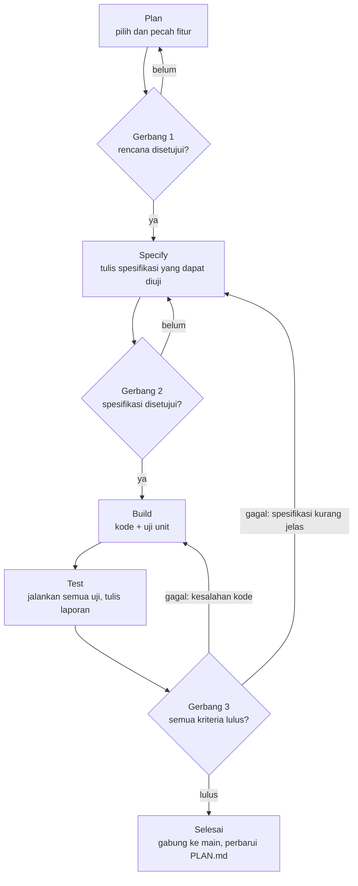

# AGENTS.md — Sehari Setara

Panduan untuk agen AI pemrograman (dan manusia) yang mengerjakan game **Sehari Setara** di repositori `ruang-setara`. Baca seluruh file ini sebelum mengubah apa pun.

Versi 0.4 (21 Oktober 2026): verifikasi rujukan dicatat di `docs/sehari-setara/Verifikasi_Rujukan.md`, bukan di kode.
Versi 0.3 (21 Oktober 2026): FR-18 (ulangi adegan dan kembali ke adegan sebelumnya) masuk ke F-13 atas keputusan pemilik proyek.
Versi 0.2 (19 Oktober 2026): aset gambar kini digambar dengan kode di `scripts/game/art/`, bukan dibuat dengan Gemini.

---

## 1. Konteks singkat

- Ruang Setara adalah media pembelajaran Pendidikan Pancasila kelas IX berupa galeri 3D, diterbitkan statis di GitHub Pages.
- Sehari Setara adalah game petualangan bercabang bergaya piksel retro yang cerah. Game ini dimainkan berkelompok di satu layar proyektor dan dioperasikan guru.
- Game dibangun sebagai **halaman terpisah** `sehari-setara/` di dalam build yang sama. Kode galeri hanya disentuh di dua titik integrasi.

## 2. Dokumen acuan dan urutan otoritas

Jika ada pertentangan, yang lebih atas yang berlaku:

1. Instruksi langsung pemilik proyek (manusia).
2. `docs/sehari-setara/PRD.md` — apa yang dibuat dan mengapa.
3. `docs/sehari-setara/Design_System.md` — tampilan, rasa, dan aturan aset.
4. `docs/sehari-setara/Architecture.md` — cara membangunnya.
   `docs/sehari-setara/Daftar_Aset.md` — status setiap aset gambar.
5. Spesifikasi fitur yang disetujui: `docs/sehari-setara/specs/F-xx-*.md`.
6. Kode yang sudah ada.

Jika dua dokumen bertentangan atau suatu hal tidak tercakup, **berhenti dan tanyakan**. Jangan menebak.

## 3. Peran

| Peran | Dijalankan oleh | Tanggung jawab |
|---|---|---|
| Perencana | Agen AI | Memilih fitur berikutnya, memecah pekerjaan, mencatat risiko |
| Penyusun spesifikasi | Agen AI | Menulis spesifikasi fitur yang dapat diuji |
| Pembangun | Agen AI | Menulis kode dan uji sesuai spesifikasi |
| Penguji | Agen AI | Menjalankan semua uji dan menulis laporan |
| Penyetuju | **Manusia** | Menyetujui rencana dan spesifikasi; memutuskan rilis |
| Peninjau konten | **Manusia** | Memverifikasi rujukan pasal di JDIH; menilai kelayakan naskah untuk siswa |
| Pembuat aset | **Claude** (chat di proyek claude.ai) | Menggambar aset lewat kode di `scripts/game/art/` mengikuti Design System bagian 12, mengirim pratinjau, memperbarui `Daftar_Aset.md` |
| Penyetuju visual | **Manusia** | Menyetujui setiap pratinjau aset sebelum berstatus "Disetujui" |

Satu agen boleh menjalankan beberapa peran, tetapi **wajib menyebut peran dan tahap yang sedang dijalankan** di awal setiap balasan, misalnya: `Tahap: Specify · Fitur: F-06`.

## 4. Alur kerja Plan → Specify → Build → Test

Setiap fitur melewati empat tahap berurutan. Dua gerbang pertama memerlukan persetujuan manusia.



### 4.1 Plan

| | |
|---|---|
| Tujuan | Memilih **satu** fitur terkecil yang bernilai dan siap dikerjakan |
| Masukan | Backlog di bagian 5, status di `docs/sehari-setara/PLAN.md`, PRD bagian 7 |
| Langkah | 1) Pilih fitur pertama yang semua dependensinya sudah selesai. 2) Sebutkan kebutuhan PRD yang dipenuhi (FR-xx). 3) Daftar file yang akan dibuat/diubah. 4) Daftar aset yang dibutuhkan dan apakah sudah tersedia. 5) Catat risiko dan perkiraan ukuran (S/M/L) |
| Keluaran | Entri baru di `PLAN.md` (templat 11.1) |
| Selesai bila | Manusia membalas `Setuju: F-xx` |
| Dilarang | Menulis kode; merencanakan lebih dari satu fitur sekaligus |

### 4.2 Specify

| | |
|---|---|
| Tujuan | Mengubah rencana menjadi perilaku yang tepat dan dapat diuji |
| Masukan | Entri `PLAN.md` yang disetujui, PRD, Design System, Architecture |
| Langkah | 1) Tulis perilaku dalam format *Diberikan / Ketika / Maka*. 2) Gambarkan setiap status antarmuka (biasa, fokus, nonaktif, kosong, galat). 3) Tulis semua teks Bahasa Indonesia final yang akan tampil. 4) Sebutkan tipe data dan aksi reducer yang terlibat. 5) Daftar aset dengan nama file sesuai konvensi. 6) Tulis rencana uji. 7) Tulis apa yang **tidak** termasuk |
| Keluaran | `docs/sehari-setara/specs/F-xx-nama.md` (templat 11.2) |
| Selesai bila | Tidak ada "TBD"; setiap kriteria penerimaan bisa diuji; manusia membalas `Spesifikasi disetujui: F-xx` |
| Dilarang | Mengarang rujukan pasal baru, atau menambahkan rujukan tanpa kotak kosong di `Verifikasi_Rujukan.md`; mengubah token Design System |

### 4.3 Build

| | |
|---|---|
| Tujuan | Mewujudkan spesifikasi, tidak lebih dan tidak kurang |
| Masukan | Spesifikasi yang disetujui |
| Langkah | 1) Buat cabang `fitur/F-xx-nama`. 2) Tulis uji unit lebih dulu untuk logika di `engine/`. 3) Implementasikan langkah kecil demi langkah kecil. 4) Daftarkan aset baru di `manifest.ts` dan `CREDITS.md`. 5) Jalankan `test` dan `build:pages` sebelum setiap commit. 6) Commit kecil dengan pesan Bahasa Indonesia, misalnya `F-06: tambah komponen indikator` |
| Keluaran | Kode, uji, dan aset terdaftar di cabang fitur |
| Selesai bila | Semua uji unit lulus dan build berhasil |
| Dilarang | Menambah fitur di luar spesifikasi; menambah dependensi tanpa izin; mengubah file galeri di luar titik integrasi |

### 4.4 Test

| | |
|---|---|
| Tujuan | Membuktikan setiap kriteria penerimaan terpenuhi di kondisi yang mirip kelas |
| Langkah | 1) `content:check`. 2) `test`. 3) `build:pages`. 4) `test:e2e` (di subfolder `/ruang-setara/`). 5) Periksa daftar manual yang relevan (bagian 9). 6) Ambil tangkapan layar pada 1280×720 dan 1024×768. 7) Tulis laporan |
| Keluaran | `docs/sehari-setara/tests/F-xx-hasil.md` (templat 11.3) |
| Selesai bila | Semua kriteria lulus, tidak ada galat konsol, tidak ada respons 4xx, anggaran ukuran terpenuhi |
| Bila gagal | Tandai penyebabnya: **kesalahan kode** → kembali ke Build; **spesifikasi kurang jelas atau salah** → kembali ke Specify |

## 5. Backlog awal

| ID | Fitur | Memenuhi | Ukuran | Bergantung pada |
|---|---|---|---|---|
| F-01 | Kerangka halaman game dan build dua halaman | A1, FR-15 | S | — |
| F-02 | Tipe data, reducer, aturan permainan, uji unit | FR-04, 06, 08, 10, 12 | M | F-01 |
| F-03 | Skema konten, data enam adegan, pemeriksa konten | FR-04, 10, 11 | M | F-02 |
| F-04 | Panggung: skala, lapisan, sprite, garis pindai, busur hari | Design §1, 3, 6 | M | F-01 |
| F-05 | Panel narasi, pertanyaan, dan tombol pilihan + kontrol keyboard | FR-04, 16 | M | F-02, F-04 |
| F-06 | Indikator dan kartu dampak | FR-07, 08 | M | F-05 |
| F-07 | Tim, giliran, bintang alasan, pengatur waktu, serta bunyi klik dan bunyi teks | FR-02, 05, 06, 09; FR-19 sebagian (klik dan bunyi teks, keputusan pemilik proyek 26 Okt 2026) | M | F-05 |
| F-08 | Kuis peran penegak hukum | FR-11 | S | F-06 |
| F-09 | Layar akhir, rekap, refleksi | FR-12, 13, 14 | M | F-06, F-07 |
| F-10 | Layar judul, pengaturan, prolog | FR-01, 02, 03 | S | F-07 |
| F-11 | Integrasi dengan galeri Ruang Setara | FR-15 | S | F-09 |
| F-12 | Integrasi aset: `manifest.ts`, uji palet CSS vs `palette.json`, uji kelengkapan manifest | Architecture §8, §12 | S | F-01 |
| F-13 | Suara (sisa FR-19: bunyi konfirmasi, dampak, tik pelan, akhir hari, dan ikon suara), layar penuh, kurangi gerak, ulangi dan kembali adegan | FR-17, 18; sisa FR-19 | M | F-10 (P1) |

Pembuatan aset gambar berjalan **paralel** dan dilacak di `Daftar_Aset.md`, bukan di backlog fitur ini. Selama sebuah aset belum berstatus "Disetujui", fitur memakai **placeholder**: kotak warna dari palet dengan label kunci aset. Placeholder wajib diganti sebelum rilis; `content:check` melaporkan placeholder yang tersisa.

## 6. Perintah

```bash
npx pnpm@11.25.0 install              # pasang dependensi
npx pnpm@11.25.0 dev:pages            # pengembangan; buka /sehari-setara/
npx pnpm@11.25.0 content:check        # validasi naskah dan rujukan
npx pnpm@11.25.0 test                 # uji unit dan konten
npx pnpm@11.25.0 build:pages          # build statis ke dist-pages/
npx pnpm@11.25.0 test:e2e             # uji Playwright di /ruang-setara/
python scripts/game/art/build_assets.py  # bangun ulang aset dari kode + pemeriksaan
```

## 7. Aturan wajib

1. **Path relatif saja.** Jangan pernah memakai URL yang diawali `/`. Aset melalui `manifest.ts`; tautan antarhalaman memakai `sehari-setara/` dan `../`.
2. **Tanpa jaringan luar.** Tidak ada CDN, analitik, pelacak, iklan, atau API pihak ketiga.
3. **Tanpa data siswa.** Tidak ada login, input nama siswa, atau penyimpanan data pribadi.
4. **Tidak menyentuh galeri** selain dua titik integrasi di Architecture bagian 11.
5. **Ikuti Design System.** Hanya token warna dan huruf yang sudah ditetapkan; teks di atas warna aksen memakai `ink`.
6. **Hormati anggaran ukuran** (Architecture bagian 8). Laporkan bila terlampaui.
7. **Aksesibilitas bukan opsional:** keyboard, fokus terlihat, `aria-live`, kurangi gerak, makna tidak hanya lewat warna.
8. **Jangan mengubah dependensi** (`package.json`, lockfile) tanpa persetujuan tertulis.
9. **Jangan commit** `node_modules/` atau `dist-pages/`. PNG aset hasil `build_assets.py` **di-commit** bersama kode gambarnya.

## 8. Aturan konten pembelajaran

- Bahasa Indonesia baku yang ramah remaja; huruf kapital hanya di awal kalimat; narasi ≤ 3 kalimat per layar.
- Tidak menyalahkan korban. Tidak menampilkan kekerasan fisik. Tokoh berwenang digambarkan membantu.
- Tokoh Bayu (pemuda yang dituduh) tidak bersalah dan digambarkan netral.
- **Rujukan pasal:**
  - Status verifikasi dicatat di `docs/sehari-setara/Verifikasi_Rujukan.md`, satu kotak centang per rujukan.
  - Setiap rujukan baru ditambahkan ke daftar itu dengan kotak kosong (`[ ]`).
  - **Agen dilarang mencentang kotak (`[x]`).** Hanya peninjau konten (manusia) yang boleh, setelah mencocokkan dengan naskah resmi di JDIH. Bila teks sebuah rujukan berubah, agen mengosongkan kotaknya agar diverifikasi ulang.
  - Agen tidak boleh mengarang nomor pasal atau undang-undang. Bila ragu, tulis usulan dengan catatan "perlu verifikasi".
  - Rilis diblokir selama masih ada kotak yang kosong.

## 9. Aturan aset

- **Sumber aset adalah kode** di `scripts/game/art/`. PNG di `app/sehari-setara/assets/` hanyalah hasil bangun dan **tidak boleh disunting manual**.
- Aset baru digambar oleh Claude di chat proyek, mengikuti Design System bagian 12, lalu disetujui manusia lewat pratinjau.
- Agen pemrograman lain boleh mengubah kode gambar **hanya** bila spesifikasi fitur yang disetujui memintanya, wajib menjaga gaya yang sudah disetujui, dan wajib menjalankan `build_assets.py` sampai lulus.
- Hanya aset berstatus "Disetujui" di `Daftar_Aset.md` dan terdaftar di `manifest.ts` yang boleh dipakai untuk rilis.
- Setiap aset dicatat di `assets/CREDITS.md`: "Digambar dengan kode (kit Sehari Setara) oleh Claude, disetujui [nama], [tanggal]".
- Aset tidak boleh memuat teks, logo, merek, atau kemiripan dengan tokoh dari game, film, atau kartun yang sudah ada.

**Daftar periksa manual (dipakai di tahap Test bila relevan)**

- [ ] Teks dialog terbaca dari jarak sekitar 8 meter di proyektor.
- [ ] Bisa dimainkan sampai akhir hanya dengan keyboard.
- [ ] Mode kurangi gerak mematikan sapuan dan animasi sprite.
- [ ] Berjalan lancar di laptop kelas bawah dengan suara mati.
- [ ] Tampilan rapi di 1024×768 dan 1920×1080.

## 10. Definisi selesai

Sebuah fitur dianggap selesai bila:

- [ ] Semua kriteria penerimaan di spesifikasi lulus dan tercatat di laporan uji.
- [ ] `content:check`, `test`, `build:pages`, dan `test:e2e` lulus.
- [ ] Tidak ada galat konsol dan tidak ada respons 4xx di `/ruang-setara/sehari-setara/`.
- [ ] Teks sesuai spesifikasi, tanpa salah ketik.
- [ ] Aset baru terdaftar di manifest dan kredit.
- [ ] `PLAN.md` diperbarui (status, tanggal, tautan laporan).

## 11. Templat

### 11.1 Entri `PLAN.md`

```markdown
## F-xx — [Nama fitur]
- Status: Direncanakan | Disetujui | Spesifikasi | Dibangun | Diuji | Selesai
- Memenuhi: FR-xx, FR-yy
- Bergantung pada: F-xx
- File yang dibuat/diubah: ...
- Aset yang dibutuhkan: ... (tersedia / placeholder)
- Risiko: ...
- Ukuran: S | M | L
```

### 11.2 Spesifikasi `specs/F-xx-nama.md`

```markdown
# F-xx — [Nama fitur]
## Ringkasan
## Kaitan PRD
## Perilaku
- Diberikan ..., ketika ..., maka ...
## Status antarmuka
## Teks yang tampil (final)
## Data dan aksi
## Aset
## Di luar cakupan
## Kriteria penerimaan
- [ ] AC-1 ...
## Rencana uji
```

### 11.3 Laporan `tests/F-xx-hasil.md`

```markdown
# Hasil uji F-xx — [tanggal]
| Kriteria | Hasil | Bukti |
|---|---|---|
| AC-1 | Lulus/Gagal | tangkapan layar / keluaran uji |
## Perintah yang dijalankan dan hasilnya
## Temuan
## Keputusan: Lulus | Kembali ke Build | Kembali ke Specify
```

## 12. Kapan berhenti dan bertanya

Hentikan pekerjaan dan tanyakan kepada pemilik proyek bila:

- Naskah, pilihan, efek indikator, atau rujukan perlu diubah.
- Sebuah keputusan pedagogis tidak tercakup di PRD.
- Dibutuhkan dependensi baru atau perubahan pada kode galeri.
- Token warna, huruf, atau tata letak di Design System tidak cukup.
- Anggaran ukuran atau kinerja tidak bisa dipenuhi.

## 13. Contoh perintah untuk memulai sesi agen

```text
Baca AGENTS.md dan semua dokumen di docs/sehari-setara/.
Jalankan tahap Plan untuk fitur berikutnya yang siap dikerjakan.
Berhenti setelah menulis entri PLAN.md dan tunggu persetujuan saya.
```
