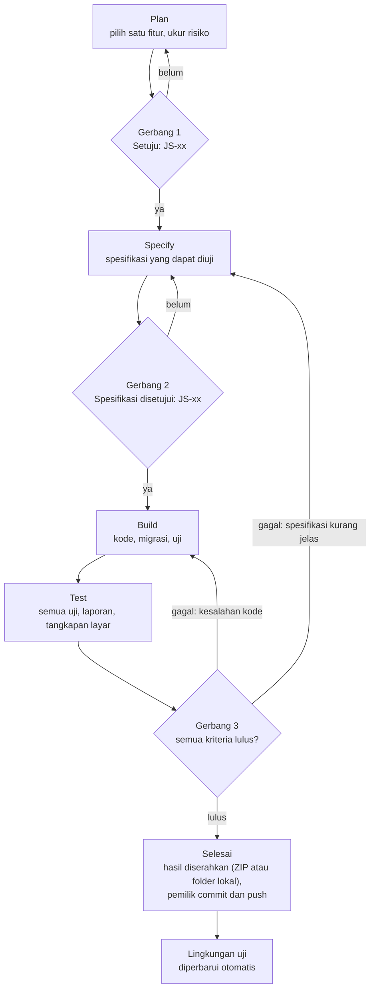

# AGENTS.md — Jejak Setara

Panduan untuk agen AI pemrograman (dan manusia) yang mengerjakan **Jejak Setara** di repositori `ruang-setara`. Baca seluruh file ini, lalu PRD, Design System, dan Architecture Jejak Setara, sebelum mengubah apa pun.

Versi 0.5 (14 November 2026): berkas alur kerja GitHub dan folder `Claude outputs/` dalam mode folder lokal (bagian 11.5, butir 8; penutupan JS-04).
Versi 0.4 (13 November 2026): mode folder lokal (aplikasi Claude desktop) di bagian 11.5, berdampingan dengan mode ZIP; penyesuaian kecil di bagian 4, 4.1, 11, 11.3, 13, dan 14 (penutupan JS-08).
Versi 0.3 (7 November 2026): paket gratis Cloudflare sampai JS-14 (bagian 0, 5, 6, dan 7; Plan JS-03).
Versi 0.2 (5 November 2026): langkah Windows di bagian 11.4, daftar skrip final di bagian 6, dan tempat rencana Sesi B dan C di bagian 4.1 (Gerbang 1 JS-01).
Versi 0.1 (4 November 2026): dokumen pertama.

---

## 0. Dua game di satu repositori

| | Sehari Setara | Jejak Setara |
|---|---|---|
| Panduan agen | `AGENTS.md` di akar repositori | `docs/jejak-setara/AGENTS.md` (dokumen ini) |
| Dokumen | `docs/sehari-setara/` | `docs/jejak-setara/` |
| Kode | `app/sehari-setara/`, `github-pages/sehari-setara/` | `app/jejak-setara/`, `web/jejak-setara/`, `server/jejak-setara/`, `scripts/jejak-setara/`, `e2e/jejak-setara/` |
| ID fitur | `F-xx` | `JS-xx` |
| Hosting | GitHub Pages (statis) | Cloudflare Workers (server real-time dan basis data) |
| Frasa persetujuan | `Setuju: F-xx` · `Spesifikasi disetujui: F-xx` | `Setuju: JS-xx` · `Spesifikasi disetujui: JS-xx` · `Rilis: vX.Y` |

- Saat mengerjakan Jejak Setara, **dokumen ini menggantikan `AGENTS.md` akar**. Aturan `AGENTS.md` akar tetap berlaku penuh untuk Sehari Setara dan galeri.
- Aturan "tanpa jaringan luar" dan "tanpa server" milik Sehari Setara **tidak** berlaku untuk Jejak Setara, karena pemilik proyek memilih mode real-time dengan server Cloudflare (PRD bagian 14 dan 21: paket gratis untuk JS-03 sampai JS-14, paket berbayar sebelum JS-15 atau uji coba kelas pertama). Aturan pengganti ada di bagian 7.
- Bila satu pekerjaan menyentuh keduanya (misalnya kit gambar bersama atau tautan galeri), kedua panduan berlaku. Bila bertentangan, **berhenti dan tanyakan**.
- Jejak Setara dimulai sesudah F-10 dan F-11 berstatus "Selesai" di `docs/sehari-setara/PLAN.md`, kecuali pemilik proyek memutuskan lain.
- Sejak JS-01, `AGENTS.md` akar memuat penunjuk ke dokumen ini.

## 1. Konteks singkat

- Jejak Setara adalah mode kompetitif dunia terbuka kecil bertampak atas 3/4 tentang hak dan kewajiban. Siswa bermain di HP atau laptop masing-masing di ruang real-time yang dibuat guru, dan papan skor tampil di proyektor.
- Guru dan admin memakai konsol admin untuk ruang, bank kejadian, rujukan, akun, dan statistik.
- Pemain adalah anak di bawah umur. Privasi dan keamanan adalah bagian dari setiap fitur, bukan tambahan.
- Pemilik proyek **bukan programmer** dan bekerja lewat GitHub Desktop. Semua hasil diserahkan dengan cara di bagian 11.

## 2. Dokumen acuan dan urutan otoritas

Jika ada pertentangan, yang lebih atas yang berlaku:

1. Instruksi langsung pemilik proyek (manusia).
2. `docs/jejak-setara/PRD.md` — apa yang dibuat dan mengapa.
3. `docs/jejak-setara/Design_System.md` — tampilan, rasa, dan aturan aset; bagian yang diwarisi merujuk ke `docs/sehari-setara/Design_System.md`.
4. `docs/jejak-setara/Architecture.md` — cara membangunnya.
   `docs/jejak-setara/Daftar_Aset.md` — status setiap aset gambar Jejak Setara.
5. Spesifikasi fitur yang disetujui: `docs/jejak-setara/specs/JS-xx-*.md`.
6. Kode yang sudah ada.

Jika dua dokumen bertentangan atau suatu hal tidak tercakup, **berhenti dan tanyakan**. Jangan menebak.

## 3. Peran

| Peran | Dijalankan oleh | Tanggung jawab |
|---|---|---|
| Perencana | Agen AI | Memilih fitur berikutnya, mengukur risiko lewat percobaan, menulis usulan |
| Penyusun spesifikasi | Agen AI | Menulis spesifikasi yang dapat diuji |
| Pembangun | Agen AI | Menulis kode, migrasi, dan uji sesuai spesifikasi |
| Penguji | Agen AI | Menjalankan semua uji, simulasi beban bila relevan, dan menulis laporan |
| Penyetuju | **Manusia** | Menyetujui rencana, spesifikasi, dependensi, dan rilis |
| Peninjau konten | **Manusia** | Memverifikasi rujukan di JDIH lalu menandainya di konsol admin; menilai kelayakan naskah untuk siswa |
| Pengelola server | **Manusia** (pemilik proyek) | Akun dan pembayaran Cloudflare, token API, rahasia GitHub, domain, tombol rilis produksi (Architecture bagian 18) |
| Pembuat aset | **Claude** (chat di proyek claude.ai) | Menggambar aset lewat kode di `scripts/game/art/` mengikuti Design System bagian 14, mengirim pratinjau, memperbarui `Daftar_Aset.md` |
| Penyetuju visual | **Manusia** | Menyetujui setiap pratinjau aset |
| Penguji kelas | **Manusia** | Menjalankan uji coba di kelas dan melaporkan temuan |

Satu agen boleh menjalankan beberapa peran, tetapi **wajib menyebut tahap dan fitur** di awal setiap balasan, misalnya: `Tahap: Specify · Fitur: JS-08`.

## 4. Alur kerja Plan → Specify → Build → Test

Setiap fitur melewati empat tahap berurutan. Dua gerbang pertama memerlukan persetujuan manusia. Rilis produksi punya gerbang sendiri (bagian 4.5).



### 4.1 Plan

| | |
|---|---|
| Tujuan | Memilih **satu** fitur terkecil yang bernilai dan siap dikerjakan, lalu mengukur risikonya sebelum ada kode |
| Masukan | Backlog di bagian 5, `docs/jejak-setara/PLAN.md`, PRD bagian 7 dan 20 (keputusan terbuka), ZIP repositori terbaru dari pemilik proyek, atau folder repositori dalam mode folder lokal (bagian 11.5) |
| Langkah | 1) Pastikan fitur sebelumnya berstatus "Selesai" dan laporannya "Lulus". 2) Pilih fitur pertama yang semua dependensinya selesai. 3) Sebutkan kebutuhan PRD yang dipenuhi (JFR-xx). 4) Daftar file yang akan dibuat atau diubah. 5) Daftar aset dan statusnya. 6) Ukur risiko dengan percobaan **di luar repositori** (maket di empat ukuran layar, prototipe kecil, ukuran bundel, simulasi beban kecil, uji jaringan) dan laporkan angkanya. 7) Tulis usulan bernomor, masing-masing dengan alternatif dan saran. 8) Sebut keputusan terbuka (KT-xx) yang perlu dijawab di gerbang ini. 9) Bila perlu dependensi baru, minta izin dengan frasa `Izinkan dependensi: nama versi`. 10) Perkirakan ukuran (S/M/L) |
| Keluaran | Entri baru di `PLAN.md` (templat 12.1). Plan pertama sekaligus membuat `PLAN.md` berisi backlog bagian 5. Untuk fitur Sesi B dan C (JS-05 dan JS-06), entri ditulis di berkas status sesi itu (`naskah/STATUS.md` atau `Daftar_Aset.md`), karena `PLAN.md` hanya diubah Sesi A. Permintaan perubahan pada berkas Sesi A ditulis di berkas status yang sama di bawah judul "Permintaan untuk Sesi A" (`PLAN.md`, bagian "Pembagian kerja tiga sesi") |
| Selesai bila | Manusia membalas `Setuju: JS-xx` (boleh dengan pilihan untuk usulan tertentu) |
| Dilarang | Menulis kode produk; merencanakan lebih dari satu fitur sekaligus |

### 4.2 Specify

| | |
|---|---|
| Tujuan | Mengubah rencana menjadi perilaku yang tepat dan dapat diuji |
| Masukan | Entri `PLAN.md` yang disetujui, PRD, Design System, Architecture |
| Langkah | 1) Tulis perilaku dengan format *Diberikan / Ketika / Maka*, termasuk untuk beberapa pemain sekaligus. 2) Gambarkan setiap status antarmuka: biasa, fokus, nonaktif, kosong, memuat, galat, **terputus, menyambung ulang, dijeda, ruang penuh, ruang terkunci** bila relevan. 3) Tulis semua teks Bahasa Indonesia final yang tampil. 4) Tulis pesan protokol baru (skema `zod`), rute API, dan migrasi D1 yang terlibat. 5) Daftar aset dengan nama berkas sesuai konvensi. 6) Tulis rencana uji: unit, server, ujung ke ujung multi-konteks, serta beban dan jaringan bila relevan. 7) Tulis apa yang **tidak** termasuk. 8) Tandai bagian yang perlu ditinjau pemilik proyek sebagai **DRAF** dengan kode (misalnya D-1, D-2) |
| Keluaran | `docs/jejak-setara/specs/JS-xx-nama.md` (templat 12.2) |
| Selesai bila | Tidak ada "TBD"; setiap kriteria penerimaan bisa diuji; manusia membalas `Spesifikasi disetujui: JS-xx` |
| Dilarang | Mengarang rujukan pasal; mengubah token Design System; menambah dependensi tanpa izin; mengubah protokol secara tidak kompatibel tanpa menaikkan `PROTOKOL_VERSI` |

### 4.3 Build

| | |
|---|---|
| Tujuan | Mewujudkan spesifikasi, tidak lebih dan tidak kurang |
| Masukan | Spesifikasi yang disetujui |
| Langkah | 1) Bekerja di cabang `fitur/JS-xx-nama` atau salinan repositori. 2) Tulis uji lebih dulu untuk `app/jejak-setara/inti/` dan inti ruang. 3) Implementasikan langkah kecil demi langkah kecil. 4) Migrasi D1 baru memakai nomor berikutnya dan hanya maju. 5) Daftarkan aset baru di `manifest.ts` dan `CREDITS.md`. 6) Jalankan perintah bagian 6 sebelum menyerahkan. 7) Commit kecil berbahasa Indonesia, misalnya `JS-08: tambah dialog dua langkah` |
| Keluaran | Kode, migrasi, uji, dan aset terdaftar |
| Selesai bila | Semua uji lulus dan build berhasil |
| Dilarang | Fitur di luar spesifikasi; dependensi tanpa izin; menyentuh Sehari Setara atau galeri di luar titik integrasi; menulis rahasia ke repositori; mengubah migrasi yang sudah ada di `main`; deploy ke produksi |

### 4.4 Test

| | |
|---|---|
| Tujuan | Membuktikan setiap kriteria penerimaan terpenuhi dalam kondisi yang mirip kelas |
| Langkah | 1) `content:check:jejak`. 2) `test:jejak`. 3) `test:jejak:server`. 4) `build:jejak`. 5) `test:e2e:jejak`. 6) `sim:beban`, **wajib** bila fitur menyentuh protokol, inti ruang, atau kiriman ke D1. 7) Periksa anggaran ukuran dan kinerja (Architecture bagian 11.3 dan 13.1). 8) Periksa daftar manual yang relevan (bagian 9). 9) Ambil tangkapan layar: HP 731 × 411, laptop 1280 × 720, layar kelas 1024 × 768 dan 1920 × 1080. 10) Tulis laporan |
| Keluaran | `docs/jejak-setara/tests/JS-xx-hasil.md` (templat 12.3) |
| Selesai bila | Semua kriteria lulus; tidak ada galat konsol; tidak ada respons 4xx atau 5xx yang tidak diharapkan; anggaran terpenuhi |
| Bila gagal | Tandai penyebabnya: **kesalahan kode** → kembali ke Build; **spesifikasi kurang jelas atau salah** → kembali ke Specify |

### 4.5 Rilis produksi (Gerbang 4)

1. Fitur yang selesai dan sudah di-push otomatis masuk **lingkungan uji**. Pemilik proyek mencobanya di sana.
2. Saat sekumpulan fitur siap dipakai di kelas, agen menulis catatan rilis `docs/jejak-setara/rilis/vX.Y.md` (templat 12.4): apa yang berubah, migrasi D1, risiko, dan cara kembali ke versi sebelumnya.
3. Pemilik proyek membalas `Rilis: vX.Y`, lalu menjalankan alur kerja "Jejak: produksi" di tab Actions GitHub.
4. Rilis tidak dilakukan selama ada ruang produksi yang sedang berjalan. Alur kerja produksi memeriksanya sendiri.
5. Agen **tidak pernah** melakukan deploy ke produksi secara langsung.

## 5. Backlog awal

| ID | Fitur | Memenuhi | Ukuran | Bergantung pada |
|---|---|---|---|---|
| JS-01 | Kerangka: folder, `vite.jejak.config.ts`, halaman pemain dan konsol kosong, Worker sederhana di lingkungan lokal, skrip, alur kerja uji tanpa deploy, dan satu paragraf penunjuk ke dokumen ini di `AGENTS.md` akar | JA-01, JA-07 | S | F-11 Sehari Setara |
| JS-02 | Inti bersama: tipe, protokol, aturan skor, peringkat, skill, kotak, dan masa, gerak dan tabrakan, acak berbenih, beserta uji unit | PRD bagian 8 | M | JS-01 |
| JS-03 | Server ruang: Worker, Durable Object, migrasi D1 awal, siklus ruang, bergabung dengan kode, nama samaran, halaman gabung dan lobi sederhana, sambung ulang, batas pesan, deploy ke lingkungan uji | JFR-01, 02, 04, 05, 06, 08 | L | JS-02 dan penyiapan server (Architecture bagian 18) |
| JS-04 | Akun dan autentikasi: masuk, keluar, sesi, sandi, peran, pembatas percobaan, admin awal, kelola akun guru, kerangka konsol | JFR-34, 35, 36, 37 (kerangka) | M | JS-03 |
| JS-05 | Konten: skema, pustaka rujukan, naskah final 16 kejadian (disetujui pemilik proyek), semai ke D1, `content:check:jejak` | JFR-15, 16, 43, 45 (data) | M | JS-02 |
| JS-06 | Peta: `kampung.txt`, `objek.json`, `build_peta.py`, uji keterjangkauan, pratinjau, ubin dan objek dasar (*placeholder* lebih dulu) | JFR-09, 12 (peta) | M | JS-02 |
| JS-07 | Penjelajah: kanvas dan skala, kamera, gerak keyboard dan joystick, pemain lain, peta mini, langit sehari, layar menyambung, layar tetap menyala | JFR-09, 10, 11, 12, 14 | L | JS-03, JS-06 |
| JS-08 | Kejadian: penanda, periksa, dialog dua langkah, kunci jawaban, kartu dampak, skor dan peringkat pribadi | JFR-15 sampai JFR-22 | M | JS-05, JS-07 |
| JS-09 | Skill dan kotak bantuan: Lari cepat, Kompas kejadian, Petunjuk, HUD skill, skill per ruang | JFR-23, 24, 26 | M | JS-08 |
| JS-10 | Layar kelas: buat ruang dari konsol, tiket, lobi, papan langsung, kontrol guru, podium, pembahasan | JFR-01, 06, 27 sampai JFR-31 | L | JS-04, JS-08 |
| JS-11 | Akhir ronde: rekap pribadi, kiriman ke D1, riwayat ruang, hasil per ruang, ekspor CSV | JFR-32, 38, 49, 53 | M | JS-10 |
| JS-12 | Bank kejadian di konsol: daftar, penyunting dan pratinjau, status dan versi, paket, pustaka rujukan dan verifikasi | JFR-41 sampai JFR-46 | L | JS-04, JS-05 |
| JS-13 | Statistik per kejadian lintas ruang dan isi dasbor | JFR-37, 50 | M | JS-11, JS-12 |
| JS-14 | Pengaturan pemain, aksesibilitas, privasi, dan suara | JFR-55, 56, 57 | M | JS-09 |
| JS-15 | Uji beban dan ketahanan jaringan, anggaran ukuran, perbaikan kinerja | PRD bagian 12 | M | JS-11 |
| JS-16 | Tautan dari galeri, panduan guru satu halaman, uji coba kelas, rilis 1.0 | KT-08; PRD bagian 16 | S | JS-13, JS-14, JS-15 |

**Versi 1.1 (P1):** JS-17 kode QR dan kode masuk ulang (JFR-03, 07); JS-18 Teropong, Angkot, dan bantuan gerak (JFR-13, 25); JS-19 log audit, pengaturan umum, ruang uji, impor dan ekspor bank (JFR-39, 40, 47, 48); JS-20 statistik kelas dan per siswa serta cetak ringkasan (JFR-51, 52, 54); JS-21 musik latar.

- Pembuatan aset gambar dan penulisan naskah kejadian berjalan **paralel** dan dilacak di `Daftar_Aset.md` dan JS-05. Selama aset belum "Disetujui", fitur memakai *placeholder* berupa kotak warna palet dengan label kunci aset. *Placeholder* wajib diganti sebelum rilis 1.0.
- Sebelum Build JS-03, pemilik proyek menyelesaikan langkah 1 dan 3–6 Architecture bagian 18 dengan paket gratis. Langkah 2 (mengaktifkan Workers Paid) dikerjakan sebelum JS-15 atau uji coba kelas pertama, mana yang lebih dulu. Agen mengingatkannya di Plan JS-15 dan sebelum uji coba kelas (keputusan pemilik proyek, 7 November 2026).

## 6. Perintah

```bash
npx pnpm@11.25.0 install                 # pasang dependensi
npx pnpm@11.25.0 dev:jejak               # pengembangan: pemain di "/", konsol di "/admin/"
npx pnpm@11.25.0 content:check:jejak     # bank awal, peta, dan rujukan
npx pnpm@11.25.0 test:jejak              # uji unit inti, inti ruang, dan klien
npx pnpm@11.25.0 test:jejak:server       # uji Worker dan D1
npx pnpm@11.25.0 build:jejak             # build halaman dan Worker ke dist-jejak/
npx pnpm@11.25.0 test:e2e:jejak          # uji Playwright multi-konteks
npx pnpm@11.25.0 sim:beban               # 50 bot per ruang; lokal saja sampai paket berbayar aktif
npx pnpm@11.25.0 db:migrasi:lokal        # migrasi D1 lokal
npx pnpm@11.25.0 peta:build              # python scripts/jejak-setara/peta/build_peta.py: bangun ulang peta + pemeriksaan
npx pnpm@11.25.0 assets:build:jejak      # python scripts/game/art/build_jejak.py: bangun ulang aset + pemeriksaan
```

Nama skrip ditetapkan di JS-01 dan terdaftar di `package.json` sejak ZIP akhir JS-01 di-commit. Skrip yang berkas atau fiturnya belum ada mencetak "Belum tersedia: …" dan selesai tanpa galat. Sesi B dan C tidak perlu mengubah `package.json`; cukup membuat berkas di jalurnya: uji konten di `app/jejak-setara/__tests__/konten/`, `scripts/jejak-setara/peta/build_peta.py`, dan `scripts/game/art/build_jejak.py`. Untuk Playwright, ikuti catatan versi peramban yang berlaku di repositori (lihat laporan uji Sehari Setara terbaru). Di lingkungan agen, jalur Chromium diberikan lewat variabel `JEJAK_CHROMIUM`.

## 7. Aturan wajib

1. **Inti murni.** `app/jejak-setara/inti/` tanpa DOM, React, API Workers, atau jam dan acak langsung.
2. **Server berwenang** atas waktu, kunci jawaban, skor, peringkat, skill, dan kotak. Jangan pernah mempercayai nilai-nilai itu dari klien.
3. **Validasi semua masukan:** setiap pesan WebSocket dan permintaan API diperiksa dengan `zod`, dibatasi ukuran dan frekuensinya.
4. **Tanpa data pribadi siswa:** hanya nama samaran dari daftar dan nomor absen opsional. Tidak ada nama asli, foto, lokasi, atau obrolan. Tidak ada analitik, pelacak, iklan, atau CDN pihak ketiga. Satu-satunya layanan luar adalah akun Cloudflare milik proyek.
5. **Rahasia** tidak pernah masuk repositori, log, ZIP, tangkapan layar, atau pesan galat.
6. **Migrasi D1 hanya maju.** Jangan mengubah atau menghapus migrasi yang sudah ada di `main`.
7. **Rujukan:** agen dan skrip tidak pernah menyemai atau menandai rujukan sebagai terverifikasi.
8. **Ikuti Design System:** hanya token `--js-` dan huruf yang sudah ditetapkan; teks di atas warna aksen memakai `ink`.
9. **Hormati anggaran** ukuran dan kinerja (Architecture bagian 11.3 dan 13.1). Laporkan bila terlampaui.
10. **Aksesibilitas bukan opsional:** keyboard, fokus terlihat, target sentuh ≥ 48 px, `aria-live`, kurangi gerak, dan makna tidak hanya lewat warna.
11. **Dependensi** (`package.json`, lockfile) hanya berubah dengan izin tertulis `Izinkan dependensi: …`.
12. **Jangan menyentuh** Sehari Setara, galeri, atau `deploy-pages.yml`. Pengecualiannya hanya paragraf penunjuk di `AGENTS.md` akar (JS-01) dan tautan galeri (JS-16), keduanya dengan izin pemilik proyek.
13. **Jangan commit** `node_modules/`, `dist-jejak/`, `dist-pages/`, `.wrangler/`, atau berkas `.dev.vars`.
14. **Protokol:** perubahan yang tidak kompatibel menaikkan `PROTOKOL_VERSI`.
15. **Produksi:** agen tidak pernah melakukan deploy ke produksi (bagian 4.5).
16. **Paket gratis (sampai JS-14):** jangan menjalankan `sim:beban` atau uji otomatis dengan banyak sambungan ke lingkungan uji. Kuota harian Cloudflare dipakai bersama semua percobaan, dan permintaan yang melewatinya gagal sampai kuota pulih pukul 08.00 WITA (Architecture bagian 13.4).

## 8. Aturan konten pembelajaran

- Bahasa Indonesia baku yang ramah remaja; huruf kapital hanya di awal kalimat; situasi paling banyak 3 kalimat.
- Tidak menyalahkan korban. Tidak menampilkan kekerasan fisik. Tokoh berwenang digambarkan membantu.
- Tokoh Sehari Setara muncul dengan watak yang sama. Bayu tidak bersalah dan digambarkan netral.
- Kejadian bertema agama, suku, atau disabilitas ditinjau khusus oleh pemilik proyek dan peninjau konten.
- **Rujukan pasal:**
  - Status verifikasi dicatat di pustaka rujukan konsol admin (Architecture bagian 10.6), satu status per rujukan.
  - Bank awal disemai dengan semua rujukan berstatus `belum`.
  - **Agen dilarang menandai rujukan terverifikasi.** Hanya akun bertanda Peninjau, sesudah mencocokkan dengan naskah resmi di JDIH.
  - Agen tidak boleh mengarang nomor pasal atau undang-undang. Bila ragu, tulis usulan dengan catatan "perlu verifikasi".
  - Kejadian tidak bisa terbit, dan tidak bisa dipakai di ruang kelas, selama salah satu rujukannya belum terverifikasi.

## 9. Aturan aset

- Aturan aset `AGENTS.md` akar berlaku: sumber aset adalah kode, PNG tidak disunting manual, dan hanya aset "Disetujui" yang boleh dirilis.
- Aset Jejak Setara digambar dengan kit di `scripts/game/art/` (berkas `atas_*.py` dan `build_jejak.py`) dan keluar ke `app/jejak-setara/assets/`.
- Setiap aset dicatat di `app/jejak-setara/assets/CREDITS.md`: "Digambar dengan kode (kit Sehari Setara) oleh Claude, disetujui [nama], [tanggal]".
- Mengubah kode gambar bersama tidak boleh mengubah aset Sehari Setara. `build_assets.py` Sehari Setara tetap harus lulus dengan hasil yang sama.

**Daftar periksa manual (dipakai di tahap Test bila relevan)**

- [ ] Lancar (≥ 30 fps) di HP Android kelas bawah selama satu ronde penuh.
- [ ] Bisa bergabung lewat wifi sekolah dan lewat data seluler.
- [ ] Teks layar kelas terbaca dari sekitar 8 meter di proyektor.
- [ ] Bisa dimainkan sampai akhir hanya dengan keyboard di laptop.
- [ ] Kurangi gerak mematikan animasi penanda, pop, dan sprite.
- [ ] Suara mati secara bawaan di HP; layar kelas berbunyi.
- [ ] Tidak ada nama asli siswa di layar, berkas ekspor, maupun log.
- [ ] Menyambung kembali sesudah wifi HP dimatikan 30 detik.

## 10. Definisi selesai

Sebuah fitur dianggap selesai bila:

- [ ] Semua kriteria penerimaan lulus dan tercatat di laporan uji.
- [ ] `content:check:jejak`, `test:jejak`, `test:jejak:server`, `build:jejak`, dan `test:e2e:jejak` lulus; `sim:beban` lulus bila wajib.
- [ ] Tidak ada galat konsol dan tidak ada respons 4xx atau 5xx yang tidak diharapkan.
- [ ] Teks sesuai spesifikasi, tanpa salah ketik.
- [ ] Aset baru terdaftar di manifest dan kredit; migrasi baru tercatat di laporan.
- [ ] `PLAN.md` diperbarui (status, tanggal, tautan laporan).
- [ ] Hasil diserahkan sesuai bagian 11.

## 11. Cara menyerahkan hasil

Bagian ini **wajib** di setiap tahap, karena pemilik proyek memasukkan hasil ke repositori sendiri lewat GitHub Desktop.

Ada dua cara kerja, dan pemilik proyek menyebut caranya di awal sesi:

- **Mode ZIP** (bagian 11.1 sampai 11.4): pemilik proyek melampirkan ZIP repositori, dan agen menyerahkan ZIP berisi berkas baru dan berubah.
- **Mode folder lokal** (bagian 11.5): folder repositori di komputer pemilik proyek terhubung ke chat di aplikasi Claude desktop, dan agen mengubah berkas langsung di folder itu.

Isi serah terima sama di kedua cara: daftar berkas, tangkapan layar, pesan commit, dan langkah GitHub Desktop. Yang berbeda hanya cara berkas sampai ke folder repositori.

### 11.1 Sesudah Test lulus

1. **Satu ZIP** bernama `JS-xx-nama.zip` berisi **hanya berkas baru dan berubah**, dengan struktur folder persis seperti di repositori. Termasuk `PLAN.md`, spesifikasi, laporan uji, dan tangkapan layar yang disimpan di repositori.
2. **Daftar berkas:** tabel berkas baru, lalu tabel **berkas lama yang diubah** (ditandai jelas) beserta alasan setiap perubahan, dalam bahasa sederhana.
3. **Tangkapan layar utama** ditampilkan langsung di balasan **sebelum** pemilik proyek melakukan commit, agar tampilan bisa dinilai lebih dulu.
4. **Pesan commit** siap tempel untuk GitHub Desktop: isi kotak **Summary** (satu baris, misalnya `JS-08: kejadian dan dialog dua langkah`) dan kotak **Description** (butir-butir singkat).
5. **Langkah bernomor** memasukkan isi ZIP ke folder repositori, lalu commit dan push di GitHub Desktop (contoh di bagian 11.4).
6. Bila ada langkah manual di Cloudflare atau GitHub (rahasia, tombol alur kerja, domain), tuliskan sebagai langkah bernomor terpisah dengan nama menu yang persis.
7. Gunakan **bahasa sederhana**. Istilah teknis yang tidak bisa dihindari dijelaskan dalam satu kalimat.

### 11.2 Saat berhenti di Gerbang 1 dan Gerbang 2

Serahkan **ZIP kecil** berisi dokumen yang berubah (`PLAN.md` di Gerbang 1, spesifikasi di Gerbang 2), pesan commit, dan langkah bernomor yang sama, agar keputusan tersimpan di repositori sebelum tahap berikutnya.

### 11.3 Menentukan berkas yang berubah

Bandingkan hasil kerja dengan **ZIP repositori terbaru** yang dilampirkan pemilik proyek. Bila ZIP itu tampak bukan versi terbaru (misalnya `PLAN.md` belum memuat fitur yang menurut pemilik proyek sudah selesai), **tanyakan dulu** sebelum bekerja. Dalam mode folder lokal, berkas yang berubah adalah yang tampil di tab **Changes** GitHub Desktop (bagian 11.5).

### 11.4 Contoh langkah di GitHub Desktop

1. Di folder **Downloads** (Unduhan), klik kanan `JS-xx-nama.zip`, pilih **Extract All…**, lalu klik **Extract**. Folder `JS-xx-nama` muncul.
2. Buka GitHub Desktop dan pilih repositori **ruang-setara**. Pastikan **Current Branch: main**, klik **Fetch origin**, lalu **Pull origin** bila tombol itu muncul.
3. Klik **Repository → Show in Explorer** untuk membuka folder repositori.
4. Buka folder `JS-xx-nama`, tekan `Ctrl+A` lalu `Ctrl+C`. Pindah ke folder repositori, lalu tekan `Ctrl+V`. Windows menggabungkan folder yang bernama sama dan hanya mengganti berkas yang bernama sama, jadi berkas lain di repositori tidak terhapus. Bila muncul kotak **Replace or Skip Files** (Ganti atau Lewati), pilih **Replace the files in the destination** (Ganti berkas di tujuan). Jangan menyalin folder `JS-xx-nama` itu sendiri ke dalam repositori.
5. Kembali ke GitHub Desktop. Cocokkan daftar di tab **Changes** dengan daftar berkas dari agen.
6. Tempel isi **Summary** dan **Description**, lalu klik **Commit to main**.
7. Klik **Push origin**.
8. Buka tab **Actions** di halaman GitHub repositori dan pastikan alur kerja "Jejak: uji" berwarna hijau. Bila merah, kirim tangkapan layarnya kepada agen.

### 11.5 Mode folder lokal (aplikasi Claude desktop)

Dipakai bila pemilik proyek menghubungkan folder repositori di komputernya ke chat di aplikasi Claude desktop, misalnya `C:\Users\ACER\Documents\ALL THINGS IN SMSTR 5\Pembelajaran Mikro\Ruang_Setara_Source_Code_v8\ruang-setara`. Untuk sesi itu, cara ini menggantikan ZIP di bagian 11.1 sampai 11.4 (keputusan pemilik proyek, 13 November 2026).

1. **Awal sesi.** Pemilik proyek sudah menekan **Pull origin** di GitHub Desktop, dan tab **Changes** kosong. Bila tab Changes tidak kosong atau folder tampak bukan versi terbaru, agen bertanya dulu (bagian 13).
2. **Bekerja langsung di folder.** Agen membaca dan mengubah berkas langsung di folder itu. Agen tidak membuat ZIP.
3. **Git.** Agen tidak menjalankan `git commit`, `git push`, atau perintah git lain yang mengubah riwayat atau membuang perubahan, misalnya `git reset`, `git checkout`, `git stash`, dan `git clean`. Perintah yang hanya membaca, misalnya `git status`, `git diff`, dan `git log`, boleh dipakai untuk menyusun daftar berkas. Pemilik proyek yang melakukan commit dan push lewat GitHub Desktop.
4. **Menghapus berkas.** Agen tidak menghapus berkas sebelum menyebutkannya kepada pemilik proyek beserta alasannya.
5. **Uji.** Agen menjalankan uji sesuai bagian 4.4. Bila Node.js, pnpm, atau Python belum ada di komputer pemilik proyek, agen mengatakannya dulu sebelum memasang apa pun. Agen juga boleh menyalin berkas ke ruang kerjanya sendiri untuk menjalankan uji, lalu menulis hasil akhirnya ke folder.
6. **Sambungan terputus.** Bila sambungan ke folder terputus, agen boleh bekerja dari salinan `main` di GitHub, yang sama dengan folder bila pemilik proyek sudah Pull dan tab Changes kosong. Hasilnya ditulis ke folder sesudah sambungan pulih. Agen tidak pernah menimpa folder dengan salinan yang lebih lama daripada isi folder. Bila sambungan tidak pulih di sesi itu, pemilik proyek boleh memilih ZIP sekali itu (bagian 11.1 sampai 11.4).
7. **Setiap kali berhenti untuk commit**, agen menyerahkan:
   - daftar berkas baru dan berubah, dengan berkas lama yang diubah ditandai beserta alasannya (seperti bagian 11.1 butir 2), ditambah berkas yang dihapus bila ada;
   - tangkapan layar bila ada tampilan yang berubah, ditampilkan di balasan sebelum commit;
   - pesan commit untuk kotak **Summary** dan **Description**;
   - langkah GitHub Desktop: periksa tab Changes, commit, push, dan cek tab Actions (contoh di bawah).

   Semuanya memakai istilah Windows dan bahasa sederhana (bagian 11.1 butir 7).
8. **Berkas alur kerja GitHub.** Dalam mode folder lokal, agen mungkin tidak bisa menulis ke `.github/workflows/` (ditemukan di Build JS-04). Bila begitu, agen menulis isi lengkap setiap berkas alur kerja yang baru atau berubah di balasan, satu blok kode per berkas, dan pemilik proyek menggantinya manual:
   - berkas yang sudah ada: buka berkasnya dari folder `.github\workflows` dengan Notepad, tekan `Ctrl+A`, tempel isi dari balasan, lalu simpan dengan `Ctrl+S`;
   - berkas baru: buka Notepad, tempel isinya, pilih **File → Save as**, buka folder `.github\workflows`, pilih **Save as type: All files (\*.\*)**, ketik nama berkas persis seperti di balasan (misalnya `jejak-admin-awal.yml`), lalu klik **Save**.

   Di daftar berkas, agen menandai berkas itu "diganti manual", dan sesi berikutnya memeriksa isinya di ZIP atau folder terbaru (seperti di penutupan JS-04). Agen tidak meninggalkan berkas percobaan tulis (misalnya `.uji-tulis`) di folder repositori. Salinan berkas yang dibuat agen di luar jalurnya, misalnya di folder `Claude outputs/`, tidak di-commit; folder itu diabaikan git sejak penutupan JS-04.

**Contoh langkah di GitHub Desktop (mode folder lokal)**

1. Buka GitHub Desktop dan pilih repositori **ruang-setara**. Pastikan **Current Branch: main**.
2. Buka tab **Changes** dan cocokkan daftarnya dengan daftar berkas dari agen. Berkas baru bertanda plus hijau, berkas yang diubah bertanda titik kuning, dan berkas yang dihapus bertanda minus merah. Bila ada berkas yang tidak ada di daftar agen, jangan commit dulu dan tanyakan kepada agen.
3. Tempel isi **Summary** dan **Description**, lalu klik **Commit to main**.
4. Klik **Push origin**.
5. Buka tab **Actions** di halaman GitHub repositori dan pastikan alur kerja "Jejak: uji" berwarna hijau. Bila merah, kirim tangkapan layarnya kepada agen.

## 12. Templat

### 12.1 Entri `PLAN.md`

```markdown
## JS-xx — [Nama fitur]
- Status: Direncanakan | Disetujui | Spesifikasi | Dibangun | Diuji | Selesai
- Memenuhi: JFR-xx, JFR-yy
- Bergantung pada: JS-xx
- File yang dibuat/diubah: ...
- Migrasi D1: ... (atau "tidak ada")
- Pesan protokol baru/berubah: ... (atau "tidak ada")
- Aset yang dibutuhkan: ... (tersedia / placeholder)
- Hasil percobaan risiko: ...
- Usulan:
  1. [usulan] — (a, saran) ... (b) ... (c) ...
- Keputusan terbuka yang perlu dijawab: KT-xx ...
- Dependensi baru: ... (atau "tidak ada")
- Risiko: ...
- Ukuran: S | M | L
```

### 12.2 Spesifikasi `specs/JS-xx-nama.md`

```markdown
# JS-xx — [Nama fitur]
## Ringkasan
## Kaitan PRD
## Perilaku
- Diberikan ..., ketika ..., maka ...
## Beberapa pemain sekaligus
## Status antarmuka
## Teks yang tampil (final)
## Data, protokol, API, dan migrasi
## Aset
## Keamanan dan privasi
## Di luar cakupan
## DRAF untuk ditinjau pemilik proyek
## Kriteria penerimaan
- [ ] AC-1 ...
## Rencana uji
```

### 12.3 Laporan `tests/JS-xx-hasil.md`

```markdown
# Hasil uji JS-xx — [tanggal]
| Kriteria | Hasil | Bukti |
|---|---|---|
| AC-1 | Lulus/Gagal | tangkapan layar / keluaran uji |
## Perintah yang dijalankan dan hasilnya
## Simulasi beban (bila wajib)
## Anggaran ukuran dan kinerja
## Temuan
## Keputusan: Lulus | Kembali ke Build | Kembali ke Specify
```

### 12.4 Catatan rilis `rilis/vX.Y.md`

```markdown
# Rilis Jejak Setara vX.Y — [tanggal]
## Fitur yang masuk (JS-xx)
## Migrasi D1
## Perubahan protokol (PROTOKOL_VERSI)
## Yang perlu dicek di lingkungan uji
## Risiko
## Cara kembali ke versi sebelumnya
```

## 13. Kapan berhenti dan bertanya

Hentikan pekerjaan dan tanyakan kepada pemilik proyek bila:

- Naskah, pilihan, skor, aturan skill, atau rujukan perlu diubah.
- Sebuah keputusan pedagogis atau privasi tidak tercakup di PRD.
- Dibutuhkan dependensi baru, layanan baru, perubahan paket Cloudflare, atau perubahan pada kode galeri dan Sehari Setara.
- Token warna, huruf, atau tata letak di Design System tidak cukup.
- Anggaran ukuran, kinerja, atau biaya tidak bisa dipenuhi.
- Konfigurasi Cloudflare di dokumentasi resmi berbeda dengan Architecture.
- ZIP repositori yang dilampirkan, atau folder repositori dalam mode folder lokal, tampak bukan versi terbaru.

## 14. Contoh perintah untuk memulai sesi agen

Contoh di bawah memakai mode ZIP. Dalam mode folder lokal (bagian 11.5), kalimat "ZIP repositori terbaru saya lampirkan" diganti "Repositori ada di folder yang terhubung ke chat ini dan sudah saya Pull", dan "Serahkan satu ZIP" diganti "Serahkan sesuai bagian 11.5".

**Plan**

```text
Baca docs/jejak-setara/AGENTS.md, lalu semua dokumen di docs/jejak-setara/.
ZIP repositori terbaru saya lampirkan.
Jalankan tahap Plan untuk fitur Jejak Setara berikutnya yang siap dikerjakan.
Berhenti setelah menulis entri PLAN.md dan tunggu persetujuan saya.
Serahkan hasil sesuai bagian 11 (CARA MENYERAHKAN HASIL).
```

**Specify**

```text
Setuju: JS-xx
Lanjutkan ke tahap Specify sesuai docs/jejak-setara/AGENTS.md bagian 4.2.
Berhenti setelah spesifikasi selesai dan tunggu persetujuan saya.
Serahkan hasil sesuai bagian 11.
```

**Build dan Test**

```text
Spesifikasi disetujui: JS-xx
Lanjutkan ke tahap Build lalu Test sesuai docs/jejak-setara/AGENTS.md bagian 4.3 dan 4.4.
Serahkan satu ZIP, daftar berkas, tangkapan layar, pesan commit, dan langkah GitHub Desktop sesuai bagian 11.
```

**Rilis**

```text
Tulis catatan rilis vX.Y sesuai docs/jejak-setara/AGENTS.md bagian 4.5 dan templat 12.4.
Sebutkan langkah bernomor untuk menjalankan alur kerja "Jejak: produksi".
```
