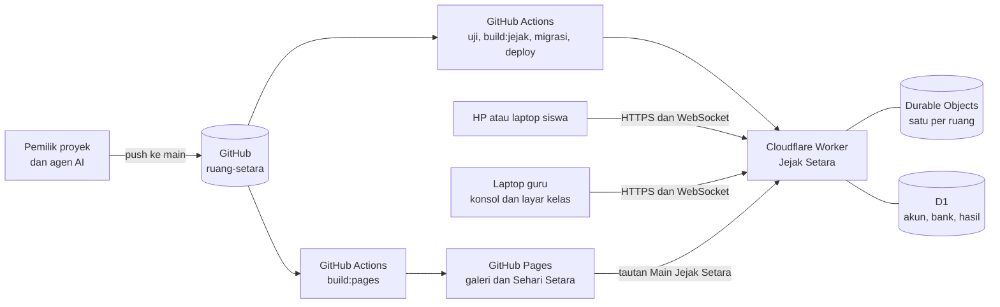
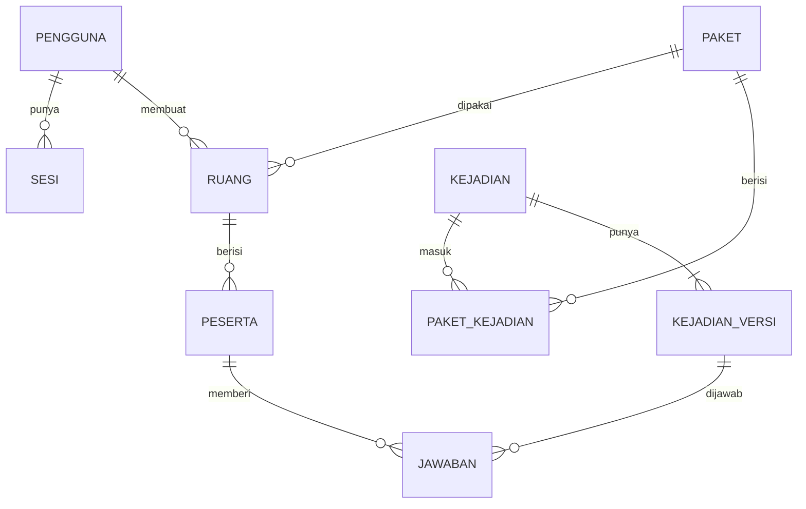
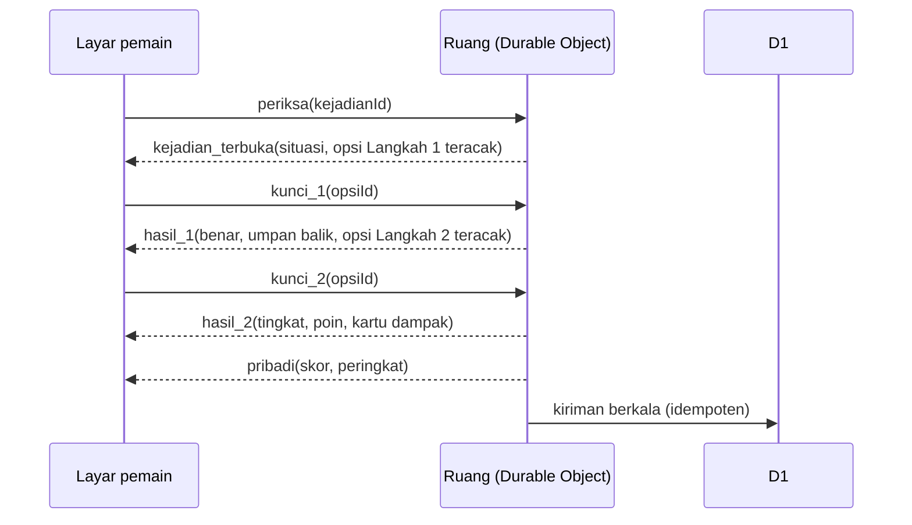
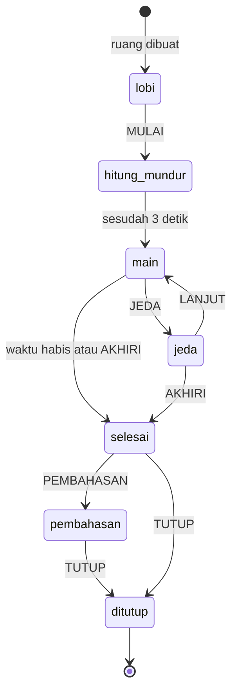

# Architecture — Jejak Setara

| | |
|---|---|
| Versi | 0.1 (draf) |
| Tanggal | 4 November 2026 |
| Repositori | `ruang-setara` (akun GitHub Y4N-D) |
| Hosting | Cloudflare Workers: aset statis, API, Durable Objects, D1. Paket gratis untuk JS-03 sampai JS-14, paket berbayar sebelum JS-15 atau uji coba kelas pertama (JA-14) |
| Dokumen terkait | `PRD.md`, `Design_System.md`, `AGENTS.md` (di `docs/jejak-setara/`) |

Catatan: nama kunci konfigurasi Cloudflare dan perintah `wrangler` di dokumen ini adalah contoh. Agen wajib mencocokkannya dengan dokumentasi resmi terbaru (developers.cloudflare.com) dan versi `wrangler` di `package.json` saat tahap Plan, lalu mencatat bila ada yang berbeda.

Pemeriksaan pertama dilakukan di Plan JS-01 (5 November 2026) terhadap `wrangler` 4.92.0 dan `@cloudflare/vite-plugin` 1.37.1. Perbedaannya sudah dimasukkan ke bagian 1 (JA-15), 4.1, 4.2, 4.4, dan 12.2; rinciannya ada di entri JS-01 `PLAN.md`.

Pemeriksaan kedua dilakukan di Plan JS-03 (7 November 2026) terhadap halaman harga dan batas Durable Objects, D1, dan Workers untuk paket gratis. Hasilnya ada di bagian 13.4 dan entri JS-03 `PLAN.md`.

---

## 1. Keputusan utama

| # | Keputusan | Alasan |
|---|---|---|
| JA-01 | Jejak Setara **dihosting terpisah di Cloudflare Workers**: halaman pemain, konsol admin, API, ruang real-time, dan basis data dalam satu Worker. Galeri dan Sehari Setara tetap di GitHub Pages | GitHub Pages hanya menyajikan berkas statis, sedangkan mode ini butuh server real-time. Satu asal (*origin*) untuk halaman, API, dan WebSocket membuat cookie sesi menjadi pihak pertama dan tidak memerlukan CORS |
| JA-02 | **Satu ruang = satu Durable Object** (`RuangJejak`), satu-satunya sumber kebenaran selama sesi | Durable Object menjamin satu instans per ruang, punya penyimpanan SQLite sendiri, dan bisa melayani banyak WebSocket sekaligus |
| JA-03 | **D1** (SQLite) untuk data tetap: akun, sesi login, bank kejadian dan versinya, rujukan, paket, ruang, peserta, jawaban, pengaturan, dan log audit | Tersedia di paket gratis dan berbayar, ada pemulihan titik waktu (*Time Travel*) 7 hari di paket gratis dan 30 hari di paket berbayar, dan SQL memudahkan statistik |
| JA-04 | **Server berwenang** atas waktu, kejadian, kunci jawaban, skor, peringkat, skill, dan kotak. **Klien berwenang atas gerak**, tetapi setiap laporan posisi diperiksa server (kecepatan dan tabrakan) | Cukup aman untuk kelas, sederhana, dan terasa responsif di HP walaupun jaringan lambat |
| JA-05 | Kunci jawaban, umpan balik, dan isi Langkah 2 **baru dikirim sesudah pemain mengunci jawaban** | Jawaban tidak bisa diintip dari lalu lintas jaringan. Bank awal tetap terbaca di repositori publik; risiko ini diterima (bagian 12) |
| JA-06 | **Autentikasi sendiri**: email dan sandi, hash PBKDF2 lewat WebCrypto, sesi di D1, cookie `HttpOnly`. Tanpa layanan login pihak ketiga | Tidak memerlukan penyiapan tambahan dan sesuai skala. Cloudflare Access bisa ditambahkan kemudian sebagai lapisan kedua untuk konsol |
| JA-07 | **Protokol JSON lewat WebSocket**, berversi, divalidasi `zod`, dengan tipe yang sama di klien dan server (`app/jejak-setara/inti/`) | `zod` sudah ada di proyek; satu sumber tipe mencegah klien dan server berbeda paham |
| JA-08 | **Dunia digambar dengan Canvas 2D** pada 320×180 piksel logis; HUD, dialog, layar kelas, dan konsol memakai **React** (HTML) | Tanpa mesin game baru; teks tetap tajam dan bisa dibaca pembaca layar |
| JA-09 | **Peta ditulis sebagai teks** (ASCII + daftar objek) lalu dibangun skrip menjadi JSON; ubin digambar kode dengan tukar palet per masa | Perubahan peta mudah ditinjau dalam *diff*, sejalan dengan kit aset Sehari Setara |
| JA-10 | **Bank awal disemai dari repositori ke D1.** Sesudah itu konsol adalah tempat menyunting. Setiap terbitan menjadi versi tetap, dan ruang memakai salinan versi saat ruang dibuat | Guru tidak perlu menunggu deploy untuk memperbaiki soal; statistik tetap konsisten |
| JA-11 | **Inti ruang ditulis sebagai modul murni** (tanpa API Workers) dan Durable Object hanya pembungkus tipis | Logika ruang bisa diuji cepat dengan Vitest biasa, termasuk dengan jam tiruan |
| JA-12 | **Dua lingkungan:** `uji` (otomatis setiap ada perubahan di `main`) dan `produksi` (dijalankan pemilik proyek lewat tombol alur kerja) | Kelas yang sedang berjalan tidak terganggu perubahan yang belum dicoba |
| JA-13 | Durable Object diberi **petunjuk lokasi `apac`** (Asia-Pasifik; `apac-se` ternyata bukan petunjuk yang sah, dikoreksi di Build JS-03) | Dekat dengan Indonesia; petunjuk bersifat *best-effort* |
| JA-14 | **Paket bertahap:** paket gratis (Workers Free) untuk JS-03 sampai JS-14, lalu **Workers Paid** (US$5 per bulan) diaktifkan sebelum JS-15 atau uji coba kelas pertama, mana yang lebih dulu | Pengembangan dan lingkungan uji muat dalam kuota harian gratis, sedangkan kelas sungguhan dan uji beban penuh butuh kuota berbayar (bagian 13.2 dan 13.4). Keputusan pemilik proyek, 7 Nov 2026 (Plan JS-03) |
| JA-15 | Pengembangan, build, dan uji ujung ke ujung memakai **plugin Cloudflare untuk Vite** (`@cloudflare/vite-plugin`): `dev:jejak` menjalankan halaman dan Worker di satu alamat; `build:jejak` menghasilkan `dist-jejak/client/` dan `dist-jejak/worker/`; uji ujung ke ujung memakai `vite preview`. Lingkungan Cloudflare dipilih saat build lewat `CLOUDFLARE_ENV` | Satu perintah dan satu alamat seperti di server sungguhan; cara yang dianjurkan dokumentasi Cloudflare untuk proyek Vite; paket sudah terpasang. Diputuskan di Gerbang 1 JS-01 (5 Nov 2026) |

Dependensi yang mungkin diperlukan dan **wajib izin tertulis** pemilik proyek: alat uji Worker (misalnya `@cloudflare/vitest-pool-workers`) dan pembuat kode QR. Semua kebutuhan lain memakai paket yang sudah ada: `react`, `zod`, `wrangler`, `@cloudflare/workers-types`, `@cloudflare/vite-plugin`, `vite`, `vitest`, `@playwright/test`, `@fontsource/*`, dan primitif `radix-ui` untuk komponen konsol.

## 2. Konteks sistem



- Sesudah WebSocket tersambung, pesan mengalir langsung antara perangkat dan Durable Object ruang; Worker hanya meneruskan permintaan sambungan pertama.
- Durable Object tidak bisa dihubungi langsung dari internet. Hanya Worker yang meneruskan permintaan ke sana, sehingga tajuk internal dari Worker bisa dipercaya.

## 3. Struktur folder

```
ruang-setara/
├─ AGENTS.md                         # akar: Sehari Setara, ditambah penunjuk ke Jejak Setara
├─ docs/jejak-setara/
│  ├─ PRD.md · Design_System.md · Architecture.md · AGENTS.md
│  ├─ PLAN.md                        # backlog dan status JS-xx (dibuat di Plan pertama)
│  ├─ Daftar_Aset.md                 # status aset tampak atas
│  ├─ specs/JS-xx-nama.md            # spesifikasi per fitur
│  ├─ tests/JS-xx-hasil.md           # laporan uji per fitur
│  └─ preview/                       # pratinjau peta dan aset
├─ app/jejak-setara/                 # kode klien (React) dan kode bersama
│  ├─ inti/                          # MURNI: dipakai klien dan server; tanpa DOM dan tanpa API Workers
│  │  ├─ tipe.ts · protokol.ts       # tipe data; skema zod pesan dan PROTOKOL_VERSI
│  │  ├─ aturan.ts                   # skor, peringkat, skill, kotak, masa, batas
│  │  ├─ gerak.ts · peta.ts          # gerak, tabrakan, pemeriksaan kecepatan; pembaca peta
│  │  ├─ acak.ts                     # pembangkit acak berbenih
│  │  └─ konten/skema.ts             # skema zod kejadian, rujukan, paket; periksa.ts: aturan konten dan kode temuan (JS-05)
│  ├─ pemain/                        # layar pemain
│  │  ├─ App.tsx · Gabung.tsx · Lobi.tsx · Dunia.tsx · Hud.tsx · Rekap.tsx
│  │  ├─ mesin/                      # loop, kamera, render kanvas, input, interpolasi
│  │  └─ jaringan.ts                 # klien WebSocket, sambung ulang, sinkron jam
│  ├─ admin/                         # konsol admin
│  │  ├─ App.tsx · rute.ts · api.ts
│  │  ├─ halaman/                    # Dasbor, Ruang, Riwayat, Kejadian, Penyunting, Paket, Rujukan, Statistik, Akun, Pengaturan, Log
│  │  └─ kelas/                      # layar kelas: Lobi, Langsung, Podium, Pembahasan
│  ├─ bersama/                       # komponen untuk pemain dan konsol: bingkai, tombol pilihan, dialog kejadian, kartu dampak; HalamanKerangka (halaman kosong JS-01)
│  ├─ teks.ts                        # semua teks yang tampil (bagian 17)
│  ├─ peta/kampung.json              # hasil build_peta.py; jangan disunting manual
│  ├─ peta/kampung_gambar.json       # hasil build_peta.py: nomor ubin per lapisan untuk layar pemain (C-9)
│  ├─ assets/                        # manifest.ts, CREDITS.md, ubin/, obj/, ava/, npc/, ikon/, sfx/
│  ├─ styles/jejak.css               # token --js-, bingkai piksel
│  └─ __tests__/                     # uji unit, konten, peta, dan aset
├─ web/jejak-setara/                 # titik masuk Vite
│  ├─ index.html · main.tsx          # layar pemain di "/"
│  ├─ admin/index.html · main.tsx    # konsol admin di "/admin/"
│  └─ public/_headers                # tajuk keamanan halaman (bagian 12.2)
├─ server/jejak-setara/              # Cloudflare Worker
│  ├─ wrangler.jsonc
│  ├─ src/
│  │  ├─ index.ts                    # router: aset, /api/*, /ws/*, tajuk keamanan
│  │  ├─ ruang/RuangJejak.ts         # Durable Object (pembungkus tipis)
│  │  ├─ ruang/inti-ruang.ts         # logika ruang murni (JA-11)
│  │  ├─ ruang/kejadian-ruang.ts     # aturan kejadian murni: penempatan, keterlihatan, pilihan, poin (JS-08)
│  │  ├─ api/                        # masuk, akun, kejadian, rujukan, paket, ruang, statistik, ekspor, pengaturan, log
│  │  ├─ auth/                       # sandi, sesi, izin, tiket, pembatas percobaan
│  │  └─ db/                         # kueri D1 (ruang; konten dan jawaban sejak JS-08)
│  ├─ migrations/0001_awal.sql …     # migrasi D1, hanya maju
│  └─ seed/bank-awal.json            # bank kejadian awal (hasil fitur konten)
├─ scripts/game/art/                 # kit gambar bersama + atas_*.py dan build_jejak.py
├─ scripts/jejak-setara/
│  ├─ bila-ada.mjs                   # penjalan skrip yang berkasnya belum ada (bagian 4.3)
│  ├─ peta/kampung.txt · objek.json · build_peta.py   # sumber peta
│  ├─ simulasi-beban.mjs             # 50 bot WebSocket
│  └─ semai.mjs                      # menyemai bank awal ke D1, sekali per basis data (JS-05)
├─ e2e/jejak-setara/                 # uji Playwright multi-konteks
├─ vite.jejak.config.ts            # Vite dan plugin Cloudflare (JA-15)
├─ vitest.jejak.config.ts · playwright.jejak.config.ts   # uji unit dan uji ujung ke ujung Jejak Setara
└─ .github/workflows/
   ├─ jejak-uji.yml                  # push ke main: uji dan build (JS-01); migrasi dan deploy ke lingkungan uji sejak JS-03
   ├─ jejak-produksi.yml             # tombol "Run workflow": deploy ke produksi
   └─ jejak-admin-awal.yml           # tombol: buat atau pulihkan akun admin
```

- Kelas CSS memakai awalan `js-`. Kode di `inti/` tidak boleh mengimpor apa pun dari `pemain/`, `admin/`, React, DOM, atau API Workers.
- Kode Sehari Setara (`app/sehari-setara/`) dan galeri tidak disentuh, kecuali satu titik integrasi (bagian 16).

## 4. Build, konfigurasi, dan lingkungan

### 4.1 Vite

`vite.jejak.config.ts` terpisah dari `vite.config.ts` (Vinext) dan `vite.pages.config.ts` (GitHub Pages), dan memakai plugin Cloudflare untuk Vite (JA-15, diputuskan di Gerbang 1 JS-01):

```ts
// Ringkasan; isi lengkap di vite.jejak.config.ts.
export default defineConfig(async () => {
  process.env.WRANGLER_SEND_METRICS ??= "false";        // tanpa telemetri Wrangler
  process.env.CLOUDFLARE_CF_FETCH_ENABLED ??= "false";  // tanpa mengambil data Request.cf dari Cloudflare
  const { cloudflare } = await import("@cloudflare/vite-plugin");
  return {
    root: "web/jejak-setara",
    base: "/",                       // Worker menyajikan halaman dari akar domain
    plugins: [react(), cloudflare({ configPath: akar + "server/jejak-setara/wrangler.jsonc", viteEnvironment: { name: "worker" }, inspectorPort: false })],
    build: { outDir: akar + "dist-jejak", emptyOutDir: true },
    environments: {
      client: { build: { rolldownOptions: { input: { pemain: "…/index.html", admin: "…/admin/index.html" } } } },
    },
  };
});
```

- `dev:jejak` menjalankan halaman (dengan muat ulang otomatis) dan Worker di satu alamat. `build:jejak` menghasilkan `dist-jejak/client/` (halaman, aset berhash, dan `_headers`) dan `dist-jejak/worker/` (Worker dan `wrangler.json` hasil build), ditambah `web/jejak-setara/.wrangler/deploy/config.json` yang menunjuk ke `wrangler.json` itu. `vite preview` menjalankan hasil build di runtime Workers lokal dan dipakai uji ujung ke ujung.
- Masukan dua halaman wajib ditulis di `environments.client`. Bila ditulis di `build` teratas, build Worker ikut membacanya dan gagal.
- Uji unit memakai `vitest.jejak.config.ts`, agar Vitest tidak memuat plugin ini.

### 4.2 Wrangler

JS-01, hanya lingkungan lokal:

```json
{
  "$schema": "../../node_modules/wrangler/config-schema.json",
  "name": "jejak-setara-lokal",
  "main": "src/index.ts",
  "compatibility_date": "2026-05-15",
  "assets": { "binding": "ASSETS", "run_worker_first": ["/api/*", "/ws/*"] },
  "vars": { "LINGKUNGAN": "lokal" }
}
```

JS-03 (isi lengkap di spesifikasi JS-03, bagian "Konfigurasi"): Durable Object `RuangJejak` (binding `RUANG`) dengan migrasi `v1` kelas SQLite; D1 (binding `DB`: `jejak-setara-lokal` di lokal, `jejak-setara-uji` di lingkungan `uji`); dua pembatas percobaan, `BATAS_PUBLIK` dan `BATAS_WS` (300 per menit per alamat IP); pemicu harian `0 19 * * *` (03.00 WITA); dan lingkungan bernama `uji` (Worker `jejak-setara-uji`). Lingkungan `produksi` ditambahkan menjelang rilis. Binding, variabel, dan pembatas ditulis ulang di setiap lingkungan karena tidak diwariskan dari lingkungan teratas, sedangkan migrasi Durable Object diwariskan (percobaan Plan JS-03). Plugin Vite memakai folder keadaan lokal `JEJAK_KEADAAN` (bawaan `.wrangler/state`), sama dengan `db:migrasi:lokal`.

- Lingkungan teratas hanya untuk pengembangan lokal. Dengan plugin Vite, lingkungan dipilih saat build lewat `CLOUDFLARE_ENV` (misalnya `CLOUDFLARE_ENV=uji`), dan `--env` saat deploy tidak berpengaruh. Build yang lupa memilih lingkungan menghasilkan Worker lokal, jadi tidak pernah menyentuh produksi.
- `compatibility_date` mengikuti runtime `workerd` yang terpasang (kini 1.20260515, batas 22 Mei 2026). Tanggal yang lebih baru membuat `wrangler dev` dan uji lokal berhenti dengan galat, jadi tanggal dinaikkan bersama `wrangler` dengan izin dependensi.
- Plugin Vite mengabaikan `assets.directory`; folder aset adalah hasil build halaman (`dist-jejak/client/`).
- Permintaan `/api/*` dan `/ws/*` selalu ditangani Worker. Selain itu, aset statis disajikan langsung (gratis dan tidak dihitung kuota).
- Stub ruang diambil dengan `env.RUANG.get(id, { locationHint: "apac" })` (JA-13; dikoreksi di Build JS-03).

### 4.3 Skrip `package.json` (tambahan)

| Skrip | Kegunaan | Aktif sejak |
|---|---|---|
| `dev:jejak` | Halaman pemain dan konsol dengan Worker lokal di satu alamat (plugin Vite) | JS-01 |
| `build:jejak` | Build halaman ke `dist-jejak/client/` dan Worker ke `dist-jejak/worker/` | JS-01 |
| `content:check:jejak` | Validasi bank awal, peta, dan kecocokan rujukan: semua uji di `app/jejak-setara/__tests__/konten/` | JS-05 dan JS-06 |
| `test:jejak` | Uji unit `inti/`, inti ruang, klien, dan konten (Vitest di Node) | JS-01 |
| `test:jejak:server` | Uji Worker, Durable Object, dan D1: Vitest di Node terhadap Worker hasil build yang dijalankan `vite preview` (Gerbang 1 JS-03, usulan 3a) | JS-03 |
| `test:e2e:jejak` | Uji Playwright multi-konteks terhadap `vite preview` (berkas `e2e/jejak-setara/*.uji.ts`) | JS-01 |
| `sim:beban` | Simulasi bot pada Worker lokal; lingkungan uji hanya dengan pilihan tertulis dan sesudah paket berbayar aktif (bagian 13.4) | JS-03 |
| `peta:build` | `python scripts/jejak-setara/peta/build_peta.py` | JS-06 |
| `assets:build:jejak` | `python scripts/game/art/build_jejak.py` | Aset pertama Sesi C |
| `db:migrasi:lokal` | Menerapkan migrasi D1 ke basis data lokal di `.wrangler/state`, yang juga dibaca `dev:jejak` dan `vite preview` | JS-03 |

Skrip yang berkas atau fiturnya belum ada dijalankan lewat `scripts/jejak-setara/bila-ada.mjs`, yang mencetak "Belum tersedia: …" lalu selesai tanpa galat. Bila berkasnya sudah ada, perintah sungguhan dijalankan, sehingga Sesi B dan C tidak perlu mengubah `package.json` (spesifikasi JS-01).

Uji Jejak Setara yang memerlukan runtime Workers **tidak** masuk `pnpm test`, agar alur terbit GitHub Pages yang sudah ada tetap lulus tanpa Cloudflare.

### 4.4 GitHub Actions

| Berkas | Nama di tab Actions | Pemicu | Langkah |
|---|---|---|---|
| `jejak-uji.yml` | Jejak: uji | Push ke `main` yang mengubah berkas Jejak Setara (daftar jalur di berkasnya), atau tombol "Run workflow" | Sejak JS-01: pasang → `content:check:jejak` → `test:jejak` → `build:jejak`. Sejak JS-03 ditambah "Uji server Jejak", lalu pekerjaan "Deploy uji" di cabang `main` (push atau tombol): build dengan `CLOUDFLARE_ENV=uji`, migrasi D1 jarak jauh, `wrangler deploy` di folder `web/jejak-setara`, dan pemeriksaan `/api/sehat`. Deploy dilewati dengan pemberitahuan bila rahasia atau Database ID uji belum diisi |
| `jejak-ruang-coba.yml` | Jejak: ruang coba | Tombol "Run workflow" | Membuat satu ruang coba di lingkungan uji dengan kunci sekali pakai `KUNCI_COBA`, lalu menulis kode dan tautannya di ringkasan alur kerja (JS-03; dipensiunkan di JS-10) |
| `jejak-produksi.yml` | Jejak: produksi | Tombol "Run workflow" oleh pemilik proyek | Sama, untuk produksi (build dengan `CLOUDFLARE_ENV=produksi`); berhenti bila ada ruang produksi berstatus `main` atau `jeda` (dicek lewat API) |
| `jejak-admin-awal.yml` | Jejak: admin awal | Tombol "Run workflow" | Membuat akun admin pertama, atau mengatur ulang sandi admin dengan sandi sementara dari rahasia GitHub |

`deploy-pages.yml` yang sudah ada tidak diubah.

### 4.5 Rahasia dan variabel

| Nama | Tempat | Isi |
|---|---|---|
| `CLOUDFLARE_API_TOKEN`, `CLOUDFLARE_ACCOUNT_ID` | Rahasia GitHub | Untuk deploy dan migrasi |
| `JEJAK_ADMIN_EMAIL`, `JEJAK_ADMIN_SANDI_SEMENTARA` | Rahasia GitHub | Untuk `jejak-admin-awal.yml` |
| `KUNCI_TIKET` | Rahasia Worker (`wrangler secret`) | Kunci HMAC tiket layar kelas |
| `KUNCI_SANDI` | Rahasia Worker | Kunci tambahan (*pepper*) hash sandi |
| `KUNCI_IP` | Rahasia Worker | Garam harian untuk hash IP pada pembatas percobaan masuk |
| `KUNCI_COBA` | Rahasia Worker lingkungan uji | Kunci sekali pakai untuk `POST /api/ruang-coba`, dibuat ulang setiap "Jejak: ruang coba" dijalankan (JS-03) |
| `LINGKUNGAN` | Variabel Worker | `lokal` (pengembangan dan uji di mesin agen), `uji`, atau `produksi` |

Rahasia tidak pernah ditulis di repositori, log, atau pesan galat.

Ketiga kunci Worker dibuat **sekali** oleh alur kerja deploy dengan nilai acak bila belum ada, dan tidak pernah diganti otomatis. Mengganti `KUNCI_SANDI` membuat semua sandi tidak berlaku, sehingga penggantiannya hanya lewat keputusan pemilik proyek dan diikuti pengaturan ulang sandi semua akun.

## 5. Model data

### 5.1 Tipe bersama (ringkas)

```ts
// app/jejak-setara/inti/tipe.ts
export type ZonaId = "z1" | "z2" | "z3" | "z4" | "z5" | "z6" | "z7" | "z8";
export type Masa = "pagi" | "siang" | "sore";
export type Tingkat = "tepat" | "kurang" | "berisiko";
export type SkillId = "lari" | "kompas" | "petunjuk" | "teropong" | "angkot";
export type Arah = "bawah" | "atas" | "kanan" | "kiri";
export type StatusRuang = "lobi" | "hitung_mundur" | "main" | "jeda" | "selesai" | "pembahasan" | "ditutup";

export interface Opsi1 { id: string; teks: string; benar: boolean; umpanBalik: string }
export interface Opsi2 { id: string; teks: string; tingkat: Tingkat; terjadi: string }

export interface IsiKejadian {               // satu versi kejadian
  kode: string;                              // "K-13"
  judul: string;
  zona: ZonaId;
  setTokoh: string[];                        // kunci tokoh dan properti dari manifest
  situasi: string;                           // ≤ 3 kalimat
  langkah1: { pertanyaan: string; opsi: [Opsi1, Opsi1, Opsi1, Opsi1]; petunjuk: string };
  langkah2: { pertanyaan: string; opsi: [Opsi2, Opsi2, Opsi2] };
  kartu: { hak: string; kewajiban: string; rujukan: string[] };   // id rujukan JR-xx
  topik: string;                             // misalnya "Hak atas kesehatan"
  jenis: "pelanggaran_hak" | "pengabaian_kewajiban" | "keduanya";
}

export interface PengaturanRuang {
  durasiMenit: 10 | 15 | 20;
  batasPemain: number;                       // 2–100, bawaan 40; mode nomor absen hanya sampai 50 (C-8)
  batasTerlambatMenit: number;               // 0–10, bawaan 5
  skillAktif: SkillId[];
  modeNomorAbsen: boolean;
  uji: boolean;                              // ruang uji: tidak masuk statistik
}

// Tambahan JS-02
export type KotakJenis = "sepatu" | "kompas" | "buku" | "teropong" | "karcis";
export type WarnaTas = "sun" | "mango" | "coral" | "rose" | "berry" | "teal" | "leaf" | "sky-d";
export interface Posisi { x: number; y: number }                          // piksel logis; posisi pemain = titik kaki
export interface TitikPeta { id: string; zona: ZonaId; x: number; y: number }   // ubin
export interface PetaJejak<Lapisan = Uint8Array> { /* bagian 11.1.1 */ }

export interface PemainRingkas {
  id: string; nama: string; avatar: number; warnaTas: WarnaTas;
  skor: number; waktuSkorMs: number; langkah1Benar: number; urutanGabung: number; terhubung: boolean;
}

export interface KeadaanSkill {                // dipegang pemanggil, bukan inti
  muatan: Record<SkillId, number>;
  aktifSampaiMs: Partial<Record<SkillId, number>>;
  terakhirPakaiMs: Partial<Record<SkillId, number>>;
}

export type StatusPemainKejadian = "belum" | "langkah1" | "langkah2" | "selesai";

export interface HasilPeriksaGerak {           // hasil satu laporan `gerak` (bagian 8.2)
  diterima: boolean; x: number; y: number; arah: Arah; seq: number;
  alasan: "seq" | "status" | "dialog" | "waktu" | "kecepatan" | "tabrakan" | null;
}
```

Tipe tambahan ditetapkan di JS-02 (spesifikasi JS-02, bagian "Data, protokol, API, dan migrasi" dan catatan Build B-7). Semua tipe dideklarasikan di `app/jejak-setara/inti/tipe.ts`; skema pesan dan tipenya ada di `inti/protokol.ts`.

### 5.2 Skema D1

| Tabel | Kolom utama | Catatan |
|---|---|---|
| `pengguna` | `id`, `email` (unik), `nama_tampilan`, `peran` (`admin`/`guru`), `peninjau`, `hash_sandi`, `garam`, `iterasi`, `wajib_ganti_sandi`, `aktif`, `dibuat_pada`, `masuk_terakhir` | Email disimpan huruf kecil |
| `sesi` | `hash_token`, `pengguna_id`, `dibuat_pada`, `terakhir_dipakai`, `kedaluwarsa` | Yang disimpan hanya hash SHA-256 token |
| `batas_masuk` | `kunci`, `jumlah`, `jendela_mulai`, `terkunci_sampai` | Kunci berupa hash email atau hash IP harian |
| `rujukan` | `id` (`JR-01` …), `teks`, `sumber`, `status` (`belum`/`terverifikasi`), `diverifikasi_oleh`, `diverifikasi_pada`, `catatan`, `kode_sehari` (misalnya `R-03`) | Mengubah `teks` mengembalikan `status` ke `belum` |
| `kejadian` | `id`, `kode` (unik), `status` (`draf`/`tinjau`/`terbit`/`arsip`), `versi_terbit_id`, `pemilik_id`, `diubah_pada` | |
| `kejadian_versi` | `id`, `kejadian_id`, `nomor`, `isi_json`, `jenis` (`kerja`/`terbit`), `dibuat_oleh`, `dibuat_pada`, `catatan_perubahan` | Satu versi `kerja` yang bisa disunting; versi `terbit` tidak pernah berubah |
| `paket` · `paket_kejadian` | `id`, `nama`, `deskripsi`, `aktif` · `paket_id`, `kejadian_id`, `urutan` | |
| `ruang` | `id`, `kode`, `pemilik_id`, `label_kelas`, `paket_id`, `pengaturan_json`, `benih`, `status`, `uji`, `do_id`, `dibuat_pada`, `mulai_pada`, `selesai_pada`, `ringkasan_json` | `kode` unik di antara ruang yang belum `ditutup` |
| `peserta` | `id`, `ruang_id`, `nama_samaran`, `avatar`, `warna_tas`, `nomor_absen`, `skor`, `waktu_skor_ms`, `langkah1_benar`, `jumlah_kejadian`, `gabung_pada`, `peringkat_akhir` | `nomor_absen` kosong bila mode nomor absen mati |
| `jawaban` | `id`, `ruang_id`, `peserta_id`, `kejadian_versi_id`, `urutan_opsi_json`, `langkah1_opsi`, `langkah1_benar`, `petunjuk_dipakai`, `langkah2_opsi`, `tingkat`, `poin`, `dibuka_pada`, `langkah1_pada`, `langkah2_pada` | Satu baris per pemain per kejadian |
| `pengaturan` | `kunci`, `nilai_json` | Nilai bawaan ruang, daftar nama samaran, masa simpan data, mode pemeliharaan |
| `log_audit` | `id`, `pengguna_id`, `aksi`, `sasaran`, `rincian_json`, `waktu` | Tanpa sandi dan tanpa token |



Migrasi `0001_awal.sql` (JS-03) membuat ketiga belas tabel ini sekaligus, dengan kolom, kunci, dan indeks seperti spesifikasi JS-03. Waktu disimpan sebagai bilangan bulat milidetik UTC. Migrasi berikutnya hanya ditulis Sesi A; sesi lain yang membutuhkan perubahan skema menulis permintaan di berkas statusnya (Gerbang 1 JS-03, usulan 4a).

### 5.3 Status di Durable Object ruang

Disimpan di SQLite milik Durable Object, sehingga tetap ada bila objek dikeluarkan dari memori:

| Tabel | Isi |
|---|---|
| `meta` | Status ruang, pengaturan, benih, `mulaiPada`, `berakhirPada`, `jedaSejak`, salinan isi versi kejadian, dan penempatan kejadian di titik |
| `pemain` | Token (hash), nama samaran, avatar, posisi terakhir, skor, waktu skor, muatan skill, waktu skill aktif, status sambungan, `dikeluarkan` |
| `jawaban` | Seperti tabel D1, ditambah status per pemain per kejadian (`belum`, `langkah1`, `langkah2`, `selesai`) |
| `kotak` | Waktu terakhir setiap pemain mengambil setiap kotak |
| `kiriman` | Antrean baris yang belum terkirim ke D1 (sampai JS-07) |
| `kejadian` | Salinan isi, versi, teks rujukan, dan titik aktif setiap kejadian ruang (JS-08) |
| `terlihat` | Titik kejadian yang sudah terlihat oleh setiap pemain (JS-08) |
| `antrean` | Antrean kiriman berkunci `jenis:id` yang diperbarui di tempat dan berversi (JS-08); menggantikan `kiriman` untuk baris baru |
| `tiket_terpakai` | Tiket layar kelas yang sudah dipakai (dibersihkan sesudah kedaluwarsa) |

Isi kejadian **disalin saat ruang dibuat**, sehingga penyuntingan di konsol tidak mengubah ruang yang sedang berjalan.

JS-03 membuat tabel `meta`, `pemain`, dan `kiriman`; tabel lain ditambahkan fitur yang memakainya. JS-08 menambah `kejadian`, `jawaban`, `terlihat`, dan `antrean`; keadaan dialog yang terbuka disimpan di lampiran sambungan (`serializeAttachment`), bukan di SQLite. Posisi pemain tidak ditulis pada setiap `gerak` (bagian 13.4).

### 5.4 Aturan validasi konten

Diperiksa skema `zod` yang sama untuk bank awal (`content:check:jejak`) dan untuk isian konsol (server menolak simpan bila gagal).

| Bagian | Aturan |
|---|---|
| Judul | ≤ 32 karakter |
| Situasi | 1–3 kalimat, ≤ 280 karakter. Satu kalimat diakhiri `.`, `!`, atau `?` sebelum spasi atau akhir teks |
| Pertanyaan Langkah 1 dan 2 | ≤ 100 karakter |
| Opsi Langkah 1 | Tepat 4, masing-masing ≤ 90 karakter, tepat satu `benar`; id `1a`–`1d` dan teks tidak kembar |
| Umpan balik Langkah 1 | ≤ 160 karakter per opsi |
| Petunjuk | ≤ 120 karakter; potongan yang sama dengan teks opsi yang benar paling banyak 20 karakter, tanpa membedakan huruf besar dan kecil |
| Opsi Langkah 2 | Tepat 3, masing-masing ≤ 140 karakter, sedikitnya satu `tepat`; id `2a`–`2c` dan teks tidak kembar |
| "Yang terjadi" | ≤ 160 karakter per opsi |
| Hak dan kewajiban kartu | ≤ 120 karakter masing-masing |
| Topik | ≤ 40 karakter |
| Rujukan | 1–4 id yang ada di pustaka, tanpa kembar |
| Pustaka rujukan | Teks ≤ 160 karakter; sumber 1–3 alamat `https://` dipisah " · ", ≤ 400 karakter; catatan ≤ 600 karakter teks polos; bank awal tanpa kolom status |
| Teks | Teks polos: tanpa HTML, tanpa Markdown, tanpa tautan; huruf kapital hanya di awal kalimat diperiksa sebagai peringatan, bukan galat, kecuali singkatan dan nama diri di `NAMA_DIRI` |
| Set tokoh | 1–4 kunci tanpa kembar, berupa nama berkas aset Disetujui tanpa `.png`: `npc_…` dicocokkan ke `NPC` dan `obj_…` ke `OBJEK` tanpa awalan di manifest |
| Paket | 1–64 kejadian tanpa kembar (batas rekap pesan `selesai`); nama ≤ 40 dan deskripsi ≤ 160 karakter; jumlah kejadian per zona tidak melebihi jumlah titik zona itu |

Skema dan aturan ini ada di `inti/konten/skema.ts` dan `inti/konten/periksa.ts` (JS-05). Setiap temuan punya kode tetap; kalimat yang tampil di konsol ditetapkan di JS-12 (Permintaan A-7).

## 6. Protokol real-time

### 6.1 Alamat dan sambungan

| Alamat | Untuk | Syarat |
|---|---|---|
| `wss://{host}/ws/ruang/{KODE}` | Pemain | Kode ruang aktif; pesan pertama harus `halo` |
| `wss://{host}/ws/kelas/{ruangId}?tiket={tiket}` | Layar kelas | Tiket dari `POST /api/ruang/{id}/tiket`: HMAC, berlaku 60 detik, sekali pakai |

Worker memeriksa tajuk `Origin` (hanya domain Jejak Setara sendiri dan `localhost` saat pengembangan), mencari ruang lewat D1, lalu meneruskan permintaan ke Durable Object dengan tajuk internal `X-Jejak-Peran` (`pemain` atau `guru`) dan `X-Jejak-Pengguna`. Tajuk `X-Jejak-*` yang dikirim klien dibuang lebih dulu. Kode penutupan sambungan (JS-03): 1008 pelanggaran, 4000 ruang ditutup, 4001 diganti sambungan baru, 4002 tanpa `halo`, 4003 ditolak masuk, 4004 dikeluarkan, dan 4005 versi berbeda.

### 6.2 Amplop pesan

Setiap pesan adalah objek JSON `{ "v": 2, "t": "<tipe>", ...isi }`. `v` adalah `PROTOKOL_VERSI` di `inti/protokol.ts` (1 sampai JS-07, 2 sejak JS-08). Pesan yang tidak lolos skema diabaikan dan dihitung sebagai pelanggaran (bagian 6.6).

### 6.3 Pesan pemain

**Dari pemain ke server**

| `t` | Isi | Kapan |
|---|---|---|
| `halo` | `peran: "pemain"`, `token?`, `nomorAbsen?` | Pesan pertama; `token` dipakai untuk menyambung ulang |
| `pilih_identitas` | `nama`, `avatar` | Di layar gabung; `nama` harus salah satu saran server |
| `minta_nama` | — | Tombol "Acak ulang"; dijawab `saran_nama` (JS-03) |
| `gerak` | `x`, `y`, `arah`, `jalan` (boolean), `seq` | Paling banyak 10 per detik saat bergerak, 1 per detik saat diam |
| `periksa` | `kejadianId` | Membuka dialog |
| `kunci_1` | `kejadianId`, `opsiId` | Mengunci Langkah 1 |
| `kunci_2` | `kejadianId`, `opsiId` | Mengunci Langkah 2 |
| `tutup_dialog` | `kejadianId` | Menutup dialog |
| `pakai_skill` | `skill`, `kejadianId?` | `kejadianId` hanya untuk Petunjuk |
| `ambil_kotak` | `kotakId` | Saat avatar melewati kotak |
| `ping` | `tKlien` | Setiap 5 detik |

**Dari server ke pemain**

| `t` | Isi |
|---|---|
| `selamat_datang` | `pemainId`, `token`, status dan pengaturan ruang, `waktuServer`, versi peta, tiga saran nama samaran, avatar yang tersedia |
| `saran_nama` | Paling banyak tiga saran nama samaran baru: jawaban `minta_nama`, atau sesudah galat `NAMA_DIPAKAI` (JS-03) |
| `status_ruang` | `status`, `mulaiPada`, `berakhirPada`, `jedaSejak` |
| `dunia` | `w` (waktu server), `p`: larik `[id, x, y, arah, jalan, dialog]` untuk pemain yang berubah di sekitar pemain ini (`dialog` sejak versi 2, JS-08), `n` (jumlah pemain) |
| `pemain_baru` · `pemain_pergi` | `id`, `nama`, `avatar`, `warnaTas` · `id` |
| `pribadi` | `skor`, `peringkat`, `selesai` (id kejadian), `terlihat`, muatan skill, skill aktif, kotak yang belum muncul lagi |
| `kejadian_terlihat` | `kejadianId`, `x`, `y`, `setTokoh` — satu titik aktif yang baru masuk pandangan pemain (atau terungkap Teropong), beserta tokoh dan propertinya (`setTokoh` sejak versi 2, JS-08) |
| `kompas` | `x`, `y`, `berakhirPada` — sasaran panah Kompas; dikirim ulang bila sasaran selesai sebelum waktunya habis |
| `kejadian_terbuka` | `kejadianId`, `judul`, `situasi`, `setTokoh`, `pertanyaan1`, `opsi1` (id dan teks, sudah diacak), `langkah` (1 atau 2) |
| `petunjuk` | `kejadianId`, `kalimat`, `opsiDicoret` |
| `hasil_1` | `benar`, `opsiBenar`, umpan balik pilihan pemain dan pilihan benar, `poin`, `pertanyaan2`, `opsi2` (diacak) |
| `hasil_2` | `tingkat`, `poin`, `terjadi`, `opsiTepat`, kartu (`hak`, `kewajiban`, `rujukan` berupa teks) |
| `koreksi` | `x`, `y`, `seq` — posisi dari server bila laporan gerak ditolak |
| `pemberitahuan` | `kode` (misalnya `dua_menit`) |
| `selesai` | `skor`, `peringkat`, `jumlahPemain`, rekap pribadi (kosong sampai JS-11) |
| `galat` | `kode`, `pesan` (bagian 6.7) |
| `pong` | `tKlien`, `waktuServer` |

### 6.4 Pesan layar kelas

| Arah | `t` | Isi |
|---|---|---|
| Kelas → server | `halo` | `peran: "guru"` (tiket sudah diperiksa Worker) |
| Kelas → server | `mulai` · `jeda` · `lanjut` · `tambah_waktu` · `akhiri` | `tambah_waktu` berisi `detik` (120) |
| Kelas → server | `kunci_ruang` · `keluarkan` · `kode_masuk_ulang` | `kunci` (boolean) · `pemainId` · `pemainId` (P1) |
| Kelas → server | `pembahasan` · `tutup_ruang` | `kejadianId` |
| Server → kelas | `lobi` | Daftar pemain (nama, avatar, warna tas, terhubung) |
| Server → kelas | `dunia_kelas` | Semua posisi pemain, 4 kali per detik |
| Server → kelas | `papan` | Peringkat lengkap, paling sering 1 kali per detik; layar kelas hanya menampilkan 10 besar |
| Server → kelas | `kemajuan` | Jumlah jawaban dan kemungkinan |
| Server → kelas | `data_pembahasan` | Isi kejadian, sebaran pilihan Langkah 1 dan 2, kartu dampak |
| Server → kelas | `status_ruang` · `galat` | Seperti di atas |

### 6.5 Frekuensi dan ukuran

| Aliran | Frekuensi | Ukuran perkiraan |
|---|---|---|
| `gerak` dari pemain | ≤ 10 per detik saat bergerak, ≤ 6 per detik di ruang lebih dari 50 pemain; saat diam tidak ada kiriman, kecuali satu laporan `jalan: false` saat berhenti (JS-07) | ±60 byte |
| `dunia` ke pemain | 10 per detik selama `main`, hanya pemain yang berubah dalam radius 1,5 pandangan (480 × 270 piksel logis), paling banyak 24 pemain terdekat. Sekali per detik per pemain berupa kerangka penuh yang juga memuat pemain diam di dalam radius. Di `lobi` dan `hitung_mundur` dikirim mengikuti `gerak` yang masuk, paling sering setiap 100 ms, tanpa putaran (JS-07) | ±200 byte |
| `dunia_kelas` | 4 per detik, semua pemain | ±1 KB untuk 40 pemain |
| `papan` | ≤ 1 per detik, hanya bila berubah | ±1,5 KB |

Perkiraan lalu lintas satu pemain dalam ronde 15 menit: ±2 MB turun dan ±0,4 MB naik, di bawah anggaran 3 MB (PRD bagian 12). Bila uji beban melampaui anggaran, `dunia` diturunkan ke 5 per detik. Percobaan Plan JS-03 (lokal, dengan batas 24 pemain terdekat): sekitar 1,5 MB untuk ruang 40 pemain dan 2,5 MB untuk ruang 100 pemain, per pemain per 15 menit. JS-08 menambah sekitar 50 KB pesan kejadian dan paling banyak sekitar 0,22 MB `pribadi` per pemain per 15 menit (Plan JS-08).

### 6.6 Validasi dan pembatasan

- Ukuran pesan masuk paling besar 2 KB.
- Batas per sambungan: 20 pesan per detik rata-rata dengan lonjakan sampai 40. Pesan berlebih dibuang; 3 pelanggaran dalam 10 detik mengirim `galat TERLALU_CEPAT`, dan 10 pelanggaran menutup sambungan.
- `nama` harus dari saran server; `avatar` dari daftar; `nomorAbsen` bilangan 1–50.
- Pesan pemain diabaikan bila tidak sesuai status ruang (misalnya `gerak` saat `jeda`).

### 6.7 Kode galat

| Kode | Arti | Tampil ke pemain |
|---|---|---|
| `RUANG_TIDAK_ADA` | Kode salah atau ruang sudah ditutup | "Kode ruang tidak ditemukan. Periksa lagi kodenya." |
| `RUANG_PENUH` | Batas pemain tercapai | "Ruang sudah penuh. Beri tahu gurumu." |
| `RUANG_TERKUNCI` | Guru mengunci ruang | "Ruang sudah dikunci guru." |
| `TERLAMBAT` | Melewati batas bergabung terlambat | "Ronde sudah berjalan terlalu lama untuk bergabung." |
| `NAMA_DIPAKAI` | Nama samaran baru saja dipakai pemain lain | Saran nama baru langsung dikirim |
| `VERSI_BERBEDA` | Versi protokol klien lama | "Ada pembaruan. Muat ulang halaman." |
| `TERLALU_CEPAT` | Batas pesan terlampaui | Tidak ditampilkan; dicatat |
| `DIKELUARKAN` | Dikeluarkan guru | "Kamu dikeluarkan dari ruang oleh guru." |
| `BUKAN_JANGKAUAN` | Memeriksa kejadian dari tempat yang terlalu jauh | Tidak ditampilkan; posisi dikoreksi |
| `NOMOR_ABSEN_DIPAKAI` | Nomor absen sudah dipakai pemain lain di ruang itu (JS-03) | "Nomor absen ini sudah dipakai di ruang ini. Periksa lagi nomormu." |

Teks akhir ditetapkan di spesifikasi JS-03 dan disimpan di `teks.ts`.

### 6.8 Jam dan sambung ulang

- Semua hitungan waktu berpatokan pada `waktuServer`. Klien menaksir selisih jam dari median lima `pong` terakhir.
- Bila sambungan putus, klien mencoba lagi dengan jeda 0,5, 1, 2, 4, lalu 8 detik (paling lama 10 detik), sambil menampilkan "Menyambung ulang…".
- `token` acak 256 bit (32 byte, 43 karakter base64url; ditetapkan JS-02) disimpan di `sessionStorage` tab itu. Server menyimpan hash token dan seluruh status pemain selama ruang belum ditutup.
- Avatar pemain yang terputus lebih dari 10 detik tampil pucat bagi pemain lain dan di layar kelas.
- Layar kelas yang tertutup tidak menghentikan ronde. Guru membuka lagi layar kelas dari konsol (tiket baru).
- Klien meminta *Screen Wake Lock* saat ronde dimulai (bila didukung), agar HP tidak terkunci di tengah ronde (JFR-14).

### 6.9 Urutan menjawab kejadian



Sejak JS-08, dialog yang ditutup sesudah Langkah 1 dikunci dibuka lagi di Langkah 2 (KT-13): server mengirim `kejadian_terbuka` dengan `langkah` 2, lalu mengulang `hasil_1`. Kartu dampak tetap terbuka sampai pemain mengirim `tutup_dialog`.

## 7. Siklus ruang



- **Pembuatan:** `POST /api/ruang` memeriksa izin, memilih versi terbit setiap kejadian di paket (semua rujukannya harus terverifikasi, kecuali ruang uji), membuat kode, membuat baris `ruang` di D1, lalu memanggil Durable Object baru dengan salinan isi, pengaturan, dan benih.
- **Penempatan kejadian:** setiap kejadian diberi satu titik dari titik-titik zonanya dengan pengacakan berbenih, atau dua titik berbeda di ruang dengan batas pemain lebih dari 50 (JS-08; keputusan Gerbang 1 JS-03, usulan 11a). Satu titik tidak dipakai dua kejadian.
- **Lobi dan jeda:** tanpa pengatur waktu berkala, sehingga Durable Object boleh beristirahat (*hibernate*). Sejak JS-07 (Permintaan C-10), pemain boleh berjalan di halaman lobi selama `lobi` dan `hitung_mundur`, dengan sel gerbang lobi diperlakukan padat; `dunia` dikirim mengikuti `gerak` yang masuk (paling sering setiap 100 ms, dan langsung untuk laporan berhenti), jadi ruang tetap bisa beristirahat saat semua pemain diam. Sambungan memakai WebSocket Hibernation API; identitas sambungan disimpan dengan `serializeAttachment`. Kiriman ke D1 memakai pengatur waktu 30 detik hanya selama antreannya berisi, sehingga ruang tetap bisa beristirahat sesudahnya (JS-03).
- **Main:** pengatur waktu 100 ms menyusun dan mengirim `dunia`, `pribadi`, dan `papan`. Alarm dipasang pada `berakhirPada`.
- **Jeda:** jam berhenti; `berakhirPada` digeser sebesar lama jeda saat dilanjutkan.
- **Selesai:** peringkat akhir dihitung, `selesai` dikirim ke setiap pemain, seluruh `kiriman` dikirim ke D1, dan `ringkasan_json` ditulis.
- **Ditutup otomatis:** 3 jam tanpa sambungan apa pun, atau 6 jam sejak dibuat. Penyimpanan Durable Object dihapus 24 jam sesudah ditutup, setelah kiriman ke D1 dipastikan lengkap.
- **Sejak JS-03:** siklus ini dijalankan inti ruang. Pesan layar kelas sampai ke ruang lewat rute `/ws/kelas/` di JS-10; di lingkungan lokal juga lewat kait uji `POST /api/ruang-coba/{KODE}/kelas`. Sejak JS-07, kait itu juga hidup di lingkungan uji dengan kunci sekali pakai `KUNCI_COBA`, dipanggil alur kerja "Jejak: kendali ruang coba", dan dipensiunkan di JS-10 bersama ruang coba.
- **Ruang coba (JS-08):** ruang coba adalah ruang uji. Saat dibuat, ia membaca Paket inti 16 dari D1 lingkungannya dengan versi `kerja` setiap kejadian, mengisi `ruang.paket_id`, lalu menyalin isi dan teks rujukannya ke Durable Object. Bila bank awal belum disemai, ruang dibuat tanpa kejadian. Kait uji lokal `kejadian` dan `pindahkan` (hanya di `lokal`) dipakai uji ujung ke ujung dan dipensiunkan di JS-10.
- **Satu alarm:** inti ruang menghitung tenggat terdekat dari semua jadwal (hitung mundur, akhir ronde, tutup otomatis, hapus penyimpanan, dan kiriman yang gagal), lalu pembungkus memasang alarm itu.

## 8. Aturan permainan di server

### 8.1 Inti ruang murni

`server/jejak-setara/src/ruang/inti-ruang.ts` berisi kelas tanpa API Workers. Ia menerima pesan, jam, dan pembangkit acak dari luar, lalu mengembalikan daftar pesan keluar dan perubahan penyimpanan. `RuangJejak.ts` hanya menyambungkannya dengan WebSocket, SQLite Durable Object, alarm, dan D1. Fungsi hitungan (skor, peringkat, skill, masa) ada di `app/jejak-setara/inti/aturan.ts` dan dipakai juga oleh klien untuk tampilan.

### 8.2 Gerak

- Kecepatan dasar 72 piksel logis per detik; ×1,6 saat Lari cepat aktif. Diagonal dinormalisasi.
- Untuk setiap `gerak`, server menghitung jarak dari posisi terakhir yang diterima. Batasnya: kecepatan saat itu × selang waktu × 1,25 + 4 piksel.
- Posisi juga ditolak bila berada di sel padat peta, di luar peta, atau tidak bisa dicapai tanpa menembus sel padat (garis lurus, X lalu Y, atau Y lalu X; ditetapkan JS-02), atau saat status bukan `lobi`, `hitung_mundur`, atau `main`, atau saat dialog terbuka. Di `lobi` dan `hitung_mundur`, pemeriksaan memakai grid lobi, yaitu grid peta dengan semua sel `gerbangLobi` padat (`tutupGerbang`, JS-07).
- Posisi yang ditolak tidak dipakai; server mengirim `koreksi` dengan posisi terakhir yang sah, dan klien langsung berpindah ke sana.
- Hitungan tabrakan memakai `inti/gerak.ts` dan grid tabrakan yang sama dengan klien. Server memakai `kampung.json` yang diimpor saat build; di lingkup modul Worker hanya lapisan `tabrakan`, `titikMuncul`, dan `gerbangLobi` yang diurai, sedangkan pemeriksaan penuh `bacaPeta` dijalankan uji (JS-07).
- Posisi awal pemain (titik muncul menurut urutan bergabung) dan posisi sesudah sambung ulang dikirim lewat `koreksi` dengan `seq` gerak terakhir yang diterima, paling kecil 0 (JS-07).
- Pemeriksaan jarak memakai **anggaran jarak** yang terkumpul (spesifikasi JS-07, P-52): anggaran bertambah kecepatan × 1,25 per detik sejak laporan diterima terakhir, paling banyak setengah detik berjalan (45 piksel pada kecepatan 72); laporan diterima bila jaraknya ≤ anggaran + 4 dan jalurnya bebas, lalu anggaran berkurang sejauh jaraknya. Dipakai sejak Build JS-07, karena uji jaringan lokal (latensi 80 ms, jitter eksponensial rata-rata 40 ms) menunjukkan 16,25% `gerak` jujur ditolak dengan batas per selang JS-02; dengan anggaran, 0 dari 14.512 laporan ditolak.

### 8.3 Kejadian

- **Posisi kejadian tidak dikirim di awal.** Klien hanya tahu titik-titik calon dari peta, bukan titik yang dipakai ruang itu. Server menganggap kejadian terlihat bila titiknya masuk kotak pandangan 320 × 180 yang berpusat di posisi pemain (dijepit ke tepi peta), lalu mengirim `kejadian_terlihat` sekali. Dengan begitu, klien yang diubah pun tidak bisa membaca semua lokasi kejadian.
- `periksa` diterima bila kejadian ada di ruang, belum `selesai` untuk pemain itu, tidak ada dialog lain yang terbuka, dan jarak pemain ke titik ≤ 24 + 8 piksel (1,5 ubin ditambah toleransi).
- Urutan opsi diacak per pemain per kejadian dengan benih (benih ruang, id pemain, id kejadian), lalu disimpan agar statistik bisa memetakan pilihan ke opsi aslinya.
- Id opsi yang dikirim ke pemain adalah id acak per pemain, bukan id asli, sehingga id tidak membocorkan jawaban yang benar.
- Langkah 1 dan Langkah 2 hanya bisa dikunci sekali. Pesan kunci kedua diabaikan.
- Waktu `dibuka_pada`, `langkah1_pada`, dan `langkah2_pada` dicatat dengan jam server.
- Sejak JS-08: keterlihatan diperiksa hanya di status `main`, pada setiap putaran 100 ms. `kejadian_terlihat` dikirim sekali per pemain per titik aktif, dicatat di tabel `terlihat`, dan dikirim ulang sesudah sambung ulang.
- Satu dialog terbuka per pemain. Selama dialog terbuka, `gerak` pemain itu ditolak (alasan `dialog`), dan butir `dunia`-nya bertanda `dialog`. Selama `jeda`, `periksa` dan kunci diabaikan; saat ronde selesai, semua dialog ditutup dan langkah yang belum dikunci tidak dihitung.
- Bila dialog ditutup sesudah Langkah 1 dikunci, pemeriksaan berikutnya membuka Langkah 2 (KT-13, dijawab di Gerbang 1 JS-08).
- `periksa` yang ditolak karena jarak dijawab `galat BUKAN_JANGKAUAN` dan `koreksi`. Klien menganggap kejadian dalam jangkauan pada 24 piksel logis, di bawah batas server 32.
- Urutan dan id pilihan per pemain dibuat dari pembangkit berbenih (benih ruang, id pemain, kode kejadian), dan id unik di setiap kejadian. Benih ruang tidak pernah dikirim ke klien.

### 8.4 Skor dan peringkat

```ts
// app/jejak-setara/inti/aturan.ts
export const POIN = { langkah1Benar: 40, tepat: 60, kurang: 25, berisiko: 0 } as const;

export function bandingkanPeringkat(a: DataPeringkat, b: DataPeringkat): number {   // DataPeringkat = bagian PemainRingkas
  return (b.skor - a.skor)                        // 1) skor lebih tinggi
      || (a.waktuSkorMs - b.waktuSkorMs)          // 2) lebih dulu mencapai skor itu
      || (b.langkah1Benar - a.langkah1Benar)      // 3) lebih banyak Langkah 1 benar
      || (a.urutanGabung - b.urutanGabung);       // 4) lebih dulu bergabung
}
```

- `waktuSkorMs` adalah waktu ronde (tanpa lama jeda) saat skor terakhir bertambah.
- Peringkat dihitung ulang setiap skor berubah. Pemain menerima peringkatnya sendiri; layar kelas menerima seluruh daftar.
- Sejak JS-08: `pribadi` dikirim langsung kepada pemain yang skornya berubah, dan kepada pemain lain yang peringkatnya berubah paling sering sekali per 2 detik. Layar pemain menampilkan "#–" selama skornya 0 (keputusan Gerbang 1 JS-08).

### 8.5 Skill dan kotak

- Muatan, lama, dan jeda pemakaian mengikuti PRD bagian 8.5 dan disimpan sebagai konstanta di `inti/aturan.ts`.
- Kotak diambil bila jarak avatar ke kotak ≤ 12 piksel dan kotak itu sudah muncul lagi untuk pemain itu. Server mencatat waktu ambil per pemain per kotak.
- Kompas: server memilih kejadian terdekat yang belum selesai (jarak lurus dari posisi pemain) dan mengirim posisinya lewat `kompas`. Klien menggambar panahnya di tepi pandangan.
- Petunjuk: server memilih satu opsi keliru secara acak berbenih untuk dicoret dan mengirim kalimat petunjuk.

### 8.6 Penyimpanan dan kiriman ke D1

- Setiap perubahan penting (bergabung, jawaban, skor) ditulis lebih dulu ke SQLite Durable Object, lalu dimasukkan ke `kiriman`. Posisi pemain tidak ditulis pada setiap `gerak` (bagian 13.4); posisi disimpan saat pemain terputus dan bersama kiriman berkala.
- Selama antrean berisi, setiap 30 detik (pengatur waktu, bukan alarm), dan saat ronde selesai, `kiriman` dikirim ke D1 dalam satu *batch* dengan `INSERT … ON CONFLICT DO UPDATE` berdasarkan id, sehingga pengiriman ulang aman.
- Bila D1 gagal, kiriman dicoba lagi lewat alarm dengan jeda yang makin panjang, dan ruang tidak ditutup sebelum kiriman habis.
- Sejak JS-08, antrean memakai tabel `antrean` berkunci `jenis:id`. Perubahan baris yang sama (misalnya satu jawaban yang dibuka lalu dikunci dua kali) memperbarui satu baris antrean, dan baris dihapus sesudah terkirim hanya bila versinya belum berubah. Urutan kirim: `ruang`, lalu `peserta`, lalu `jawaban`, agar kunci asing D1 terpenuhi. Skor pemain dihitung ulang dari tabel `jawaban` saat ruang dipulihkan, sehingga baris `pemain` tidak ditulis karena skor.

## 9. Klien pemain

- **Loop:** `requestAnimationFrame`; gerak pemain sendiri dihitung dengan langkah tetap 60 Hz memakai `inti/gerak.ts` (langsung terasa tanpa menunggu server).
- **Pemain lain:** digambar di belakang waktu server dengan tunda yang menyesuaikan jaringan: 100 ms ditambah dua kali jitter terukur, dijepit 120–250 ms, dengan interpolasi di antara dua butir dan penerusan paling lama 100 ms (JS-07). Di status `main`, pemain lain yang tidak muncul di `dunia` selama 2,5 detik disembunyikan; di lobi tidak.
- **Kanvas:** ukuran *backing store* = 320 × k dan 180 × k piksel perangkat dengan k bilangan bulat terbesar yang muat, boleh terpotong paling banyak 2 piksel logis per sisi (Design System bagian 3.2). Dunia digambar di kanvas logis 320 × 180, lalu diperbesar sekali tanpa penghalusan (JS-07). Peta digambar dari potongan 256 × 256 yang disiapkan di kanvas luar layar per masa. Peta sekitar 160 × 100 ubin berarti sekitar 70 potongan per masa (sekitar 17,5 MB memori gambar bila semuanya disiapkan), jadi hanya potongan di sekitar kamera yang disiapkan dan yang jauh dilepas (JS-07). Setiap potongan punya lapis bawah (tanah, tumpang, bayangan, bagian bawah objek) dan lapis atas (bagian atas objek, dipakai bersama semua masa); paling banyak 16 potongan disimpan, dan potongan untuk masa berikutnya disiapkan mulai 10 detik sebelum masa berganti. Potongan cincin dan potongan masa berikutnya disiapkan bertahap, satu irisan (4 baris ubin, objek bawah, atau objek atas) per bingkai, agar tidak ada bingkai yang tersendat; potongan yang terlihat disiapkan utuh (Build JS-07).
- **Langit sehari:** kemajuan dihitung dari sisa waktu (`berakhirPada` dikurangi jam server, atau dikurangi `jedaSejak` saat jeda) dibagi durasi ronde, sehingga sama di setiap perangkat; tambah waktu memundurkan langit (JS-07).
- **Urutan gambar:** lapisan Design System bagian 7; tokoh diurutkan menurut y kaki; siluet pemain sendiri digambar di atas objek atas.
- **Warna tas:** saat memuat, setiap strip avatar disalin untuk warna tas yang dipakai, dengan mengganti warna kunci `sun` dan `mango` serentak memakai pasangan Design System bagian 8 (JS-07).
- **Input:** keyboard (`keydown`/`keyup` dengan peta tombol), joystick sentuh (*pointer events*, satu penunjuk di separuh kiri), dan tombol HTML untuk Periksa serta skill.
- **HUD dan dialog:** komponen React di atas kanvas. Dialog dibuka dari `kejadian_terbuka` dan memakai komponen `bersama/` yang juga dipakai pratinjau konsol.
- **Label nama:** kanvas lapisan kedua dengan resolusi perangkat, agar teks tajam; paling banyak 8 label.
- **Pramuat:** aset pemain dimuat sebelum tombol "Masuk" aktif; lembar ubin masa berikutnya dimuat di latar belakang.
- **Tanpa penyimpanan lain:** hanya `token` di `sessionStorage` dan pengaturan pemain di memori.
- **Kejadian (JS-08):** penanda, tokoh, dan properti digambar di titik yang sudah terlihat. Tokoh dan properti `setTokoh` ditata otomatis di ruang 3 × 3 sekitar titik dan bisa dilewati. Tombol Periksa tampil di perangkat sentuh, dan ajakan `E` di laptop. Dialog memakai komponen `bersama/` dengan mode ringkas bila tinggi area dialog kurang dari 560 px CSS. Angka fps tampil bila alamat diakhiri `#fps`.

## 10. Konsol admin dan layar kelas

### 10.1 Rute konsol

Satu halaman di `/admin/` dengan rute *hash*: `#/dasbor`, `#/ruang`, `#/ruang/{id}` (hasil), `#/kelas/{id}` (layar kelas, dibuka di tab baru), `#/kejadian`, `#/kejadian/{id}`, `#/paket`, `#/rujukan`, `#/statistik`, `#/akun`, `#/pengaturan`, `#/log`, dan `#/masuk`. Router kecil ditulis sendiri, tanpa dependensi baru.

### 10.2 API

Semua API memakai JSON. Galat berbentuk `{ "galat": { "kode": "...", "pesan": "..." } }`. Daftar memakai `?batas=` dan `?mulai=`.

| Metode dan jalur | Fungsi | Izin |
|---|---|---|
| `POST /api/masuk` · `POST /api/keluar` · `GET /api/saya` | Masuk, keluar, akun saat ini | Umum · masuk · masuk |
| `POST /api/sandi` | Ganti sandi sendiri | Masuk |
| `GET` · `POST /api/akun`; `PATCH /api/akun/{id}` | Daftar, buat, ubah, nonaktifkan, atur ulang sandi | Admin |
| `GET` · `POST /api/kejadian`; `GET` · `PATCH /api/kejadian/{id}` | Daftar, buat draf, baca, simpan versi kerja | Admin, guru |
| `POST /api/kejadian/{id}/ajukan` · `/terbitkan` · `/arsipkan` | Ubah status | Admin, guru · admin · admin |
| `GET /api/kejadian/{id}/versi` | Riwayat versi | Admin, guru |
| `GET` · `POST /api/rujukan`; `PATCH /api/rujukan/{id}`; `POST /api/rujukan/{id}/verifikasi` | Pustaka rujukan; verifikasi | Admin, guru; verifikasi hanya Peninjau |
| `GET` · `POST /api/paket`; `PATCH /api/paket/{id}` | Paket kejadian | Admin |
| `POST /api/ruang`; `GET /api/ruang`; `GET /api/ruang/{id}`; `DELETE /api/ruang/{id}` | Buat, daftar, hasil, hapus data | Admin, guru (miliknya) |
| `POST /api/ruang/{id}/tiket` | Tiket layar kelas | Pemilik ruang, admin |
| `GET /api/ruang/{id}/ekspor?jenis=peserta\|jawaban` | CSV | Pemilik ruang, admin |
| `GET /api/statistik/kejadian` · `/kelas` · `/siswa` | Statistik | Admin (semua), guru (miliknya) |
| `GET` · `PUT /api/pengaturan` | Pengaturan umum | Admin |
| `GET /api/log` | Log audit | Admin |
| `GET /api/bank/ekspor`; `POST /api/bank/impor` | Ekspor dan impor JSON bank | Admin |
| `GET /api/publik/ruang/{KODE}` | Apakah kode ada dan apakah mode nomor absen aktif; dibaca dari D1 tanpa memanggil ruang (JS-03) | Umum, dibatasi frekuensinya |
| `POST /api/ruang-coba`; `POST /api/ruang-coba/{KODE}/kelas`; `GET /api/ruang-coba/{KODE}/statistik` | Ruang coba di lingkungan `lokal` dan `uji` (di `uji` dengan kunci `KUNCI_COBA`); kait uji dan statistik ruang hanya di `lokal`. Dipensiunkan di JS-10 (JS-03) | Alur kerja "Jejak: ruang coba"; uji |
| `GET /api/ruang-coba/{KODE}/kejadian`; `POST /api/ruang-coba/{KODE}/pindahkan` | Kait uji lokal JS-08: titik aktif setiap kejadian, dan memindahkan pemain bernama tertentu. Hanya di `lokal`; dipensiunkan di JS-10 | Uji |

### 10.3 Autentikasi dan sesi

- **Hash sandi:** PBKDF2-HMAC-SHA256 lewat WebCrypto dengan garam acak 16 byte dan kunci tambahan `KUNCI_SANDI`. Jumlah iterasi setinggi yang diizinkan runtime Workers (sumber komunitas menyebut batas 100.000; diukur ulang di Plan fitur autentikasi), disimpan per akun agar bisa dinaikkan. Pembandingan memakai waktu konstan. Bila pemilik proyek ingin hash yang lebih kuat, Argon2id lewat pustaka WASM bisa dipakai dengan izin dependensi. Selama paket gratis berlaku (CPU 10 ms per permintaan, bagian 13.4), jumlah iterasi dipilih agar satu hash muat dalam batas itu. Percobaan Plan JS-03 di Node 22: 50.000 iterasi sekitar 7,8 ms CPU dan 100.000 iterasi sekitar 15 ms; `workerd` lokal menerima 600.000 iterasi, jadi batas 100.000 dari sumber komunitas diperiksa ulang. Angkanya ditetapkan di Plan JS-04 lewat pengukuran di lingkungan uji, lalu dinaikkan sesudah paket berbayar aktif; hash lama diperbarui saat pengguna berhasil masuk.
- **Sandi:** minimal 12 karakter; sandi sementara wajib diganti saat masuk pertama.
- **Pembatas percobaan:** 5 kali gagal dalam 15 menit per email, atau 20 kali per hash IP harian, mengunci percobaan selama 15 menit. Pesan galat selalu sama ("Email atau sandi salah"), agar tidak membocorkan email mana yang terdaftar.
- **Sesi:** token acak 32 byte di cookie `__Host-jejak_sesi` dengan `HttpOnly`, `Secure`, `SameSite=Lax`, dan `Path=/`. D1 hanya menyimpan hash-nya. Sesi berakhir sesudah 8 jam tidak dipakai, dan paling lama 7 hari. Keluar dan ganti sandi menghapus sesi.
- **CSRF:** permintaan yang mengubah data wajib membawa tajuk `X-Jejak: 1` dan `Origin` yang sama dengan domain sendiri.
- **Pemulihan admin:** alur kerja `jejak-admin-awal.yml` (bagian 15).

### 10.4 Izin

Matriks izin di PRD bagian 11.1 dijalankan di satu fungsi penjaga di `auth/izin.ts` yang dipanggil setiap rute API. Guru hanya bisa mengakses ruang miliknya. Setiap perubahan konten, akun, pengaturan, dan penghapusan data dicatat di `log_audit`.

### 10.5 Bank kejadian dan versi

- Kejadian baru mendapat kode berikutnya (`K-17`, `K-18`, …) dan satu versi `kerja`.
- **Simpan** memperbarui versi `kerja` sesudah validasi bagian 5.4.
- **Ajukan** mengubah status menjadi `tinjau`.
- **Terbitkan** (Admin) menyalin versi `kerja` menjadi versi `terbit` bernomor baru, bila validasi lulus dan semua rujukannya `terverifikasi`.
- **Arsipkan** mengeluarkan kejadian dari paket dan ruang baru. Kejadian yang pernah dipakai di ruang tidak bisa dihapus, hanya diarsipkan, agar statistik tetap utuh. Draf yang belum pernah terbit boleh dihapus.
- Bila teks sebuah rujukan diubah, statusnya kembali `belum`, dan kejadian yang memakainya tidak bisa dipakai untuk ruang baru sampai rujukan itu diverifikasi ulang.

### 10.6 Pustaka rujukan

- Setiap rujukan punya id `JR-xx`, teks, sumber JDIH, status, dan catatan. Kolom `kode_sehari` mencatat padanannya di `docs/sehari-setara/Verifikasi_Rujukan.md` (misalnya `R-03`) sebagai bantuan pemeriksa.
- Bank awal disemai dengan semua rujukan berstatus `belum`. **Agen dan skrip tidak pernah menyemai status `terverifikasi`.**
- Hanya akun bertanda Peninjau yang dapat menandai `terverifikasi`; nama dan tanggal dicatat otomatis.
- Bank awal disemai sekali per basis data: `semai.mjs` menulis penanda `semai_bank_awal` di tabel `pengaturan`, dan setiap pernyataan hanya berlaku selama penanda belum ada, sehingga semai ulang tidak menimpa suntingan konsol, tanda Terverifikasi, atau kejadian yang dihapus (JS-05).

### 10.7 Statistik

- Dihitung dengan SQL dari `jawaban`, `peserta`, dan `ruang` (ruang uji dikecualikan), dikelompokkan per `kejadian_versi_id`.
- Rumus mengikuti PRD bagian 11.2. Median waktu dihitung di Worker dari hasil kueri.
- Saringan: rentang tanggal, guru, label kelas, paket, dan kejadian.
- Statistik per siswa lintas sesi mengelompokkan `label_kelas` (dinormalkan: huruf besar, tanpa spasi ganda) dan `nomor_absen`, hanya untuk ruang dengan mode nomor absen.

### 10.8 Ekspor

- CSV memakai **titik koma** sebagai pemisah, koma sebagai tanda desimal, dan diawali BOM UTF-8, agar langsung rapi di Excel berbahasa Indonesia.
- Nama berkas: `jejak-setara_{label-kelas}_{tanggal}_{jenis}.csv`.
- Ringkasan ruang dicetak lewat fitur cetak peramban dengan gaya cetak khusus (P1).

### 10.9 Layar kelas

- Dibuka dari halaman hasil ruang dengan tombol "Buka layar kelas". Konsol meminta tiket, lalu membuka `#/kelas/{id}` di tab baru yang langsung tersambung ke Durable Object.
- Pintasan keyboard: `Spasi` mulai atau jeda/lanjut, `T` tambah 2 menit, `A` akhiri (dengan konfirmasi), `L` kunci ruang, `←` `→` berpindah kejadian di pembahasan, `F` layar penuh, `M` suara.
- Halaman ini tidak menampilkan lokasi kejadian selama ronde (JFR-28).

## 11. Peta, aset, dan anggaran

### 11.1 Peta

- Ukuran: sekitar 160 × 100 ubin (2.560 × 1.600 piksel logis; keputusan pemilik proyek 6 Nov 2026, Permintaan C-7).
- Sumber: `scripts/jejak-setara/peta/kampung.txt` (satu karakter per ubin untuk tanah dan tabrakan) dan `objek.json` (bangunan, pohon, titik kejadian per zona, kotak, halte, gerbang lobi, dan titik munculnya pemain).
- `build_peta.py` menghasilkan dua berkas dan pratinjau di `docs/jejak-setara/preview/` (Permintaan C-9, usulan JS-06 nomor 1a, disetujui 8 Nov 2026):
  - `app/jejak-setara/peta/kampung.json`: lapisan bahan, grid tabrakan, daftar objek, zona, titik, gerbang lobi, dan titik muncul (bagian 11.1.1). Dipakai server dan layar pemain.
  - `app/jejak-setara/peta/kampung_gambar.json`: nomor ubin lembar per sel untuk lapisan tanah, tumpang, dan bayangan (bagian 11.1.1). Hanya dipakai layar pemain untuk menggambar.
- Uji peta (`content:check:jejak`, rinciannya di spesifikasi JS-06 P-25 sampai P-27): semua titik kejadian, kotak, dan halte bisa dicapai dari titik muncul (pencarian lebar); setiap titik punya ruang kosong 3 × 3 ubin; jarak antartitik kejadian ≥ 6 ubin; setiap zona punya sedikitnya 12 titik kejadian (keputusan 6 Nov 2026); jumlah titik cukup untuk Paket inti; setiap sel terjangkau termasuk blok 2 × 2 sel bebas (lebar jalan 2 ubin, Design System 7 aturan 1); dari setiap sel terjangkau, kamera 320 × 180 melihat sedikitnya satu ubin objek penanda zona (Design System 7 aturan 3); dan kedua berkas peta bersama-sama ≤ 60 KB gzip.

#### 11.1.1 Bentuk `kampung.json` (ditetapkan JS-02)

`build_peta.py` menghasilkan `app/jejak-setara/peta/kampung.json` berbentuk `PetaJejak<string>` (bagian 5.1), yaitu `PetaJejak` dengan lapisan `ubin` dan `tabrakan` berupa teks RLE. `bacaPeta` di `inti/peta.ts` adalah pemeriksa resminya: isi yang tidak cocok ditolak dengan galat `PETA_CACAT`, dan isi yang sah dikembalikan sebagai `PetaJejak` dengan kedua lapisan terurai (satu byte per sel, baris demi baris dari kiri-atas). Kunci lain selain yang tertulis di sini ditolak.

- `versi` = 1; `lebar`, `tinggi` dalam ubin (1–512); `ukuranUbin` = 16.
- `ubin` dan `tabrakan` berupa teks RLE `"<nilai>x<jumlah>;"` berulang, misalnya `"0x5;1x2;"`; `ubin` 0–63, `tabrakan` 0 (kosong) atau 1 (padat); jumlah sel tepat `lebar × tinggi`. Di peta JS-06, `ubin` berisi kode bahan: 0 rumput, 1 tanah setapak, 2 paving, 3 semen, 4 pasir, 5 aspal, 6 air, 7 air dalam (C-9).
- Koordinat `x`, `y` dalam ubin, bilangan bulat mulai 0 di kiri-atas dan selalu di dalam peta; pusat piksel logis ubin = `n × 16 + 8`.
- `objek`: `id` unik, `jenis` (huruf kecil, angka, dan `_`; Sesi C bebas menambah jenis), `x`, `y`, dan `arah` bila perlu.
- `zona`: `id` z1–z8 tanpa ganda, `nama` (1–32 karakter), dan batas `kiri`, `atas`, `kanan`, `bawah` (ubin, inklusif).
- `titikKejadian`: `id`, `zona`, `x`, `y`. `kotak`: `id`, `jenis` (`sepatu` | `kompas` | `buku` | `teropong` | `karcis`), `zona`, `x`, `y`. `halte`: seperti titik kejadian. Id ketiganya unik bersama, dan `zona` harus ada di daftar `zona`.
- `gerbangLobi`: batas ubin gerbang lobi `{ kiri, atas, kanan, bawah }` (inklusif). `titikMuncul`: daftar `{ x, y }`, sedikitnya satu.

**Berkas kedua, `kampung_gambar.json` (C-9; bentuk lengkapnya di spesifikasi JS-06 P-20 sampai P-24).** Satu objek JSON dengan kunci tepat `versi` (1), `lebar`, `tinggi`, `kolom` (16, kolom lembar ubin), `jumlahUbin` (jumlah ubin di lembar), `sumber` (SHA-256 sumber peta, agar uji gagal bila sumber diubah tanpa `peta:build`), `daftar`, `tanah`, `tumpang`, dan `bayangan`. `daftar[0]` bernilai `null` (kosong), dan unsur lain adalah nomor ubin di lembar, unik dan urut naik, paling banyak 256. Ketiga lapisan berisi nomor urut dalam `daftar` untuk setiap sel, dalam RLE yang sama, sehingga bisa diurai `uraiRle`. Ubin nomor n berada di kolom n mod 16 dan baris n div 16 lembar `ubin_{masa}.png`. Layar pemain menggambar setiap sel dengan urutan tanah, tumpang, lalu bayangan.

### 11.2 Manifest aset

`app/jejak-setara/assets/manifest.ts` menjadi satu-satunya pintu masuk aset, dengan pola Sehari Setara. Kelompoknya: `ubin` (per masa), `objek`, `avatar`, `npc`, `ikon`, `tanda`, dan `suara`. Aset selalu menjadi berkas berhash, bukan data URI.

Manifest dibuat otomatis oleh `build_jejak.py` (Sesi C) hanya untuk aset Disetujui, dan tidak disunting manual. Bentuknya mengikuti usulan Sesi C di `Daftar_Aset.md` (Permintaan C-6, disetujui di Gerbang 1 JS-03), dengan tiga ketentuan:

1. `AVATAR` berupa larik delapan butir berurutan A1–A8, sehingga nomor avatar di protokol (0–7) langsung menjadi indeks. Nama berkas tetap `ava_1` sampai `ava_8`.
2. Kunci `WARNA_TAS` sama dengan tipe `WarnaTas` di `inti/tipe.ts`.
3. Manifest tidak mengimpor apa pun dari `inti/`, karena hanya dipakai klien.

Bentuk lengkap semua kelompok (usulan 11a JS-07, disetujui 8 Nov 2026). `Gambar` adalah satu strip mendatar: `url`, ukuran satu bingkai (`lebar`, `tinggi`, piksel), dan jumlah `bingkai`.

```ts
type Gambar = { url: string; lebar: number; tinggi: number; bingkai: number };
export const UBIN = { ukuran: 16, kolom: 16, jumlah: 377, pagi: url, siang: url, sore: url };
export const TOKOH = { lebar: 16, tinggi: 24, kakiX: 8, kakiY: 21 };
export const AVATAR: { bawah: { diam: Gambar; jalan: Gambar }; atas: { diam: Gambar; jalan: Gambar };
                       kanan: { diam: Gambar; jalan: Gambar }; ikon: Gambar }[];   // 8 butir, A1–A8
export const KUNCI_TAS = { dasar: "#FFD23F", bayangan: "#FF9F1C" };
export const WARNA_TAS: Record<WarnaTas, [dasar: string, bayangan: string]>;      // tabel Design System 8
export const OBJEK: Record<string, { bawah: Gambar; atas: Gambar | null; lebar: number; tinggi: number }>;
export const NPC: Record<string, Gambar & { kakiX: number; kakiY: number }>;
export const IKON: Record<string, Gambar>;
export const TANDA: Record<string, Gambar>;
```

- `OBJEK` berkunci `jenis` di `kampung.json` (tanpa awalan `obj_`); `lebar` dan `tinggi` adalah jejak kaki dalam ubin.
- `NPC`, `IKON`, dan `TANDA` berkunci nama berkas tanpa `.png`, misalnya `npc_bayu_bawah_diam`, `ikon_menyambung`, dan `tanda_diri`. Kunci `setTokoh` kejadian (Sesi B) dicocokkan langsung ke `NPC`, dan ke `OBJEK` tanpa awalan `obj_`.
- Kelompok `suara` ditambahkan di JS-14.

### 11.3 Anggaran

| Item | Anggaran |
|---|---|
| Kode layar pemain (gzip) | ≤ 200 KB |
| Kode konsol admin (gzip, dimuat terpisah) | ≤ 350 KB |
| Seluruh aset layar pemain | ≤ 2 MB |
| Satu lembar ubin per masa | ≤ 60 KB |
| Satu strip avatar atau tokoh | ≤ 6 KB |
| Kedua berkas peta JSON bersama, `kampung.json` dan `kampung_gambar.json` (gzip) | ≤ 60 KB |
| Satu efek suara | ≤ 30 KB |

## 12. Keamanan dan privasi

### 12.1 Ancaman dan penanganan

| Ancaman | Penanganan |
|---|---|
| Menebak kode ruang | 5 karakter dari 31 huruf dan angka (±28 juta kemungkinan); `GET /api/publik/ruang` dan sambungan dibatasi frekuensinya; guru bisa mengunci ruang |
| Menyamar sebagai layar kelas | Tiket HMAC 60 detik, sekali pakai, dan hanya diberikan kepada pemilik ruang atau admin yang sudah masuk |
| Kecurangan gerak | Pemeriksaan kecepatan dan tabrakan di server (bagian 8.2) |
| Membaca semua lokasi kejadian dari klien | Lokasi dikirim hanya saat kejadian masuk pandangan atau lewat skill (bagian 8.3) |
| Mengintip kunci jawaban | Kunci dan umpan balik dikirim sesudah jawaban dikunci (JA-05). Bank awal di repositori publik adalah risiko yang diterima |
| Menjawab dua kali atau jawaban ulang | Kunci sekali per langkah; id jawaban unik per pemain per kejadian |
| Membanjiri server | Batas ukuran dan frekuensi pesan (bagian 6.6); batas pemain per ruang; satu ruang aktif per guru (bisa diubah admin) |
| XSS lewat isi kejadian | Konten teks polos; React menolak HTML; CSP ketat |
| CSRF | `SameSite=Lax`, tajuk `X-Jejak`, dan pemeriksaan `Origin` |
| Menebak sandi | Pembatas percobaan, sandi minimal 12 karakter, hash berkunci tambahan |
| Kebocoran basis data | Hanya hash sandi dan hash token yang tersimpan; tidak ada nama asli siswa |

### 12.2 Tajuk keamanan

Halaman statis mendapat tajuk dari `web/jejak-setara/public/_headers` (aturan `/*`), karena aset disajikan langsung tanpa melewati Worker: `Content-Security-Policy` (`default-src 'self'`; `connect-src 'self'`, yang juga mencakup WebSocket ke alamat sendiri; `img-src 'self' data: blob:`; `frame-ancestors 'none'`; `base-uri 'self'`; `form-action 'self'`), `X-Content-Type-Options: nosniff`, `Referrer-Policy: same-origin`, dan `Permissions-Policy` yang menolak kamera, mikrofon, dan lokasi.

Tajuk `_headers` tidak berlaku untuk jawaban buatan Worker (dokumentasi Cloudflare). Karena itu setiap jawaban API membawa tajuknya sendiri: `Content-Type: application/json; charset=utf-8`, `Cache-Control: no-store`, `X-Content-Type-Options: nosniff`, `Referrer-Policy: same-origin`, dan `Content-Security-Policy: default-src 'none'; frame-ancestors 'none'`. Saat `vite` dev, `_headers` tidak dipakai, sehingga muat ulang otomatis tidak terhalang.

### 12.3 Data yang disimpan

Rincian di PRD bagian 13. Ketentuan teknisnya:

- Tidak ada analitik, pelacak, CDN pihak ketiga, atau huruf dari luar. Huruf dari `@fontsource` ikut terbit bersama halaman.
- Alamat IP tidak disimpan. Pembatas percobaan memakai hash IP dengan garam yang berganti setiap hari.
- Log Workers hanya mencatat galat dan hitungan, tanpa token, sandi, atau isi jawaban.
- Pemicu harian menghapus ruang, peserta, dan jawaban yang melewati masa simpan (bawaan 12 bulan), juga sesi dan catatan pembatas yang kedaluwarsa.

## 13. Kinerja, kapasitas, dan biaya

### 13.1 Sasaran

| Ukuran | Sasaran |
|---|---|
| Pemain per ruang | 40 bawaan, paling banyak 100 (C-8, Gerbang 1 JS-03) |
| Ruang serentak | ≥ 10 tanpa penurunan layanan |
| Waktu pulang-pergi pesan p95 | ≤ 250 ms di wifi sekolah |
| Waktu tangani satu `gerak` di server | ≤ 1 ms |
| Satu putaran kirim 100 ms untuk 50 pemain | ≤ 5 ms waktu CPU |
| Layar pemain | ≥ 30 fps di HP kelas bawah; sasaran 60 fps |

### 13.2 Perkiraan pemakaian dan biaya

Bagian ini berlaku sesudah paket berbayar aktif (JA-14); masa paket gratis ada di bagian 13.4. Paket Workers Paid berharga US$5 per bulan dan sudah termasuk: 10 juta permintaan Worker; 1 juta permintaan dan 400.000 GB-detik durasi Durable Objects; serta 25 miliar baris baca, 50 juta baris tulis, dan 5 GB penyimpanan D1. Permintaan aset statis gratis. Pesan WebSocket masuk ke Durable Object ditagih dengan rasio 20 : 1, sedangkan pesan keluar tidak ditagih.

Perkiraan satu sesi (40 pemain, ronde 15 menit, sekitar 20 menit objek aktif):

| Pemakaian | Hitungan | Hasil |
|---|---|---|
| Pesan masuk | 40 pemain × ±6,3 pesan/detik × 900 detik ≈ 225.000 pesan | ±11.300 permintaan Durable Object |
| Durasi Durable Object | 1.200 detik × ±0,125 GB | ±150 GB-detik |
| Baris tulis D1 | ±700 baris data, termasuk indeks ±2.100 | Sangat kecil |

| Pemakaian per bulan | 100 sesi | 1.000 sesi |
|---|---|---|
| Permintaan Durable Object | ±1,13 juta (lebih ±0,13 juta, sekitar US$0,02) | ±11,3 juta (lebih ±10,3 juta, sekitar US$1,55) |
| Durasi Durable Object | ±15.000 GB-detik (dalam kuota) | ±150.000 GB-detik (dalam kuota) |
| D1 | Dalam kuota | Dalam kuota |
| **Perkiraan tagihan** | **±US$5 (±Rp 91.000)** | **±US$6,6 (±Rp 120.000)** |

Kurs yang dipakai sekitar Rp 18.150 per dolar AS (3 November 2026). Pajak dan biaya kartu belum termasuk. Kedua angka masih jauh di bawah anggaran Rp 500.000 per bulan. Angka ini diperiksa ulang dengan hasil simulasi beban (bagian 14).

### 13.3 Alternatif yang ditimbang

| Pilihan | Mengapa tidak dipilih |
|---|---|
| VPS (Jakarta atau Singapura) dengan Node.js dan basis data sendiri | Perlu pemeliharaan server (pembaruan keamanan, sertifikat, cadangan, pemantauan) yang berat untuk pemilik proyek yang bukan programmer |
| Supabase (Realtime + Postgres + Auth) | Pesan *broadcast* dihitung per penerima, sehingga posisi 40 pemain 10 kali per detik cepat menghabiskan kuota; logika skor yang berwenang tetap butuh fungsi server terpisah |
| Firebase | Aturan keamanan basis datanya sulit menjamin skor tidak dimanipulasi, sehingga logika skor berwenang tetap perlu Cloud Functions; biaya mengikuti lalu lintas unduh |
| Cloudflare paket gratis saja | Dipakai untuk pengembangan JS-03 sampai JS-14 (bagian 13.4), tetapi kuota hariannya (100.000 permintaan Durable Object per hari) habis bila beberapa kelas bermain pada hari yang sama, dan permintaan yang melewati kuota gagal |

### 13.4 Masa paket gratis (JS-03 sampai JS-14)

Diperiksa terhadap dokumentasi resmi Cloudflare (halaman *Pricing* dan *Limits* Durable Objects, D1, dan Workers) pada 7 November 2026.

| Layanan | Batas paket gratis | Akibat untuk Jejak Setara |
|---|---|---|
| Workers | 100.000 permintaan per hari; CPU 10 ms per permintaan | Aset statis tidak dihitung. Hash sandi JS-04 harus muat dalam 10 ms (bagian 10.3) |
| Durable Objects: permintaan | 100.000 per hari. Satu sambungan WebSocket dihitung 1 permintaan, pesan masuk dihitung 20 : 1, setiap alarm dihitung 1 permintaan, sedangkan pesan keluar dan ping protokol gratis | Sekitar 13.600 permintaan per sesi 40 pemain dan 33.500 per sesi 100 pemain (percobaan Plan JS-03) |
| Durable Objects: CPU | Sama dengan Workers: 10 ms per peristiwa (permintaan, pesan WebSocket, atau alarm). Sisa CPU dihitung ulang setiap ada pesan masuk | Pekerjaan berkala di antara dua pesan masuk harus jauh di bawah 10 ms. Satu putaran 100 ms untuk 100 pemain sekitar 0,16 ms di Node (percobaan Plan JS-03) |
| Durable Objects: durasi | 13.000 GB-detik per hari | Sekitar 150 GB-detik per sesi; bukan hambatan bila lobi dan jeda bisa beristirahat (*hibernate*) |
| Durable Objects: penyimpanan SQLite | 5 juta baris dibaca dan 100.000 baris ditulis per hari, 5 GB per akun; setiap `setAlarm()` dihitung 1 baris ditulis | Posisi pemain tidak ditulis ke SQLite pada setiap `gerak`; yang ditulis hanya perubahan penting (bagian 8.6). Putaran 100 ms memakai pengatur waktu, bukan alarm berulang |
| Durable Objects: jenis | Hanya kelas SQLite (`new_sqlite_classes`) | Sudah sesuai bagian 4.2 |
| D1 | 5 juta baris dibaca dan 100.000 baris ditulis per hari; 5 GB per akun, 500 MB per basis data, 10 basis data; 50 kueri per permintaan; *Time Travel* 7 hari | Sekitar 2.100 baris ditulis per sesi 40 pemain (bagian 13.2) |

- Bila salah satu batas terlampaui, operasi jenis itu gagal dengan galat sampai kuota pulih pukul 00.00 UTC (08.00 WITA). Tidak ada tagihan.
- Dengan kuota 100.000 permintaan Durable Objects per hari, sekitar tujuh sesi 40 pemain atau tiga sesi 100 pemain muat dalam sehari. Cukup untuk pengembangan dan percobaan pemilik proyek, tetapi tidak cukup untuk beberapa kelas sehari.
- Dokumentasi menyebut rasio 20 : 1 untuk penagihan pesan masuk. Bila batas harian gratis ternyata menghitung pesan tanpa rasio itu, satu sesi 40 pemain sudah melewatinya. Karena itu percobaan dengan banyak perangkat di lingkungan uji ditunda sampai paket berbayar aktif.
- `sim:beban` dijalankan terhadap Worker lokal (`vite preview`), yang tidak memakai kuota Cloudflare. Uji beban penuh di lingkungan uji (bagian 14) menunggu paket berbayar: satu kali uji 10 ruang × 50 bot selama 15 menit memakai sekitar 170.000 permintaan, melebihi kuota harian.
- Ukuran Build JS-03 (`sim:beban` lokal, 50 detik, jeda acak 50 ms): ruang 50 pemain sekitar 7,0 pesan naik per pemain per detik, 1,7 MB turun per 15 menit, dan sekitar 15.900 permintaan Durable Object per sesi; ruang 100 pemain dengan `gerak` 6 per detik sekitar 4,1 pesan naik, 1,9 MB, dan sekitar 18.400 permintaan per sesi (sekitar lima sesi 100 pemain per hari di paket gratis).
- Satu Durable Object punya batas lunak sekitar 1.000 permintaan per detik. Ruang 100 pemain yang banyak bergerak mendekati batas itu (sekitar 740 pesan per detik di percobaan Plan JS-03).
- Saat pindah ke paket berbayar, kode dan data tidak berubah; yang berubah hanya kuota (bagian 18, langkah 2).

## 14. Pengujian

| Lapisan | Alat | Cakupan |
|---|---|---|
| Unit | Vitest | `inti/` (skor, peringkat dan seri, skill, kotak, masa, gerak dan tabrakan, pemeriksaan kecepatan, pengacakan berbenih, skema protokol), inti ruang dengan jam tiruan (siklus ruang, jeda, sambung ulang, kunci sekali, batas pesan, penempatan kejadian), klien (kamera, skala, interpolasi) |
| Konten dan peta | Vitest + zod | Bank awal (bagian 5.4), kecocokan rujukan dengan pustaka awal, keterjangkauan peta, jarak antartitik, kecukupan titik per zona |
| Worker dan D1 | Vitest di Node terhadap Worker hasil build yang dijalankan `vite preview` (`test:jejak:server`; Gerbang 1 JS-03, usulan 3a) | Rute API, izin per peran, autentikasi, pembatas percobaan, migrasi, versi dan status kejadian, statistik, CSV |
| Ujung ke ujung | Playwright, beberapa konteks peramban, terhadap `vite preview` (berkas `e2e/jejak-setara/*.uji.ts`) | Guru masuk, membuat ruang, dan membuka layar kelas; tiga pemain bergabung (satu dengan emulasi HP Android dan sentuhan); mulai; bergerak lewat kait uji; memeriksa dan menjawab kejadian; papan skor berubah; jeda dan lanjut; sambungan diputus lalu tersambung kembali; dikeluarkan; ronde berakhir; podium; pembahasan; rekap pribadi; ekspor CSV |
| Jaringan | Playwright + pembatas jaringan | Jaringan lambat dan terputus-putus; latensi 300 ms; sambung ulang |
| Beban | `sim:beban` (Node 22, WebSocket bawaan) | 50 bot per ruang dan 10 ruang serentak, serta 1 ruang × 100 bot, selama 15 menit: CPU per putaran, ukuran dan jumlah pesan, lalu lintas per pemain, p95 waktu pulang-pergi, dan perkiraan biaya. Selama paket gratis, hanya terhadap Worker lokal (bagian 13.4) |
| Manual | Daftar periksa AGENTS | HP kelas bawah, proyektor dari 8 m, wifi sekolah, kurangi gerak, keyboard saja, uji coba kelas |

Tangkapan layar uji: HP 731 × 411 (emulasi Android), laptop 1280 × 720, dan layar kelas 1024 × 768 serta 1920 × 1080.

Ambang kinerja otomatis sejak JS-08 (AC-19), dari histogram waktu gambar di ukuran HP dengan 40 pemain tiruan: CPU normal p95 ≤ 4 ms, bingkai terlama ≤ 25 ms, dan sedikitnya 50 bingkai per detik; CPU 6× lebih lambat p95 ≤ 50 ms, bingkai 50 ms ke atas paling banyak 1%, dan tanpa bingkai 100 ms ke atas. Penentunya tetap ≥ 30 fps di HP Android kelas bawah (uji manual).

## 15. Operasional

- **Rilis:** push ke `main` memperbarui lingkungan **uji** secara otomatis. Sesudah dicoba, pemilik proyek menekan "Run workflow" pada `jejak-produksi.yml`. Alur itu menolak berjalan bila ada ruang produksi yang sedang `main` atau `jeda`.
- **Migrasi D1:** hanya maju dan tidak merusak. Perubahan yang menghapus kolom dilakukan dalam dua rilis (berhenti memakai dulu, baru menghapus).
- **Kembali ke versi sebelumnya:** versi Worker sebelumnya dipulihkan dengan fitur *rollback* Workers. Data D1 dapat dipulihkan ke titik waktu sampai 7 hari ke belakang di paket gratis dan 30 hari di paket berbayar (*Time Travel*).
- **Cadangan konten:** admin mengunduh ekspor bank (JSON) setiap akhir bulan; agen juga boleh menyimpannya ke repositori atas permintaan pemilik proyek.
- **Pemulihan akun admin:** isi rahasia `JEJAK_ADMIN_SANDI_SEMENTARA` dengan sandi baru, jalankan `jejak-admin-awal.yml`, masuk, lalu ganti sandi.
- **Pemantauan:** selama paket gratis, pemakaian harian dicek di dasbor Cloudflare sesudah percobaan dengan banyak perangkat. Sesudah paket berbayar aktif, pemakaian dan tagihan dicek setiap bulan, dan pemberitahuan penagihan diaktifkan bila tersedia di akun.
- **Sebelum kelas:** buat ruang uji, masuk dengan satu HP lewat wifi sekolah, lalu tutup ruang uji.

## 16. Integrasi dengan Ruang Setara

- Galeri mendapat satu tautan "Main Jejak Setara" ke alamat Jejak Setara. Ini satu-satunya perubahan pada kode galeri dan memerlukan persetujuan pemilik proyek (keputusan terbuka KT-08 PRD).
- Karena alamatnya berbeda situs, tautan ini menjadi pengecualian dari aturan "path relatif" Sehari Setara. Alamatnya disimpan di satu konstanta.
- Sehari Setara tidak diubah. Tautan dari layar judulnya diputuskan sesudah F-11.

## 17. Konvensi kode

- TypeScript mode ketat, komponen fungsi, tanpa `any`.
- `inti/` murni: tanpa DOM, React, `Date.now()` langsung, atau API Workers. Waktu dan acak selalu masuk sebagai parameter.
- Semua teks yang tampil ke pengguna berasal dari berkas teks (`app/jejak-setara/teks.ts`) atau dari konten, bukan ditulis langsung di komponen.
- Semua akses D1 lewat `server/jejak-setara/src/db/` dengan kueri berparameter, tanpa menyambung string SQL. Pengecualiannya hanya SQL semai bank awal (`scripts/jejak-setara/semai.mjs`), yang seperti berkas migrasi disusun sebagai teks dari berkas repositori lewat satu fungsi pengutip yang diuji (JS-05).
- Setiap pesan protokol baru menambah skema di `inti/protokol.ts` dan ujinya.
- Dependensi baru memerlukan izin tertulis pemilik proyek dan dicatat sebagai keputusan baru di bagian 1.

## 18. Panduan penyiapan server untuk pemilik proyek

Langkah ini dikerjakan pemilik proyek, dengan pendampingan agen dalam bahasa sederhana. Sejak keputusan 7 November 2026 (JA-14), penyiapan dimulai dengan **paket gratis**. Nomor langkah tetap, tetapi waktunya mengikuti tabel ini.

| Kapan | Langkah |
|---|---|
| Sebelum Build JS-03 | 1; 3 (hanya basis data uji); 4; 5; 6 (dua rahasia Cloudflare) |
| Sesudah hasil Build JS-03 di-push | 8 |
| Sebelum Build JS-04 | 6 (dua rahasia admin) |
| Sesudah hasil JS-04 di-push | 9 |
| Sebelum JS-15 atau uji coba kelas pertama, mana yang lebih dulu | 2, lalu 3 (basis data produksi) |
| Sebelum uji coba kelas (disarankan) | 7 |
| Saat rilis | 10 |

1. **Buat akun Cloudflare** di cloudflare.com dengan email Anda. Akun baru langsung memakai paket gratis (Workers Free), tanpa kartu.
2. **(Ditunda sampai sebelum JS-15 atau uji coba kelas pertama) Aktifkan paket Workers Paid** (US$5 per bulan) di menu Workers & Pages → Plans. Siapkan kartu yang bisa dipakai untuk pembayaran internasional, atau metode lain yang ditawarkan Cloudflare. Kode dan data tidak berubah; yang berubah hanya kuota (bagian 13.4).
3. **Buat basis data D1** di menu Storage & Databases → D1. Sekarang cukup `jejak-setara-uji`; `jejak-setara` (produksi) dibuat bersama langkah 2. Salin **Database ID** dan kirimkan kepada agen. ID ini bukan rahasia.
4. **Buat token API** di My Profile → API Tokens → Create Token. Pakai templat "Edit Cloudflare Workers", lalu tambahkan izin D1 Edit. Salin tokennya; token hanya tampil sekali. **Jangan kirim token ke chat**; token hanya disimpan di GitHub (langkah 6).
5. **Catat Account ID** yang tampil di halaman Workers & Pages.
6. **Simpan rahasia di GitHub:** buka repositori `ruang-setara` → Settings → Secrets and variables → Actions → New repository secret. Sebelum Build JS-03: `CLOUDFLARE_API_TOKEN` dan `CLOUDFLARE_ACCOUNT_ID`. Sebelum Build JS-04: `JEJAK_ADMIN_EMAIL` dan `JEJAK_ADMIN_SANDI_SEMENTARA` (minimal 12 karakter).
7. **(Disarankan) Domain sendiri:** beli domain, tambahkan ke Cloudflare (paket gratis cukup untuk DNS), ganti *nameserver* di tempat membeli domain, lalu sambungkan domain ke Worker `jejak-setara` lewat Settings → Domains & Routes.
8. **Deploy pertama** ke lingkungan uji terjadi otomatis sesudah perubahan fitur server di-push ke `main`. Bila deploy pertama gagal karena akun belum punya subdomain `workers.dev`, buka Workers & Pages, pilih nama subdomain, lalu jalankan ulang alur kerja; agen memberi langkahnya. Agen memberi tahu alamat lingkungan uji.
9. **Buat akun admin pertama:** buka tab Actions di GitHub → "Jejak: admin awal" → Run workflow. Masuk ke `/admin/`, lalu ganti sandi.
10. **Terbitkan ke produksi:** Actions → "Jejak: produksi" → Run workflow.

Kunci rahasia Worker (`KUNCI_TIKET`, `KUNCI_SANDI`, `KUNCI_IP`) dibuat oleh alur kerja deploy dengan nilai acak, sehingga pemilik proyek tidak perlu mengetiknya (bagian 4.5).
