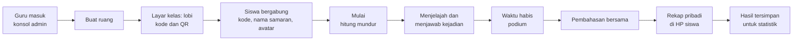
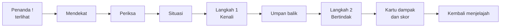

# PRD — Jejak Setara

| | |
|---|---|
| Produk | Jejak Setara (nama kerja), mode kompetitif dunia terbuka kecil di dalam media Ruang Setara |
| Versi dokumen | 0.1 (draf untuk ditinjau) |
| Tanggal | 4 November 2026 |
| Pemilik | YAN |
| Dokumen terkait | `Design_System.md`, `Architecture.md`, `AGENTS.md` (semuanya di `docs/jejak-setara/`); dokumen Sehari Setara di `docs/sehari-setara/` |

---

## 1. Ringkasan

Jejak Setara adalah permainan bergaya piksel retro yang cerah, sekeluarga dengan Sehari Setara. Setiap siswa memakai **HP atau laptopnya sendiri**, masuk ke **ruang** yang dibuat guru dengan kode, lalu menjelajahi kampung Nara dari **sudut pandang tampak atas 3/4** untuk menemukan **kejadian sehari-hari tentang hak dan kewajiban** yang tersebar di peta.

Di setiap kejadian, pemain menjalani dua langkah:

1. **Kenali:** hak siapa yang terganggu, kewajiban apa yang diabaikan, atau lembaga mana yang berwenang.
2. **Bertindak:** memilih tindakan yang paling menjaga keseimbangan hak dan kewajiban.

Sesudah menjawab, pemain melihat **kartu dampak** dengan rujukan pasal, seperti di Sehari Setara. **Skor dihitung dari ketepatan**, dan waktu hanya menjadi penentu bila skor sama. Selama bermain, pemain mendapat **skill** seperti lari cepat, kompas kejadian, dan petunjuk. Papan skor tampil langsung di proyektor. Guru dan admin mengelola ruang, **bank kejadian** (soal dan jawaban), rujukan, akun, dan **statistik** lewat **konsol admin**.

Bila Sehari Setara adalah "bermain dan memutuskan bersama", Jejak Setara adalah "menjelajah dan menganalisis sendiri".

## 2. Latar belakang dan masalah

- Sehari Setara melatih diskusi kelompok di satu layar. Belum ada latihan yang membuat **setiap siswa** menganalisis sendiri banyak situasi dalam waktu singkat.
- Unsur penjelajahan dan persaingan menaikkan semangat. Namun persaingan yang hanya menghargai kecepatan mendorong tebakan, padahal yang ingin dilatih adalah **alasan**.
- Guru membutuhkan data untuk tindak lanjut: kejadian mana yang sulit, pilihan keliru mana yang sering diambil, dan siapa yang perlu dibantu, **tanpa mengumpulkan nama siswa**.
- Guru ingin **menambah dan memperbaiki soal sendiri** tanpa menyentuh kode atau menunggu pengembang.
- Asumsi Sehari Setara bahwa siswa tidak memakai gawai **tidak berlaku** untuk mode ini. Pemilik proyek memutuskan siswa memakai gawai masing-masing secara real-time (4 Nov 2026).

## 3. Tujuan dan non-tujuan

**Tujuan**

1. Setiap siswa menganalisis sendiri sedikitnya 10 kejadian hak dan kewajiban dalam satu sesi 15 menit.
2. Persaingan yang sehat: peringkat ditentukan ketepatan analisis; kecepatan hanya penentu bila skor sama.
3. Setiap kejadian terhubung dengan pasal UUD NRI 1945 atau peraturan terkait lewat kartu dampak dan pembahasan bersama.
4. Guru menjalankan sesi tanpa pelatihan khusus dan memperoleh statistik yang bisa langsung dipakai.
5. Admin dapat menambah dan menyunting kejadian, jawaban, dan rujukan lewat konsol, tetap dengan gerbang verifikasi rujukan.

**Non-tujuan (tidak dikerjakan pada versi ini)**

- Login siswa, nama asli siswa, foto, atau obrolan antarpemain.
- Saling serang, mencuri skor, atau menghalangi pemain lain.
- Mode tim (P2), papan skor antarsekolah, pembelian di dalam game, dan iklan.
- Aplikasi Android atau iOS yang dipasang. Cukup peramban.
- Menyunting peta lewat konsol admin. Peta diubah lewat kode.
- Mengubah Sehari Setara atau galeri 3D, selain menambah tautan masuk.

## 4. Pengguna, peran, dan konteks pemakaian

| Pengguna | Kebutuhan | Peran di sistem |
|---|---|---|
| Siswa SMP kelas IX (14–15 tahun), 20–40 per kelas | Masuk cepat, bermain lancar di HP, tahu skor dan peringkatnya sendiri | **Pemain** tanpa akun: kode ruang, nama samaran dari daftar, dan avatar |
| Guru Pendidikan Pancasila | Membuat dan menjalankan ruang, memandu pembahasan, melihat hasil kelasnya | **Akun guru** |
| Pemilik proyek (YAN) | Mengelola akun, bank kejadian, rujukan, paket, pengaturan, dan seluruh statistik | **Akun admin** |
| Peninjau konten | Mencocokkan rujukan dengan naskah resmi di JDIH | Akun guru atau admin bertanda **Peninjau** |

**Lingkungan:**

- HP Android kelas menengah-bawah (RAM sekitar 3 GB, layar 6–6,7 inci, Chrome) dan laptop lab (Chrome atau Edge).
- Laptop guru tersambung ke proyektor 1024×768 atau 1280×720 untuk **layar kelas**.
- Wifi sekolah yang bisa lambat, atau data seluler siswa.
- Kelas ramai, sehingga suara di HP pemain mati secara bawaan.

## 5. Kaitan dengan tujuan pembelajaran

TP mengikuti Sehari Setara agar kedua mode saling melengkapi. Pemilik proyek memastikan kecocokannya dengan RPM (keputusan terbuka KT-11).

| TP | Rumusan singkat | Bagian Jejak Setara |
|---|---|---|
| TP 1 | Mengidentifikasi hak dan kewajiban dalam situasi sehari-hari | Langkah 1 "Kenali" di setiap kejadian |
| TP 2 | Menganalisis dampak pelanggaran hak dan pengabaian kewajiban | Kartu dampak, pembahasan bersama, rekap pribadi |
| TP 3 | Menghubungkan hak yang terganggu dengan Pasal 28A–28J | Rujukan di kartu dampak, statistik per topik |
| TP 4 | Membedakan peran polisi, jaksa, hakim, dan advokat | Langkah 1 kejadian K-07 (peran lembaga) |
| TP 5 | Menentukan sikap yang menyeimbangkan hak dan kewajiban | Langkah 2 "Bertindak" di setiap kejadian |

## 6. Pengalaman inti

Satu sesi kelas:

Satu kejadian:

## 7. Kebutuhan fungsional

Prioritas: **P0** wajib ada di versi pertama, **P1** sebaiknya ada, **P2** nanti.

### A. Ruang dan bergabung

| ID | Kebutuhan | Prioritas |
|---|---|---|
| JFR-01 | Guru atau admin yang sudah masuk membuat ruang: label kelas (misalnya "IX B"), paket kejadian, durasi 10, 15 (bawaan), atau 20 menit, skill yang aktif, batas pemain (bawaan 40, paling banyak 100), batas bergabung terlambat (bawaan 5 menit sesudah mulai), dan mode nomor absen (mati secara bawaan; hanya untuk ruang sampai 50 pemain) | P0 |
| JFR-02 | Ruang mendapat kode 5 karakter tanpa huruf dan angka yang mirip (misalnya tanpa O dan 0) serta tautan pendek untuk dibuka di HP | P0 |
| JFR-03 | Kode QR tautan ruang di lobi layar kelas | P1 |
| JFR-04 | Siswa masuk tanpa akun: buka tautan, ketik kode, isi nomor absen bila mode nomor absen aktif, pilih satu dari tiga saran nama samaran (boleh acak ulang), lalu pilih satu dari 8 avatar | P0 |
| JFR-05 | Lobi: pemain bisa berjalan di halaman lobi tanpa kejadian sambil menunggu; layar kelas menampilkan jumlah dan nama samaran pemain | P0 |
| JFR-06 | Guru dapat mengunci ruang dan mengeluarkan pemain dengan konfirmasi | P0 |
| JFR-07 | Kode masuk ulang dari guru untuk pemain yang berganti perangkat, dengan skor dan progres tetap | P1 |
| JFR-08 | Menyambung ulang otomatis bila koneksi putus atau HP terkunci sebentar, dengan skor dan progres utuh | P0 |

### B. Penjelajahan

| ID | Kebutuhan | Prioritas |
|---|---|---|
| JFR-09 | Peta tampak atas 3/4 sekitar 160 × 100 ubin dengan 8 zona (bagian 9), dijelajah dengan keyboard (WASD atau panah) atau joystick sentuh | P0 |
| JFR-10 | Pemain lain terlihat sebagai avatar dengan nama samaran. Pemain saling tembus dan tidak bisa saling mengganggu | P0 |
| JFR-11 | Peta mini pribadi: posisi sendiri, zona, halte, dan kejadian yang **sudah pernah terlihat**; kejadian yang belum terlihat tidak ditampilkan | P0 |
| JFR-12 | "Langit sehari": waktu ronde dipetakan ke satu hari (pagi, siang, sore), warna peta berganti per masa, dan busur hari tampil di bilah atas | P0 |
| JFR-13 | Bantuan gerak: memilih kejadian di peta mini atau daftar kejadian terdekat membuat avatar berjalan sendiri ke sana dengan kecepatan jalan biasa | P1 |
| JFR-14 | Layar tetap menyala selama bermain (bila perangkat mendukung), agar HP tidak terkunci dan koneksi tidak putus | P0 |

### C. Kejadian dan skor

| ID | Kebutuhan | Prioritas |
|---|---|---|
| JFR-15 | Kejadian ditempatkan di titik-titik per zona. Penempatan diacak sekali per ruang dan sama untuk semua pemain di ruang itu. Penanda "!" muncul saat kejadian tampak di layar, dan pemain memeriksa bila cukup dekat | P0 |
| JFR-16 | Dialog dua langkah: situasi (paling banyak 3 kalimat), Langkah 1 "Kenali" (4 pilihan, satu benar), umpan balik, Langkah 2 "Bertindak" (3 pilihan bertingkat tepat, kurang tepat, berisiko), lalu kartu dampak (yang terjadi, hak yang terdampak, kewajiban terkait, rujukan) | P0 |
| JFR-17 | Pilihan dipilih lalu dikunci dengan tombol "Kunci jawaban" (atau `Enter`), agar sentuhan tak sengaja di HP tidak langsung menjadi jawaban | P0 |
| JFR-18 | Setiap kejadian dijawab sekali per pemain; jawaban pertama yang dihitung; kejadian selesai ditandai ✓ di peta | P0 |
| JFR-19 | Skor dihitung server: Langkah 1 benar 40; Langkah 2 tepat 60, kurang tepat 25, berisiko 0. Paling banyak 100 per kejadian | P0 |
| JFR-20 | Peringkat: skor tertinggi; bila sama, yang lebih dulu mencapai skor itu. Setiap pemain melihat skor dan peringkatnya sendiri | P0 |
| JFR-21 | Urutan pilihan diacak per pemain. Huruf A–D atau A–C mengikuti urutan tampil | P0 |
| JFR-22 | Jam ronde tetap berjalan selama dialog terbuka. Tidak ada batas waktu per kejadian | P0 |

### D. Skill dan kotak bantuan

| ID | Kebutuhan | Prioritas |
|---|---|---|
| JFR-23 | Kotak bantuan tersebar di setiap zona dan diambil dengan melewatinya. Setiap pemain punya kotaknya sendiri; kotak yang diambil muncul lagi 90 detik kemudian untuk pemain itu | P0 |
| JFR-24 | Skill P0: Lari cepat, Kompas kejadian, dan Petunjuk (bagian 8.5), paling banyak 2 muatan per skill. Jawaban "tepat" di Langkah 2 memberi +1 muatan Kompas | P0 |
| JFR-25 | Skill P1: Teropong dan Angkot (jalan pintas antarhalte) | P1 |
| JFR-26 | Guru dapat mematikan skill tertentu untuk satu ruang | P0 |

### E. Layar kelas (proyektor)

| ID | Kebutuhan | Prioritas |
|---|---|---|
| JFR-27 | Lobi: kode besar, tautan, jumlah pemain, dan daftar nama samaran | P0 |
| JFR-28 | Saat bermain: sisa waktu dan busur hari, papan 10 besar, kemajuan kelas (jumlah jawaban terhadap jumlah kemungkinan), dan peta kecil berisi titik pemain **tanpa** lokasi kejadian | P0 |
| JFR-29 | Kontrol guru: Mulai (hitung mundur 3 detik), Jeda dan Lanjut (semua pemain berhenti), Tambah 2 menit, dan Akhiri (dengan konfirmasi), juga lewat pintasan keyboard | P0 |
| JFR-30 | Akhir ronde: podium 3 besar dan daftar 4–10. Peringkat lengkap hanya di konsol, bukan di proyektor | P0 |
| JFR-31 | Pembahasan: per kejadian tampil situasi, jawaban yang tepat, sebaran pilihan kelas dalam persen, dan kartu dampak, untuk didiskusikan | P0 |

### F. Rekap pemain

| ID | Kebutuhan | Prioritas |
|---|---|---|
| JFR-32 | Di akhir ronde, layar pemain menampilkan skor, peringkat, dan rekap: kejadian yang dijawab, pilihannya, pilihan yang tepat, rujukan, serta dua kalimat refleksi untuk ditulis di buku | P0 |
| JFR-33 | Pemain dapat menyimpan rekap pribadinya sebagai gambar PNG | P2 |

### G. Akun dan konsol admin

| ID | Kebutuhan | Prioritas |
|---|---|---|
| JFR-34 | Masuk dengan email dan kata sandi, keluar, dan ganti sandi. Sesi berakhir sendiri sesudah tidak dipakai | P0 |
| JFR-35 | Peran Admin dan Guru, ditambah tanda Peninjau (bagian 11) | P0 |
| JFR-36 | Admin mengelola akun: membuat akun guru dengan sandi sementara (wajib diganti saat masuk pertama), menonaktifkan, dan mengatur ulang sandi | P0 |
| JFR-37 | Dasbor: ruang yang sedang berjalan, sesi terakhir, ringkasan statistik, dan peringatan (misalnya rujukan yang belum terverifikasi) | P0 |
| JFR-38 | Riwayat ruang: daftar ruang dengan saringan (tanggal, label kelas, guru) dan tautan ke hasilnya | P0 |
| JFR-39 | Log audit: siapa mengubah apa dan kapan (konten, akun, ruang) | P1 |
| JFR-40 | Pengaturan umum: nilai bawaan ruang, daftar nama samaran, masa simpan data, dan mode pemeliharaan | P1 |

### H. Bank kejadian dan rujukan

| ID | Kebutuhan | Prioritas |
|---|---|---|
| JFR-41 | Daftar kejadian dengan saringan (zona, topik, status) dan pencarian judul | P0 |
| JFR-42 | Penyunting kejadian: judul, zona, set tokoh dan properti, situasi, Langkah 1 (pertanyaan, 4 pilihan, kunci, umpan balik), Langkah 2 (3 pilihan, tingkat, dan "yang terjadi" per pilihan), hak dan kewajiban di kartu dampak, rujukan dari pustaka, kalimat petunjuk, serta topik dan jenis. Validasi langsung dan pratinjau seperti di HP | P0 |
| JFR-43 | Status kejadian: Draf → Siap tinjau → Terbit → Arsip. Hanya Admin yang menerbitkan, dan kejadian hanya bisa terbit bila validasi lulus dan **semua rujukannya terverifikasi** | P0 |
| JFR-44 | Versi: setiap terbitan menjadi versi tetap. Ruang memakai versi yang berlaku saat ruang dibuat, dan statistik dicatat per versi | P0 |
| JFR-45 | Pustaka rujukan: teks, sumber JDIH, dan status verifikasi. Hanya akun bertanda Peninjau yang dapat menandai "Terverifikasi", dengan nama dan tanggal tercatat | P0 |
| JFR-46 | Paket kejadian: Admin menyusun paket (misalnya "Paket inti 16"), dan guru memilih paket saat membuat ruang | P0 |
| JFR-47 | Ruang uji: admin dan guru mencoba kejadian berstatus Draf atau Siap tinjau di ruang khusus yang tidak masuk statistik | P1 |
| JFR-48 | Impor dan ekspor bank kejadian (JSON) untuk cadangan dan pemindahan | P1 |

### I. Statistik dan ekspor

| ID | Kebutuhan | Prioritas |
|---|---|---|
| JFR-49 | Hasil per ruang: peringkat lengkap (nama samaran, nomor absen bila aktif, skor, jumlah kejadian, ketepatan Langkah 1, sebaran tingkat Langkah 2, waktu), dan rincian jawaban setiap pemain | P0 |
| JFR-50 | Statistik per kejadian, lintas ruang dengan saringan: jumlah dijawab, persentase Langkah 1 benar, sebaran pilihan Langkah 2, median waktu menjawab, indeks kesulitan, dan pilihan keliru yang paling sering diambil | P0 |
| JFR-51 | Statistik per label kelas dan per topik hak dan kewajiban, termasuk tren antarsesi | P1 |
| JFR-52 | Statistik per siswa lintas sesi berdasarkan label kelas + nomor absen, hanya untuk ruang yang memakai mode nomor absen | P1 |
| JFR-53 | Ekspor CSV (peserta dan jawaban) yang langsung terbuka rapi di Excel berbahasa Indonesia | P0 |
| JFR-54 | Cetak ringkasan ruang (lewat fitur cetak peramban, bisa disimpan sebagai PDF) | P1 |

### J. Pengaturan pemain, aksesibilitas, dan privasi

| ID | Kebutuhan | Prioritas |
|---|---|---|
| JFR-55 | Pengaturan di layar pemain: suara (bawaan mati), kurangi gerak, teks muncul per huruf, dan ukuran label nama | P0 |
| JFR-56 | Pemberitahuan privasi singkat sebelum siswa masuk ruang (data apa yang disimpan dan untuk apa) | P0 |
| JFR-57 | Dapat dimainkan penuh dengan keyboard di laptop; dialog terbaca pembaca layar | P0 |

## 8. Aturan permainan

### 8.1 Waktu dan langit sehari

- Durasi ronde D = 10, 15, atau 20 menit, didahului hitung mundur 3 detik.
- Waktu ronde dipetakan ke jam cerita 06.00–18.00:

| Masa | Bagian ronde | Jam cerita |
|---|---|---|
| Pagi | 0–30% | 06.00–09.36 |
| Siang | 30–65% | 09.36–13.48 |
| Sore | 65–100% | 13.48–18.00 |
| Malam | Layar akhir dan pembahasan | 20.00 |

- Saat masa berganti, warna peta ikut berganti (tukar palet, Design System bagian 4) tanpa sapuan, agar permainan tidak terganggu.
- Dua menit terakhir ditandai pemberitahuan dan busur hari yang berdenyut pelan.
- Jeda menghentikan jam ronde dan jam cerita.

### 8.2 Gerak dan peta

- Kecepatan jalan 4,5 ubin per detik (72 piksel logis per detik). Gerak diagonal tidak lebih cepat.
- Bangunan, air, batang pohon, dan pagar tidak bisa ditembus. Pemain saling tembus.
- Server memeriksa kecepatan dan tabrakan, sehingga lompatan posisi yang mustahil dikoreksi (Architecture bagian 8).

### 8.3 Kejadian

- Penanda "!" terlihat bila titiknya tampak di layar pemain. Begitu terlihat, kejadian tercatat di peta mini pribadi.
- Tombol "Periksa" aktif bila pemain berada paling jauh 1,5 ubin dari titik kejadian.
- Satu pemain membuka satu dialog pada satu waktu. Selama dialog, avatarnya diam dengan gelembung "…" di atas kepala.
- Menutup dialog **sebelum** Langkah 1 dikunci diperbolehkan tanpa akibat. Sesudah Langkah 1 dikunci, jawabannya tersimpan; bila dialog ditutup, pemeriksaan berikutnya langsung membuka Langkah 2 (keputusan terbuka KT-13).
- Langkah 1 boleh menanyakan hak yang terganggu, kewajiban yang diabaikan, atau peran lembaga, sesuai kejadiannya.
- Setiap kejadian punya sedikitnya dua titik di zonanya. Penempatan diacak sekali per ruang dengan benih (*seed*) ruang, sehingga peta tidak bisa dihafal antarsesi, tetapi adil di dalam satu ruang.
- Di ruang lebih dari 50 pemain, setiap kejadian aktif di dua titik zonanya sekaligus agar pemain tidak menumpuk; pemeriksaan, penanda, dan Kompas memakai titik terdekat (Permintaan C-8; dibangun di JS-08).

### 8.4 Skor dan peringkat

| Bagian | Poin |
|---|---|
| Langkah 1 benar | 40 |
| Langkah 1 keliru | 0 |
| Langkah 2 tepat | 60 |
| Langkah 2 kurang tepat | 25 |
| Langkah 2 berisiko | 0 |

- Paling banyak 100 poin per kejadian; 1.600 poin untuk Paket inti 16.
- Urutan peringkat: (1) skor lebih tinggi; (2) lebih dulu mencapai skor itu; (3) lebih banyak Langkah 1 benar; (4) urutan bergabung.
- Skor dihitung server. Angka di layar pemain hanya menampilkan hasil dari server.
- Petunjuk tidak mengurangi skor; batasnya adalah jumlah muatan.

### 8.5 Skill dan kotak bantuan

| Skill | Efek | Sumber | Muatan maks. | Prioritas |
|---|---|---|---|---|
| Lari cepat | Kecepatan ×1,6 selama 6 detik | Kotak sepatu (zona jalan, pasar, taman) | 2 | P0 |
| Kompas kejadian | Panah di tepi layar menunjuk kejadian terdekat yang belum selesai, selama 20 detik atau sampai pemain tiba | Kotak kompas (zona rumah dan balai warga); +1 setiap jawaban "tepat" | 2 | P0 |
| Petunjuk | Di Langkah 1: menampilkan satu kalimat petunjuk dan mencoret satu pilihan keliru | Kotak buku (zona sekolah, puskesmas, pojok gawai) | 2 | P0 |
| Teropong | Memperlihatkan kejadian dalam radius 12 ubin di peta mini selama 30 detik | Kotak teropong (zona taman dan pantai) | 1 | P1 |
| Angkot | Pindah ke halte lain yang dipilih | Karcis dari kotak di halte | 1 | P1 |

- Kotak diambil dengan berjalan melewatinya. Isi setiap kotak tetap menurut tempatnya.
- Jeda antarpemakaian skill yang sama 2 detik. Skill tidak bisa dipakai selama dialog terbuka, kecuali Petunjuk.
- Guru bisa mematikan skill per ruang (JFR-26). Nilai di tabel ini adalah nilai awal yang akan ditimbang ulang sesudah uji coba kelas.

### 8.6 Sportivitas

- Tidak ada serangan, tidak ada obrolan, dan nama hanya dari daftar nama samaran.
- Proyektor hanya menampilkan 10 besar dan podium 3 besar. Pemain lain hanya melihat peringkatnya sendiri.
- Pemberitahuan bernada netral dan menyemangati, tanpa menyebut siapa yang tertinggal.
- Guru dapat mengunci ruang dan mengeluarkan pemain yang mengganggu.

### 8.7 Tidak ada "kalah"

Setiap pemain mendapat rekap pribadi yang menunjukkan pilihan yang lebih tepat beserta rujukannya, dan kelas membahas kejadian bersama sesudah ronde.

## 9. Peta dan zona

Peta adalah **kampung Nara**, tempat fiktif yang terasa dekat dengan Buleleng: rumah, sekolah, jalan, pasar, balai warga, taman, sungai, dan pantai. Setiap zona punya bangunan penanda dan bahan dominan agar pemain mudah mengenali arah (Design System bagian 7).

| Zona | Nama | Penanda tempat | Kejadian (Paket inti) | Kotak bantuan |
|---|---|---|---|---|
| Z1 | Rumah dan gang | Rumah Nara, pagar bambu, warung Pak Made | K-01, K-02 | Kompas |
| Z2 | Sekolah | Gedung SMP dua lantai, lapangan, kantin | K-03, K-04 | Buku |
| Z3 | Jalan dan halte | Persimpangan, zebra cross, halte angkot | K-05, K-06 | Sepatu |
| Z4 | Pasar | Tenda bergaris, los pedagang, parkir | K-07, K-08 | Sepatu |
| Z5 | Balai warga | Bale terbuka, pos ronda dengan kentongan | K-09, K-10 | Kompas |
| Z6 | Taman, sungai, dan pantai | Jembatan kayu, pohon kelapa, lapangan taman | K-11, K-12 | Sepatu, Teropong (P1) |
| Z7 | Puskesmas dan kantor desa | Puskesmas beratap hijau toska, kantor desa | K-13, K-14 | Buku |
| Z8 | Pojok gawai | Warung berwifi, bangku dan colokan | K-15, K-16 | Buku |

Halaman lobi berada di depan sekolah dan tertutup gerbang sampai ronde dimulai.

## 10. Bank kejadian awal

Keterangan: **Tipe** "mirip adegan n" berarti kejadian itu sejenis dengan adegan n Sehari Setara; "baru" berarti jenis yang belum ada di Sehari Setara.

**Semua rujukan berstatus perlu verifikasi.** Rujukan yang sama dengan rujukan Sehari Setara diberi kode R-xx-nya sebagai bantuan; centangnya tetap dicatat terpisah di pustaka rujukan Jejak Setara (Architecture bagian 10.6). Agen dilarang menambah nomor pasal di luar daftar ini tanpa catatan "perlu verifikasi".

| ID | Zona | Judul | Situasi singkat | Langkah 1 menanyakan | Arah tindakan tepat | Tipe | Rujukan usulan |
|---|---|---|---|---|---|---|---|
| K-01 | Z1 | Menjaga adik | Ibu mengantar Nenek ke puskesmas dan meminta Nara menjaga Gita sampai sore. Teman mengajak bermain ke pantai. | Kewajiban Nara | Menjaga Gita; mengajak teman bermain di rumah atau lain hari | Mirip adegan 1 | UU No. 23 Tahun 2002 jo. UU No. 35 Tahun 2014, Pasal 19 (R-02); Pasal 28B ayat (2) UUD NRI 1945 (R-01) |
| K-02 | Z1 | Hari suci tetangga | Keluarga Pak Made menjalankan hari suci yang menuntut suasana tenang. Dimas mengajak bermain musik keras di teras. | Hak yang perlu dihormati | Menolak dengan sopan; bermain tanpa suara keras atau di tempat lain | Baru (toleransi) | Pasal 28E ayat (1), Pasal 29 ayat (2), Pasal 28J ayat (1) UUD NRI 1945 (R-08) |
| K-03 | Z2 | Bekal yang diejek | Komang diejek karena bekalnya sederhana, dan seseorang memotretnya. | Hak yang terganggu | Menghentikan dengan cara aman, mengajak Komang menjauh, melapor kepada Bu Ratih | Mirip adegan 4 | Pasal 28B ayat (2) (R-01), Pasal 28G ayat (1) (R-03), Pasal 28J ayat (1) (R-08) UUD NRI 1945 |
| K-04 | Z2 | Kelas di lantai dua | Raka, teman berkursi roda, tidak bisa ikut praktik di lab lantai dua. Teman lain berkata dia tidak usah ikut. | Hak yang dipertaruhkan | Mengusulkan kepada guru agar praktik dipindah ke lantai satu atau Raka dibantu dengan aman | Baru (disabilitas) | Pasal 31 ayat (1) (R-04), Pasal 28H ayat (2), Pasal 28J ayat (1) (R-08) UUD NRI 1945 |
| K-05 | Z3 | Bonceng tanpa helm | Dimas menawarkan boncengan ke lapangan tanpa helm cadangan. Ia belum punya SIM. | Kewajiban yang diabaikan | Menolak dengan sopan, berjalan atau naik angkot, mengingatkan helm | Mirip adegan 2 | Pasal 27 ayat (1) (R-05), Pasal 28G ayat (1) (R-03) UUD NRI 1945; UU No. 22 Tahun 2009 tentang LLAJ, Pasal 77 ayat (1) dan Pasal 106 ayat (8) (R-06) |
| K-06 | Z3 | Zebra cross | Seorang nenek ragu menyeberang di zebra cross, sementara kendaraan terus melaju. | Hak siapa yang terganggu | Membantu nenek menyeberang di tempat penyeberangan dengan aman | Baru | UU No. 22 Tahun 2009 tentang LLAJ, Pasal 131 ayat (2); Pasal 28J ayat (1) UUD NRI 1945 (R-08) |
| K-07 | Z4 | Tuduhan di pasar | Dompet pedagang hilang. Beberapa orang langsung menuduh Bayu yang lewat dan ingin menggeledahnya beramai-ramai. | Lembaga yang berwenang menerima laporan dan menyelidiki | Mengingatkan agar tidak main hakim sendiri; menyarankan melapor kepada petugas pasar dan polisi; menunjuk kamera pasar | Mirip adegan 5 | Pasal 28D ayat (1) (R-09), Pasal 28G ayat (1) (R-03) UUD NRI 1945; UU No. 48 Tahun 2009, Pasal 8 ayat (1) (asas praduga tak bersalah) (R-12); UU No. 2 Tahun 2002 sebagaimana telah diubah terakhir dengan UU No. 5 Tahun 2026, Pasal 13 dan Pasal 14 ayat (1) huruf g (R-11) |
| K-08 | Z4 | Dompet tertinggal | Nara menemukan dompet berisi uang di bangku pasar. Teman menyarankan uangnya dibagi. | Hak yang harus dihormati | Menyerahkan kepada pos keamanan pasar tanpa mengambil isinya | Baru | Pasal 28H ayat (4), Pasal 28J ayat (1) (R-08) UUD NRI 1945 |
| K-09 | Z5 | Rapat lomba | Rapat persiapan lomba 17-an. Usul Sinta tentang lomba yang bisa diikuti semua anak dipotong dan ditertawakan. | Hak yang terganggu | Meminta Sinta menyelesaikan usulnya; memutuskan dengan musyawarah dan alasan | Mirip adegan 3 | Pasal 28E ayat (3) (R-07), Pasal 28J ayat (1) (R-08) UUD NRI 1945 |
| K-10 | Z5 | Logat yang diejek | Peserta lomba yang baru pindah dari daerah lain ditertawakan karena logatnya. Panitia remaja ikut tertawa. | Hak yang terganggu | Menghentikan ejekan, menyambut peserta, mengingatkan panitia | Baru (diskriminasi) | Pasal 28I ayat (2), Pasal 28J ayat (1) (R-08) UUD NRI 1945 |
| K-11 | Z6 | Sampah di sungai | Sesudah piknik, sekelompok remaja hendak membuang sampah plastik ke sungai karena tempat sampah jauh. | Kewajiban yang diabaikan | Membawa sampah ke tempat sampah dan mengajak memilah | Baru (lingkungan) | Pasal 28H ayat (1) UUD NRI 1945; UU No. 32 Tahun 2009, Pasal 67 |
| K-12 | Z6 | Lapangan untuk semua | Anak-anak SD, termasuk Gita, diusir dari lapangan taman oleh remaja yang ingin bermain bola. | Hak siapa yang terganggu | Membagi waktu atau area lapangan lewat musyawarah | Baru | UU No. 23 Tahun 2002 jo. UU No. 35 Tahun 2014, Pasal 11; Pasal 28J ayat (1) UUD NRI 1945 (R-08) |
| K-13 | Z7 | Antrean puskesmas | Contoh lengkap di bawah | Hak yang paling terganggu | Kembali ke antrean dan memberi tahu petugas tentang bayi yang demam | Baru (layanan publik) | Pasal 28H ayat (1), Pasal 28J ayat (1) (R-08) UUD NRI 1945 |
| K-14 | Z7 | Berhenti sekolah? | Wayan, teman sekelas, berkata akan berhenti sekolah untuk membantu orang tuanya berdagang. | Hak dan kewajiban Wayan | Mengajak Wayan bicara dengan wali kelas atau guru BK tentang bantuan; mendukungnya tetap sekolah | Baru (pendidikan) | Pasal 31 ayat (1) (R-04) dan ayat (2) UUD NRI 1945 |
| K-15 | Z8 | Video yang disebar | Video Komang terjatuh di lapangan dikirim ke grup kelas dengan stiker ejekan. | Hak yang terganggu | Tidak meneruskan, meminta video dihapus, mendukung Komang, melapor kepada wali kelas | Mirip adegan 6 | Pasal 28G ayat (1) (R-03), Pasal 28J ayat (1) (R-08) UUD NRI 1945 |
| K-16 | Z8 | Kabar menakutkan | Pesan berantai tentang penculikan anak di desa sebelah beredar tanpa sumber. Teman ingin meneruskannya ke semua grup. | Hak dan kewajiban terkait informasi | Memeriksa ke sumber resmi, tidak meneruskan, memberi tahu guru atau orang tua | Baru (literasi digital) | Pasal 28F, Pasal 28J ayat (1) (R-08) dan ayat (2) UUD NRI 1945 |

### Contoh lengkap: K-13 Antrean puskesmas

Contoh ini menunjukkan bentuk yang diharapkan. Naskah final seluruh kejadian ditulis di tahap Specify fitur konten (AGENTS bagian 5) dan disetujui pemilik proyek.

- **Zona:** Z7 Puskesmas dan kantor desa. **Set tokoh:** ibu menggendong bayi, Raka, petugas puskesmas.
- **Situasi:** "Ruang tunggu puskesmas penuh. Seorang ibu menggendong bayinya yang demam sudah lama mengantre. Raka menyerobot ke depan karena ingin cepat pulang, lalu menarikmu ikut."
- **Langkah 1 — Kenali:** "Hak siapa yang paling terganggu di sini?"

| Pilihan | Benar | Umpan balik |
|---|---|---|
| Hak ibu dan bayinya untuk memperoleh pelayanan kesehatan secara tertib | Ya | Benar. Bayi yang demam berhak dilayani, dan antrean menjaga agar semua orang dilayani dengan adil. |
| Hak Raka untuk pulang lebih cepat | Tidak | Keinginan pulang cepat bukan alasan untuk mengambil giliran orang lain. |
| Hak petugas untuk beristirahat | Tidak | Petugas memang perlu istirahat, tetapi yang dirugikan oleh serobotan ini adalah pengantre. |
| Hak pengunjung untuk memilih puskesmas lain | Tidak | Pilihan itu tidak menjawab masalah di ruang tunggu ini. |

- **Petunjuk:** "Perhatikan siapa yang sudah lama menunggu dan paling membutuhkan layanan."
- **Langkah 2 — Bertindak:** "Apa yang kamu lakukan?"

| Pilihan | Tingkat | Yang terjadi |
|---|---|---|
| Ikut menyerobot karena antrean terlalu lama | Berisiko | Ibu itu harus menunggu lebih lama, dan orang lain ikut menyerobot. |
| Menolak, mengajak Raka kembali ke antrean, lalu memberi tahu petugas bahwa ada bayi yang demam | Tepat | Raka kembali ke antrean. Petugas memeriksa bayi itu lebih dulu karena keadaannya. |
| Tetap mengantre, tetapi diam saja | Kurang tepat | Kamu tidak ikut menyerobot, tetapi Raka tetap mengambil giliran orang lain. |

- **Kartu dampak:** Hak yang terdampak: hak memperoleh pelayanan kesehatan. Kewajiban terkait: menghormati hak orang lain dengan tertib mengantre.
- **Rujukan (perlu verifikasi):** Pasal 28H ayat (1) UUD NRI 1945; Pasal 28J ayat (1) UUD NRI 1945.
- **Topik:** Hak atas kesehatan. **Jenis:** pelanggaran hak.

### Aturan menulis kejadian

- Mengikuti aturan konten Sehari Setara: Bahasa Indonesia baku yang ramah remaja, huruf kapital hanya di awal kalimat, situasi paling banyak 3 kalimat, tidak menyalahkan korban, tanpa kekerasan fisik, dan tokoh berwenang digambarkan membantu.
- Tokoh Sehari Setara boleh muncul dengan watak yang sama. Bayu tetap tidak bersalah dan digambarkan netral.
- Langkah 1: tepat satu jawaban benar dan tiga pilihan keliru yang masuk akal. Umpan balik menjelaskan alasan, bukan sekadar "salah".
- Langkah 2: sedikitnya satu pilihan bertingkat tepat. "Yang terjadi" ditulis untuk setiap pilihan.
- Kejadian bertema agama, suku, atau disabilitas ditinjau khusus agar tidak memuat stereotip (keputusan terbuka KT-10).
- Batas panjang setiap bagian ada di Architecture bagian 5.4 dan diperiksa otomatis, baik untuk bank awal maupun untuk isian konsol.

## 11. Akun admin dan statistik

### 11.1 Peran dan izin

| Aksi | Admin | Guru |
|---|---|---|
| Membuat, menjalankan, dan mengakhiri ruang | Ya | Ya |
| Melihat hasil dan statistik ruang | Semua ruang | Ruang miliknya |
| Membuat dan menyunting draf kejadian | Ya | Ya (KT-03) |
| Menerbitkan dan mengarsipkan kejadian | Ya | Tidak |
| Menyusun paket kejadian | Ya | Tidak |
| Menandai rujukan "Terverifikasi" | Bila bertanda Peninjau | Bila bertanda Peninjau |
| Mengelola akun | Ya | Tidak (hanya sandinya sendiri) |
| Pengaturan umum dan log audit | Ya | Tidak |
| Menghapus data ruang | Semua ruang | Ruang miliknya |
| Ekspor CSV dan cetak ringkasan | Semua ruang | Ruang miliknya |

### 11.2 Definisi statistik

| Ukuran | Cara menghitung |
|---|---|
| Ketepatan Langkah 1 | Jumlah Langkah 1 benar ÷ jumlah kejadian yang dijawab |
| Sebaran tingkat Langkah 2 | Persentase jawaban tepat, kurang tepat, dan berisiko |
| Indeks kesulitan kejadian | Proporsi pemain yang mendapat poin penuh (100) di kejadian itu; makin kecil makin sulit |
| Pilihan keliru terbanyak | Pilihan Langkah 1 keliru yang paling sering dipilih |
| Waktu menjawab | Dari dialog dibuka sampai Langkah 2 dikunci; dilaporkan sebagai median |
| Kemajuan kelas | Jumlah kejadian terjawab seluruh pemain ÷ (jumlah pemain × jumlah kejadian paket) |

Ruang uji (JFR-47) tidak masuk statistik. Statistik dicatat per versi kejadian, sehingga perbaikan soal tidak mencampur data lama dan baru.

## 12. Kebutuhan non-fungsional

| Aspek | Kebutuhan |
|---|---|
| Kapasitas | Sampai 100 pemain per ruang (bawaan 40) dan sedikitnya 10 ruang serentak tanpa penurunan layanan; syarat teknisnya di Architecture 6.5 |
| Latensi | Waktu pulang-pergi pesan p95 ≤ 250 ms di wifi sekolah; permainan tetap layak sampai 500 ms |
| Kinerja HP | ≥ 30 fps di HP kelas bawah (RAM 3 GB, Android 10 ke atas); sasaran 60 fps |
| Muatan awal | Halaman pemain siap ≤ 6 detik pada koneksi 10 Mbps: kode pemain ≤ 200 KB (gzip), aset pemain ≤ 2 MB |
| Data seluler | ≤ 3 MB lalu lintas permainan per pemain untuk satu ronde 15 menit, di luar aset yang dimuat sekali |
| Ketahanan | Koneksi yang putus sampai 2 menit tersambung kembali tanpa kehilangan skor; ronde tetap berjalan bila layar kelas tertutup |
| Kompatibilitas | Chrome Android versi dua tahun terakhir; Chrome dan Edge di Windows; Safari iOS tetap layak |
| Layar | Pemain: HP mendatar dan laptop 16:9 atau lebih lebar. Layar kelas: 1024×768 sampai 1920×1080 |
| Keterbacaan | Teks layar kelas terbaca dari 8 m; teks di HP minimal 13 px CSS; kontras teks ≥ 4,5 : 1 |
| Aksesibilitas | Keyboard penuh di laptop, target sentuh ≥ 48 px, makna tidak hanya lewat warna, kurangi gerak, dialog untuk pembaca layar |
| Keamanan | Lihat Architecture bagian 12 |
| Privasi | Lihat bagian 13 |
| Ketersediaan | Layanan siap di jam sekolah; rilis produksi tidak dilakukan saat ada ruang yang sedang berjalan |
| Biaya | Server di bawah Rp 500.000 per bulan (bagian 14) |
| Bahasa | Bahasa Indonesia baku yang ramah untuk siswa SMP; kalimat pendek |

## 13. Privasi dan perlindungan data

Pemain adalah anak di bawah umur. Prinsipnya: **kumpulkan sesedikit mungkin, simpan secukupnya, dan tampilkan seperlunya.**

| Data | Siapa | Disimpan | Dilihat oleh |
|---|---|---|---|
| Email, nama tampilan, peran, dan hash sandi | Guru dan admin | Selama akun aktif | Admin |
| Nama samaran, avatar, skor, dan jawaban | Pemain | Masa simpan data (bawaan 12 bulan) | Guru pemilik ruang dan admin |
| Nomor absen dan label kelas | Pemain, hanya bila mode nomor absen aktif | Masa simpan data | Guru pemilik ruang dan admin |
| Token sesi pemain | Perangkat pemain (`sessionStorage`) | Sampai tab ditutup | Tidak ada |
| Alamat IP | Semua pengguna | Tidak disimpan; hanya dipakai sesaat untuk membatasi percobaan masuk | Tidak ada |

- Tidak ada nama asli siswa, foto, lokasi perangkat, atau obrolan.
- Tidak ada analitik, pelacak, atau iklan.
- Guru menyampaikan pemberitahuan privasi kepada siswa dan, bila sekolah memintanya, kepada orang tua. Pemakaian data mengikuti UU No. 27 Tahun 2022 tentang Pelindungan Data Pribadi dan ketentuan sekolah; pihak sekolah sebaiknya dilibatkan sebelum mode nomor absen dipakai.
- Admin dapat menghapus data satu ruang kapan saja, dan data yang melewati masa simpan dihapus otomatis.

## 14. Server dan biaya

**Cloudflare Workers.** Satu layanan memuat halaman pemain, konsol admin, ruang real-time (Durable Objects), dan basis data (D1). Paketnya bertahap (keputusan pemilik proyek, 7 November 2026):

| Masa | Paket | Biaya | Cukup untuk |
|---|---|---|---|
| JS-03 sampai JS-14 | Paket gratis (Workers Free) | Rp 0 | Pengembangan, lingkungan uji, dan percobaan pemilik proyek dengan beberapa perangkat. Kuotanya harian, dan permintaan yang melewati kuota gagal sampai kuota pulih pukul 08.00 WITA (Architecture bagian 13.4) |
| Sebelum JS-15 atau uji coba kelas pertama, mana yang lebih dulu | Paket berbayar (Workers Paid) | US$5 per bulan | Uji beban penuh, uji coba kelas, dan pemakaian kelas sehari-hari |

- Biaya paket berbayar tetap US$5 per bulan, sekitar **Rp 91.000** dengan kurs sekitar Rp 18.150 per dolar AS (3 November 2026), belum termasuk pajak atau biaya kartu bila ada.
- Perkiraan pemakaian 100 sesi kelas per bulan masih jauh di dalam kuota paket berbayar, sehingga tagihan biasanya tetap US$5 (rincian di Architecture bagian 13).
- Paket gratis tidak dipakai untuk kelas sungguhan: satu sesi 40 pemain memakai sekitar 14% kuota harian Durable Objects, sehingga hanya sekitar tujuh sesi muat dalam sehari, dan uji beban penuh tidak bisa dijalankan di lingkungan uji (Architecture bagian 13.4).
- Domain sendiri (misalnya `jejak.namadomain.id`) disarankan agar tautan pendek dan mudah diketik siswa (KT-06). Biayanya tahunan dan bergantung pada ekstensi domain.
- Sisa anggaran di bawah Rp 500.000 menjadi cadangan bila pemakaian melonjak.

## 15. Aset yang dibutuhkan (ringkas)

Semua aset gambar digambar dengan kode oleh Claude, mengikuti Design System bagian 14, dan disetujui pemilik proyek. Status setiap aset dicatat di `docs/jejak-setara/Daftar_Aset.md`.

- Lembar ubin kampung dalam tiga masa (pagi, siang, sore) lewat tukar palet. Layar akhir dan pembahasan bernuansa malam memakai warna antarmuka, bukan lembar ubin malam.
- Bangunan dan objek: rumah, sekolah dua lantai, kantin, halte, pasar, bale, pos ronda, puskesmas, kantor desa, warung berwifi, pohon, pohon kelapa, jembatan, pagar, tempat sampah, kursi roda, motor, dan properti kejadian.
- 8 avatar pemain tampak atas (empat arah, diam dan berjalan) dengan tas berwarna penanda.
- Tokoh Sehari Setara versi tampak atas, ditambah warga umum (dewasa, lansia, ibu menggendong bayi, anak SD, pedagang, petugas puskesmas, polisi), serta Raka, Wayan, dan siswa SMP umum tanpa tas punggung.
- Penanda kejadian, kotak bantuan, ikon skill, ikon zona, dan ikon peta mini.
- Efek suara chiptune; bunyi klik dan bunyi teks Sehari Setara dipakai ulang.

## 16. Ukuran keberhasilan

| Ukuran | Target |
|---|---|
| Seluruh kelas bergabung | ≤ 3 menit sejak kode tampil, pada ≥ 80% sesi uji coba |
| Kejadian dianalisis per siswa per sesi 15 menit | Median ≥ 10 |
| Ketepatan Langkah 1 kelas | Naik dari sesi pertama ke sesi kedua pada kelas yang sama |
| Pemain yang terputus dan gagal kembali | ≤ 2% pemain per sesi |
| Bug yang menghentikan sesi di kelas | 0 |
| Guru menjalankan sesi tanpa bantuan sesudah membaca panduan satu halaman | Ya, pada uji coba dengan minimal 2 guru |
| Admin menambah satu kejadian baru sampai terbit | ≤ 15 menit, tanpa bantuan pengembang |
| Biaya server bulanan | < Rp 500.000 |

## 17. Ruang lingkup rilis

- **Versi 1.0:** semua kebutuhan P0, Paket inti 16, dan peta 8 zona.
- **Versi 1.1:** P1 (QR, kode masuk ulang, bantuan gerak, Teropong, Angkot, log audit, pengaturan umum, ruang uji, impor-ekspor bank, statistik kelas dan per siswa, cetak ringkasan) serta musik latar.
- **Nanti (P2):** rekap pribadi sebagai gambar, mode tim, mode latihan mandiri tanpa ruang, dan paket kejadian tambahan.

## 18. Risiko dan mitigasi

| Risiko | Mitigasi |
|---|---|
| Wifi sekolah lambat atau memblokir WebSocket | Uji jaringan di sekolah sebelum uji coba; pesan kecil dan jarang; sambung ulang otomatis; data seluler sebagai cadangan |
| HP siswa terlalu lemah | Kanvas kecil 320×180, aset kecil, anggaran fps diuji di HP kelas bawah sejak awal |
| Siswa menebak cepat demi peringkat | Skor dari ketepatan; waktu hanya penentu seri; "Kunci jawaban" mencegah sentuhan tak sengaja |
| Siswa yang tertinggal merasa malu | Proyektor hanya 10 besar; peringkat pribadi hanya di HP sendiri; pesan netral |
| Kecurangan lewat kode atau jaringan | Skor, waktu, dan kunci jawaban di server; gerak diperiksa server; jawaban dikirim sesudah pemain menjawab |
| Bank awal terbaca di repositori publik | Risiko diterima; nilai belajar ada di analisis dan pembahasan; guru bisa menambah dan mengubah kejadian lewat konsol |
| Rujukan keliru di soal buatan guru | Kejadian tidak bisa terbit sebelum semua rujukannya ditandai Terverifikasi oleh Peninjau |
| Akun admin dibobol | Sandi di-hash, pembatasan percobaan masuk, sesi yang kedaluwarsa, log audit |
| Biaya melonjak | Kuota paket jauh di atas pemakaian kelas; batas pemain dan pesan per ruang; pemantauan pemakaian bulanan |
| Kuota harian paket gratis habis selama pengembangan | Uji beban hanya di komputer lokal; lingkungan uji dipakai seperlunya; paket berbayar diaktifkan sebelum JS-15 atau uji coba kelas pertama |
| Pemilik proyek bukan programmer | Penyiapan server dalam langkah bernomor; rilis produksi dengan satu tombol; pemulihan akun admin lewat alur kerja GitHub |
| Gaya visual tampak atas tidak selaras dengan Sehari Setara | Palet, huruf, bingkai, dan kit gambar yang sama; pratinjau disetujui sebelum dipakai |

## 19. Jadwal usulan

Pengerjaan dimulai sesudah Sehari Setara F-10 dan F-11 selesai (keputusan pemilik proyek, 4 Nov 2026). Tanggal pasti ditetapkan saat itu.

| Tahap | Perkiraan | Hasil |
|---|---|---|
| M0 | Minggu 0 | Keempat dokumen disetujui; akun Cloudflare siap (Architecture bagian 18) |
| M1 | Minggu 1–2 | Kerangka, aturan bersama, server ruang, autentikasi, bank awal di basis data |
| M2 | Minggu 3–4 | Peta dan aset tampak atas, penjelajah, kejadian, skill |
| M3 | Minggu 5–6 | Layar kelas, konsol admin, bank kejadian, statistik |
| M4 | Minggu 7 | Uji beban, uji jaringan sekolah, uji coba kelas |
| M5 | Minggu 8 | Rilis produksi dan tautan dari galeri |

Pembuatan aset dan penulisan naskah kejadian berjalan paralel sejak M1.

## 20. Keputusan terbuka

| Kode | Pertanyaan | Saran |
|---|---|---|
| KT-01 | Nama produk | "Jejak Setara". Alternatif: "Jelajah Setara", "Peta Setara" |
| KT-02 | Mode nomor absen untuk statistik per siswa | Disediakan, mati secara bawaan, dinyalakan guru per ruang |
| KT-03 | Siapa yang boleh menyunting draf kejadian | Admin dan guru; hanya admin yang menerbitkan |
| KT-04 | Tambahan warna khusus peta bila 36 warna tidak cukup | Coba dulu dengan 36 warna; tambahan paling banyak 4 warna lewat persetujuan |
| KT-05 | Huruf sistem untuk tabel dan formulir konsol admin | Ya; judul dan tombol tetap Pixelify Sans |
| KT-06 | Domain sendiri | Ya, sebelum uji coba kelas |
| KT-07 | Dependensi baru (QR dan alat uji Workers) | Diputuskan di Plan fitur terkait dengan izin tertulis |
| KT-08 | Pintu masuk dari galeri dan dari layar judul Sehari Setara | Galeri: ya; layar judul Sehari Setara: diputuskan sesudah F-11 |
| KT-09 | Masa simpan data hasil | 12 bulan, bisa diatur 3–24 bulan |
| KT-10 | Nuansa lokal Bali di kejadian toleransi (misalnya hari suci tertentu) | Diputuskan peninjau konten saat naskah ditulis |
| KT-11 | Kecocokan TP dengan RPM | Dikonfirmasi pemilik proyek |
| KT-12 | Durasi bawaan 15 menit dan 16 kejadian | Ditinjau ulang sesudah uji coba kelas |
| KT-13 | Langkah 2 tetap bisa dijawab sesudah dialog ditutup | Ya, tanpa pengurangan skor |

## 21. Catatan keputusan

| Tanggal | Keputusan |
|---|---|
| 4 Nov 2026 | Mode baru: dunia terbuka kecil yang kompetitif untuk materi hak dan kewajiban, dengan kejadian sejenis adegan Sehari Setara yang tersebar di peta dan skill yang didapat selama bermain |
| 4 Nov 2026 | Siswa bermain di gawai masing-masing secara real-time, masuk ruang dengan kode dari guru, dan papan skor tampil langsung di proyektor (jawaban pemilik proyek) |
| 4 Nov 2026 | Persaingan individu; semua kejadian bisa diselesaikan semua pemain; peringkat dari skor ketepatan, lalu waktu (jawaban pemilik proyek) |
| 4 Nov 2026 | Peta tampak atas 3/4; palet, huruf, garis pindai, dan gaya piksel mengikuti Sehari Setara (jawaban pemilik proyek) |
| 4 Nov 2026 | Dikerjakan sesudah Sehari Setara F-10 dan F-11 selesai (jawaban pemilik proyek) |
| 4 Nov 2026 | Akun admin untuk membuat dan menjalankan ruang, menambah dan menyunting soal serta jawaban, melihat papan skor dan peringkat, serta statistik pemain (permintaan pemilik proyek) |
| 4 Nov 2026 | Server berbayar dengan anggaran di bawah Rp 500.000 per bulan; rekomendasi Cloudflare Workers Paid, sekitar US$5 per bulan |
| 5 Nov 2026 | Nama produk tetap "Jejak Setara" (KT-01, Gerbang 1 JS-01) |
| 7 Nov 2026 | Mulai dengan paket gratis Cloudflare (Workers Free) untuk JS-03 sampai JS-14; Workers Paid diaktifkan sebelum JS-15 atau uji coba kelas pertama, mana yang lebih dulu (keputusan pemilik proyek, Plan JS-03) |
| 7 Nov 2026 | Permintaan Sesi B (A-1 sampai A-4) dan Sesi C (C-1 sampai C-7) diterapkan: tokoh Raka, Wayan, dan siswa umum; teks rujukan bagian 10; tiga masa; peta sekitar 160 × 100 ubin (Gerbang 1 JS-03) |
| 7 Nov 2026 | Kapasitas ruang sampai 100 pemain (bawaan 40); mode nomor absen disediakan, mati secara bawaan, dan hanya untuk ruang sampai 50 pemain (KT-02 dan Permintaan C-8, Gerbang 1 JS-03) |
