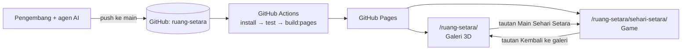
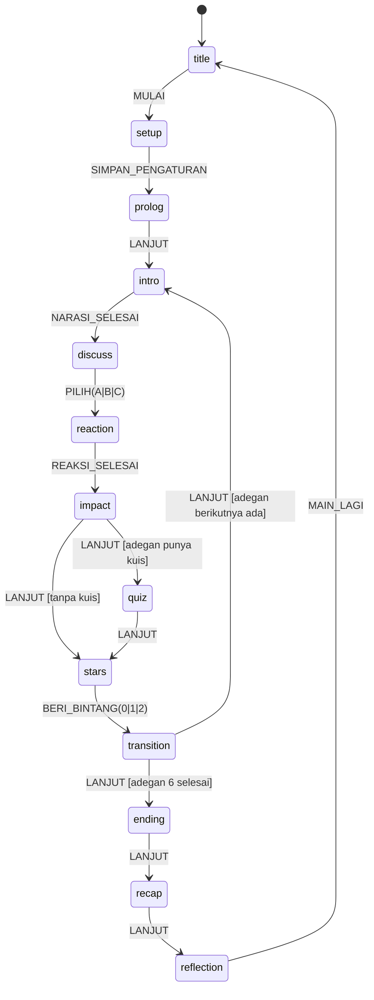

# Architecture — Sehari Setara

| | |
|---|---|
| Versi | 0.6 (draf) |
| Tanggal | 22 Oktober 2026 |
| Repositori | `ruang-setara` (akun GitHub Y4N-D), diterbitkan lewat GitHub Pages |
| Perubahan 0.2 | Aset digambar dengan kode (A8, bagian 8); `pixelize.py` diganti kit `scripts/game/art/`; rumus posisi sprite disesuaikan |
| Perubahan 0.3 | Keputusan A9 (`vitest`); `quizAnswer` di `GameState`; `LANJUT` keluar dari fase `transition`; `history` sebagai sumber kebenaran (F-02) |
| Perubahan 0.4 | Verifikasi rujukan dicatat di `Verifikasi_Rujukan.md`, sehingga `Reference` menjadi `{ id, text }`; `references.ts`; `CharId` ditambah `siswa` dan `warga`; `RoleInfo` (F-03) |
| Perubahan 0.5 | `manifest.ts` dengan kunci nama berkas, `spriteFor`, dan `sceneAssets`; aset game selalu menjadi berkas terpisah (`assetsInlineLimit`); `png.d.ts`; `ikon.py` di kit gambar; uji aset `assets.test.ts` (F-12) |
| Perubahan 0.6 | Keputusan A10 (Playwright) dan A11 (huruf `@fontsource`); tata letak layar, bayangan kaki, ikon emosi, vinyet, busur hari, dan pratinjau panggung (bagian 7); `head` dan `floorShadows` di manifest; pramuat di `ui/preload.ts` (F-04) |
| Dokumen terkait | `PRD.md`, `Design_System.md`, `AGENTS.md`, `Daftar_Aset.md` |

---

## 1. Keputusan utama

| # | Keputusan | Alasan |
|---|---|---|
| A1 | Game menjadi **halaman terpisah** `sehari-setara/` di dalam build GitHub Pages yang sama | Kode galeri (`app/page.tsx`) menganggap jumlah galeri tetap enam di banyak tempat. Halaman terpisah tidak mengganggu galeri, punya bundel sendiri, dan cukup ditautkan. **Sudah diuji:** halaman di `/ruang-setara/sehari-setara/` memuat aset tanpa 404 |
| A2 | **React + TypeScript + CSS (DOM)**, tanpa mesin game atau kanvas | Objek bergerak sedikit; teks HTML tetap tajam dan dapat diakses pembaca layar; tidak perlu dependensi besar baru |
| A3 | **Mesin status eksplisit dengan reducer murni** (`useReducer`) | Alur permainan mudah diuji tanpa browser dan dapat diprediksi |
| A4 | **Konten sebagai data bertipe**, divalidasi dengan `zod` (sudah ada di proyek) | Naskah bisa direvisi tanpa menyentuh logika; kesalahan data tertangkap oleh tes |
| A5 | **Aset diimpor sebagai modul ES**, tidak ditaruh di `public/` | Vite menghasilkan URL relatif yang benar di subfolder GitHub Pages dan memberi nama berhash untuk cache |
| A6 | Reaksi tokoh berupa **animasi sprite** (strip PNG + CSS `steps()`), bukan video | Jauh lebih ringan, sesuai gaya retro, mudah direvisi (lihat PRD bagian 9) |
| A7 | **Tanpa server dan tanpa penyimpanan data siswa** | Hosting statis; privasi siswa di bawah umur |
| A8 | **Aset digambar dengan kode** (Python + Pillow) di `scripts/game/art/`; PNG hasilnya di-*commit* | Gaya dan tokoh konsisten, warna pasti sesuai palet, revisi cukup mengubah kode. Build web tidak membutuhkan Python karena PNG sudah tersedia |
| A9 | **Vitest** untuk uji unit dan uji konten, dengan konfigurasi terpisah `vitest.config.ts` | Cepat dan memakai Vite yang sudah ada; konfigurasi terpisah mencegah vitest memuat `vite.config.ts` milik Vinext. Disetujui pemilik proyek 21 Okt 2026 (F-02) |
| A10 | **`@playwright/test` 1.56.1** untuk uji ujung ke ujung (`test:e2e`), hanya di lingkungan agen | Versi ini cocok dengan Chromium 141 yang tersedia di lingkungan agen. Uji tidak dijalankan di CI (bagian 4) dan tidak perlu dijalankan pemilik proyek. Disetujui 21 Okt 2026 (F-04) |
| A11 | **Huruf dari `@fontsource/press-start-2p` dan `@fontsource/pixelify-sans` 5.3.0**, hanya subset latin berbobot 400 | Huruf ikut terbit dari situs sendiri tanpa layanan luar; berkasnya kecil (woff2 7,7 KB dan 12,5 KB). Disetujui 21 Okt 2026 (F-04) |

## 2. Konteks sistem



## 3. Struktur folder

```
ruang-setara/
├─ AGENTS.md
├─ docs/sehari-setara/
│  ├─ PRD.md · Design_System.md · Architecture.md
│  ├─ Daftar_Aset.md             # status setiap aset gambar
│  ├─ Verifikasi_Rujukan.md      # daftar centang verifikasi rujukan (diisi manusia)
│  ├─ preview/                   # pratinjau aset (adegan x4, lembar pose x6)
│  ├─ PLAN.md                    # backlog dan status (dikelola alur Plan)
│  ├─ specs/F-xx-nama.md         # spesifikasi per fitur
│  └─ tests/F-xx-hasil.md        # laporan uji per fitur
├─ github-pages/
│  ├─ index.html · main.tsx      # galeri (sudah ada)
│  └─ sehari-setara/
│     ├─ index.html              # halaman game
│     └─ main.tsx                # titik masuk game
├─ app/sehari-setara/
│  ├─ Game.tsx                   # komponen akar
│  ├─ engine/
│  │  ├─ types.ts                # tipe data dan status
│  │  ├─ reducer.ts              # transisi status (murni)
│  │  ├─ rules.ts                # clamp, efek, akhir, giliran
│  │  └─ useTimer.ts             # pengatur waktu diskusi
│  ├─ content/
│  │  ├─ schema.ts               # skema zod
│  │  ├─ scenes.ts               # enam adegan
│  │  ├─ references.ts           # rujukan R-01 dst. (status verifikasi di Verifikasi_Rujukan.md)
│  │  ├─ endings.ts · roles.ts · copy.ts
│  ├─ ui/
│  │  ├─ Stage.tsx · Sprite.tsx · DayArc.tsx · Meters.tsx
│  │  ├─ layout.ts · preload.ts · StagePreview.tsx   # F-04 (pratinjau sementara)
│  │  ├─ NarrationBox.tsx · ChoicePanel.tsx · ImpactCard.tsx
│  │  ├─ Timer.tsx · Teams.tsx · StarsAward.tsx · RoleQuiz.tsx
│  │  ├─ Ending.tsx · Recap.tsx · Reflection.tsx
│  │  └─ Title.tsx · Setup.tsx · Settings.tsx
│  ├─ assets/
│  │  ├─ manifest.ts             # satu-satunya pintu masuk aset
│  │  ├─ png.d.ts                # tipe impor *.png untuk TypeScript
│  │  ├─ CREDITS.md              # asal-usul setiap aset
│  │  ├─ bg/ · sprites/ · ui/ · end/ · sfx/   # PNG hasil build_assets.py
│  ├─ styles/game.css            # token, bingkai piksel, garis pindai
│  └─ __tests__/                 # uji unit, konten, dan aset
├─ scripts/game/
│  ├─ art/                       # kit gambar piksel (sumber utama aset)
│  │  ├─ palette.json            # 36 warna resmi (sumber tunggal)
│  │  ├─ pixelart.py · tokoh.py · latar.py · ikon.py
│  │  └─ build_assets.py         # ekspor PNG + pratinjau + pemeriksaan
│  └─ serve-subpath.mjs          # server uji di /ruang-setara/
├─ e2e/sehari-setara.spec.ts     # uji Playwright
└─ playwright.config.ts          # webServer: build:pages lalu serve-subpath.mjs
```

Semua kelas CSS game memakai awalan `ss-`.

## 4. Build dan konfigurasi

### `vite.pages.config.ts`

Tambahkan halaman kedua sebagai *input* build (sudah diuji pada Vite 8 proyek ini):

```ts
build: {
  rollupOptions: {
    input: {
      main: root + "github-pages/index.html",
      game: root + "github-pages/sehari-setara/index.html",
    },
  },
  outDir: "../dist-pages",
  emptyOutDir: true,
},
```

Hasil build: `dist-pages/index.html` (galeri) dan `dist-pages/sehari-setara/index.html` (game), keduanya memakai folder `dist-pages/assets/` bersama.

### Skrip `package.json` (tambahan)

| Skrip | Perintah | Kegunaan |
|---|---|---|
| `dev:pages` | `vite --config vite.pages.config.ts` | Server pengembangan untuk galeri dan game. Buka `/sehari-setara/` |
| `test` | `vitest run` | Uji unit mesin dan uji konten |
| `content:check` | `vitest run app/sehari-setara/__tests__/content.test.ts` | Validasi naskah dan status verifikasi rujukan |
| `test:e2e` | `playwright test` | Uji ujung ke ujung di subfolder |
| `assets:build` | `python scripts/game/art/build_assets.py` | Membangun ulang semua aset gambar dari kode dan memeriksanya |

Catatan: `pnpm dev` bawaan (Vinext) **tidak** menyajikan halaman game. Gunakan `dev:pages`.

Dependensi pengembangan baru: `vitest`, `@playwright/test`. Dependensi aplikasi baru: `@fontsource/pixelify-sans`, `@fontsource/press-start-2p`. Untuk membangun aset: Python 3 dan Pillow (`pip install pillow`), hanya di komputer pengembang; CI tidak memerlukannya.

### GitHub Actions

Tambahkan langkah uji sebelum build di `.github/workflows/deploy-pages.yml`:

```yaml
- name: Uji game
  run: npx -y pnpm@11.25.0 test
```

Uji Playwright dijalankan di komputer pengembang sebelum rilis, tidak di CI, agar alur terbit tetap cepat.

## 5. Model data

```ts
// app/sehari-setara/engine/types.ts
export type TimeOfDay = "pagi" | "siang" | "sore" | "malam";
export type Tier = "tepat" | "kurang" | "berisiko";
export type ChoiceId = "A" | "B" | "C";
export type Flag = "komangDibela";
export type CharId = "nara" | "ibu" | "gita" | "dimas" | "sinta" | "ratih" | "komang" | "made" | "bayu" | "siswa" | "warga";
export type PoseId = "idle" | "talk" | "happy" | "sad" | string; // pose khusus didaftarkan di manifest
export type RoleId = "polisi" | "jaksa" | "advokat" | "hakim";

export interface CastSlot { char: CharId; pose: PoseId; x: number; facing: "left" | "right" }
export interface Reference { id: string; text: string }   // status verifikasi di Verifikasi_Rujukan.md
export interface RoleInfo { id: RoleId; label: string; tugas: string }

export interface Choice {
  id: ChoiceId;
  text: string;
  textIfFlag?: { flag: Flag; text: string };   // varian teks (akibat berantai)
  effects: { hak: number; kewajiban: number }; // bilangan kelipatan 5, −20…+20
  tier: Tier;
  setsFlag?: Flag;
  reaction: CastSlot[];                        // pose tokoh setelah memilih
  emote?: { char: CharId; icon: "hati" | "keringat" | "tanya" | "seru" };
  impact: { terjadi: string; hak: string; kewajiban: string; rujukan: Reference[] };
}

export interface Scene {
  id: "s1" | "s2" | "s3" | "s4" | "s5" | "s6";
  title: string;            // "Pagi di rumah"
  clock: string;            // "06.15"
  timeOfDay: TimeOfDay;
  bg: string;               // kunci di manifest
  altText: string;          // deskripsi adegan untuk pembaca layar
  cast: CastSlot[];
  narration: string[];      // maks. 3 kalimat per layar
  narrationIfFlag?: { flag: Flag; present: string[]; absent: string[] };
  question: string;
  choices: [Choice, Choice, Choice];
  roleQuiz?: { question: string; answer: RoleId };
}

export type Phase =
  | "title" | "setup" | "prolog"
  | "intro" | "discuss" | "reaction" | "impact" | "quiz" | "stars" | "transition"
  | "ending" | "recap" | "reflection";

export interface Team { id: string; name: string; color: string; shape: "lingkaran" | "segitiga" | "persegi" | "bintang"; stars: number }

export interface GameState {
  phase: Phase;
  sceneIndex: number;                       // 0–5
  meters: { hak: number; kewajiban: number }; // 0–100, awal 50
  flags: Flag[];
  teams: Team[];
  history: { sceneId: Scene["id"]; choiceId: ChoiceId; teamId: string; stars: 0 | 1 | 2 }[];
  timer: { duration: number; remaining: number; running: boolean };
  settings: { sound: boolean; reducedMotion: boolean; typewriter: boolean; discussSeconds: 30 | 60 | 90 };
  quizAnswer: RoleId | null;                // jawaban kuis peran adegan berjalan; null sebelum dijawab
}
```

Aturan skema (`content/schema.ts`), dicek oleh `content:check`:

- Tepat enam adegan dengan `id` unik, urutan jam naik.
- Setiap adegan punya tepat tiga pilihan A, B, C dan minimal satu pilihan bertingkat `tepat`.
- Efek kelipatan 5 dalam rentang −20…+20.
- Setiap `impact.rujukan` tidak kosong.
- Narasi per layar ≤ 3 kalimat; teks pilihan ≤ 140 karakter.
- Setiap bendera yang dibaca (`textIfFlag`, `narrationIfFlag`) pernah disetel oleh pilihan di adegan sebelumnya.
- Setiap berkas latar, sprite, dan ikon emosi yang dirujuk naskah ada di `app/sehari-setara/assets/`, dan naskah sama dengan PRD bagian 8.
- Laporan berisi daftar rujukan yang belum dicentang di `docs/sehari-setara/Verifikasi_Rujukan.md`. **Rilis diblokir** bila masih ada (pemeriksaan ketat `RILIS=1`).

## 6. Mesin permainan



**Aksi tambahan:** `TICK`, `JEDA_WAKTU`, `TAMBAH_30`, `LEWATI_DISKUSI`, `JAWAB_KUIS(role)`, `ULANGI_ADEGAN` (P1), `KEMBALI` (P1), `UBAH_PENGATURAN`.

**Aturan di `engine/rules.ts`** (fungsi murni, diuji unit):

```ts
export const clamp = (v: number) => Math.max(0, Math.min(100, v));

export const activeTeamIndex = (sceneIndex: number, teamCount: number) =>
  sceneIndex % teamCount;

export function endingFor(m: { hak: number; kewajiban: number }) {
  if (m.hak >= 75 && m.kewajiban >= 75) return "setara";
  if (m.hak < 40 || m.kewajiban < 40) return "berat";
  return "hampir";
}
```

- Saat `PILIH`: terapkan efek dengan `clamp`, tambahkan bendera bila ada, catat ke `history`.
- Pilihan hanya bisa diambil sekali per adegan; tombol dikunci selama `reaction`, `impact`, dan `transition` untuk mencegah klik ganda.
- Pengatur waktu hanya berjalan pada fase `discuss`. `useTimer` mengirim `TICK` setiap detik; reducer tidak memakai `setInterval`.
- Saat waktu habis, fase tetap `discuss`; antarmuka menampilkan "Waktunya memilih".
- `LANJUT` di fase `quiz` hanya diterima setelah `JAWAB_KUIS`. Jawaban pertama disimpan di `quizAnswer` dan dikosongkan saat adegan berikutnya dimulai.
- `history` adalah sumber kebenaran. `meters`, `flags`, dan bintang tim dihitung ulang dari `history` setiap kali isinya berubah, sehingga pembatalan pilihan (FR-18, F-13) cukup memotong `history` lalu menghitung ulang.

## 7. Rendering

### Panggung

- `Stage` membuat kotak logis 320×180 lalu memperbesarnya dengan `transform: scale(k)`.
- Rumus skala:

```ts
function stageScale(availW: number, availH: number) {
  const fit = Math.min(availW / 320, availH / 180);
  const whole = Math.floor(fit);
  return whole >= 1 && whole / fit >= 0.75 ? whole : fit; // bulat bila sisa ruang < 25%
}
```

- Semua posisi di dalam panggung memakai bilangan bulat piksel logis.
- `image-rendering: pixelated` untuk semua gambar.

### Sprite

Setiap animasi berupa strip horizontal dengan lebar bingkai seragam. Baris terbawah bingkai (garis luar di bawah sepatu) berada tepat di garis lantai y = 156, sehingga `top = 157 − tinggi bingkai`. Rumus ini sama dengan `place()` di kit gambar.

```tsx
<div
  className="ss-sprite"
  style={{
    width: frame.w, height: frame.h,
    left: slot.x - Math.floor(frame.w / 2), top: 157 - frame.h,
    backgroundImage: `url(${frame.src})`,
    transform: slot.facing === "left" ? "scaleX(-1)" : undefined,
    animation: reduced ? "none" : `ss-strip ${frame.frames / frame.fps}s steps(${frame.frames}) infinite`,
    ["--ss-strip-end" as string]: `-${frame.w * frame.frames}px`,
  }}
/>
```

```css
@keyframes ss-strip { to { background-position-x: var(--ss-strip-end); } }
```

### Garis pindai

Diletakkan pada pembungkus panggung yang **tidak** ikut diskalakan, supaya garisnya setebal piksel layar:

```css
.ss-stage-frame::after {
  content: ""; position: absolute; inset: 0; pointer-events: none;
  background: repeating-linear-gradient(to bottom,
    transparent 0 2px, rgb(31 42 68 / 0.10) 2px 3px);
}
```

### Antarmuka

Bilah atas, panel samping, dan panel bawah adalah HTML biasa di luar panggung, dengan ukuran huruf berbasis `--u` (lihat Design System bagian 5). Teks tidak pernah digambar ke dalam gambar.

### Tata letak, lapisan, dan efek (F-04)

- **Tata letak:** layar 16:9 dibagi menjadi bilah atas 8u, area panggung 62u, dan panel bawah 30u. Panel samping (minimal 30u) disediakan untuk F-06 dan F-07. Skala k = `stageScale((177,78 − 60)u, 62u)`, sehingga k hanya bergantung pada tinggi layar: 2 pada 720p dan 768p, 3 pada 1080p, dan 1,984 pada 1024×768 (`ui/layout.ts`).
- **Lapisan:** latar z 0; bayangan kaki dan tokoh z 20 (semua bayangan sebelum semua tokoh); ikon emosi z 30; vinyet dan garis pindai z 40.
- **Bayangan kaki:** kotak `(w − 6)` × 2 piksel di y 155, berwarna menurut `floorShadows` di manifest, sama dengan pratinjau adegan yang disetujui.
- **Ikon emosi:** 8×8, dua piksel di atas titik kepala strip (`head` di manifest, dicerminkan bila tokoh menghadap kiri).
- **Vinyet:** dua cincin keras 2 dan 4 piksel logis di dalam panggung, masing-masing `ink` 6 %.
- **Busur hari:** gambar logis 136×22 berskala k di bilah atas. Warna bilah mengikuti waktu adegan, dan ikon matahari atau bulan menandai titik berjalan (Design System bagian 7).
- **Pratinjau panggung:** `#adegan-N` dan `#adegan-N-a|b|c` di halaman game menampilkan panggung tanpa mesin permainan, sampai alur permainan dibuat (spesifikasi F-04).

## 8. Manajemen aset

### Manifest

`assets/manifest.ts` adalah satu-satunya tempat aset diimpor. Komponen hanya memakai kunci.

```ts
import bgS1RumahPagi from "./bg/bg_s1_rumah_pagi.png";
import charNaraIdle from "./sprites/char_nara_idle.png";

export const backgrounds = { bg_s1_rumah_pagi: bgS1RumahPagi /* … */ } as const;

export const sprites = {
  nara: { idle: { src: charNaraIdle, frames: 2, fps: 2, w: 26, h: 62 } /* … */ },
} as const;
```

- **Kelompok:** `backgrounds`, `endings` (per `EndingId`), `sprites`, `icons`, `iconStrips` (bintang dan timbangan), `teamIcons`, `roleIcons`, dan `emoteIcons`. Isi lengkapnya ada di `specs/F-12-integrasi-aset.md`.
- **Kunci** mengikuti cara naskah menyebut aset. Latar memakai nama berkas utuh, sama dengan `Scene.bg` (`bg_s1_rumah_pagi`). Kelompok lain memakai bagian `{nama}` dari pola penamaan di bawah, misalnya `roleIcons.hakim` untuk `role_hakim.png`.
- **Fungsi:** `spriteFor(char, pose)` mencari strip tanpa membaca properti bawaan objek. `sceneAssets(scene)` mendaftar aset panggung satu adegan tanpa duplikat, untuk uji dan pramuat.
- Impor `*.png` dikenali TypeScript lewat `assets/png.d.ts`.

### Penamaan file

| Jenis | Pola | Contoh |
|---|---|---|
| Latar | `bg_s{n}_{tempat}_{waktu}.png` | `bg_s5_kampung_sore.png` |
| Sprite | `char_{tokoh}_{pose}.png` | `char_komang_sad.png` |
| Ikon | `ui_{nama}.png` | `ui_star.png` |
| Akhir | `end_{jenis}.png` | `end_setara.png` |
| Suara | `sfx_{peristiwa}.mp3` | `sfx_confirm.mp3` |

### Anggaran dan format

| Item | Anggaran |
|---|---|
| Satu latar 320×180 (PNG terindeks) | ≤ 40 KB |
| Satu strip sprite | ≤ 15 KB |
| Seluruh aset game | ≤ 4 MB |
| Kode game (gzip) | ≤ 150 KB |

- Gambar: PNG, hanya warna dari palet 36 warna, tanpa piksel semi-transparan (dicek otomatis oleh `build_assets.py`).
- **Berkas, bukan data URI:** aset game selalu dikeluarkan sebagai berkas berhash di `dist-pages/assets/`. `build.assetsInlineLimit` di `vite.pages.config.ts` mengembalikan `false` untuk berkas di `app/sehari-setara/assets/` (F-12). Tanpa aturan ini, Vite menyelipkan gambar di bawah 4 KB ke JS sebagai data URI, sehingga gambar ikut menghabiskan anggaran kode 150 KB.
- Suara: MP3 mono, ≤ 30 KB per efek; dimuat setelah interaksi pertama.
- Huruf: impor `latin-400.css` dari paket `@fontsource` di `main.tsx` (A11).
- **Pramuat:** saat adegan *n* tampil, aset adegan *n+1* dimuat dan di-*decode* (`img.decode()`) di latar belakang. Fungsinya `preloadScene` di `ui/preload.ts`, memakai `sceneAssets` dari manifest (F-04).
- **Tambahan manifest (F-04):** setiap strip tokoh punya `head` (titik kepala untuk ikon emosi), setiap latar punya warna bayangan kaki di `floorShadows`, dan `backgroundFor` serta `shadowFor` mencari dengan aman. Uji aset mengukur ulang titik kepala dari PNG.

### Kit gambar (`scripts/game/art/`)

Aset tidak dibuat dengan editor gambar, melainkan **digambar oleh kode**. Kit terdiri atas `palette.json`, `pixelart.py`, `tokoh.py`, `latar.py`, `ikon.py` (ikon antarmuka, ikon peran, ikon emosi, dan timbangan), dan `build_assets.py`. Rincian aturan menggambar ada di `Design_System.md` bagian 12.

```
python scripts/game/art/build_assets.py                 # bangun semua aset + pratinjau
python scripts/game/art/build_assets.py --only char_nara_idle pose_nara
```

Yang dilakukan skrip:

1. Menjalankan setiap fungsi di daftar `ASSETS` dan menyimpan PNG ukuran asli ke `app/sehari-setara/assets/{bg,sprites,ui,end}/`.
2. Membuat pratinjau di `docs/sehari-setara/preview/`: komposisi adegan ×4 dengan garis pindai, dan lembar pose ×6.
3. Memeriksa setiap aset: warna di luar palet, piksel semi-transparan, ukuran latar 320×180, dan total ukuran terhadap anggaran 4 MB.
4. Keluar dengan kode galat bila ada masalah, sehingga bisa dipakai di uji otomatis.

Setelah mengubah kode gambar, jalankan skrip ini lalu *commit* kode dan PNG hasilnya bersama-sama. PNG tidak boleh disunting manual.

Fps animasi diatur di `manifest.ts`: diam dan bicara 2–4 fps, berjalan 6–8 fps.

## 9. Kontrol

| Tombol | Fungsi |
|---|---|
| `1` `2` `3` atau `A` `B` `C` | Memilih (fase diskusi) |
| `Spasi` / `Enter` | Lanjut; menampilkan seluruh teks narasi |
| `P` | Jeda atau lanjutkan pengatur waktu |
| `T` | Tambah 30 detik |
| `S` | Lewati diskusi |
| `0` `1` `2` | Memberi bintang alasan (fase bintang) |
| `F` | Layar penuh |
| `M` | Suara aktif/nonaktif |
| `Esc` | Buka pengaturan |

Semua tombol juga bisa diklik atau disentuh. Fokus keyboard selalu terlihat (latar `sun` dan kursor ▶).

## 10. Aksesibilitas

- Narasi dan isi kartu dampak diumumkan melalui wilayah `aria-live="polite"`.
- Kartu dampak, pengaturan, dan kuis memakai `role="dialog"` dengan fokus terkunci di dalamnya; fokus kembali ke tombol pemicu setelah ditutup.
- Setiap adegan punya `altText` yang menggambarkan situasi tanpa bergantung pada gambar.
- Tingkat dampak dan tim selalu ditandai dengan ikon dan teks, tidak hanya warna.
- `prefers-reduced-motion` dan pengaturan "Kurangi gerak" mematikan sapuan, angka melayang, dan animasi sprite.
- `<html lang="id">`.

## 11. Integrasi dengan galeri Ruang Setara

Perubahan pada kode galeri dibatasi pada dua titik:

1. Tombol "Main Sehari Setara" di panel galeri Refleksi.
2. Satu baris di menu Daftar materi.

Keduanya berupa tautan biasa `href="sehari-setara/"` (relatif, tanpa garis miring di depan). Di dalam game, tombol "Kembali ke galeri" memakai `href="../"`.

## 12. Pengujian

| Lapisan | Alat | Cakupan |
|---|---|---|
| Unit | Vitest | `rules.ts` (clamp, giliran, ambang akhir), reducer (setiap transisi, kunci klik ganda, bendera) |
| Konten | Vitest + zod | Semua aturan skema di bagian 5; daftar rujukan belum terverifikasi |
| Aset | `build_assets.py` + Vitest (`assets.test.ts`) | `build_assets.py`: palet per piksel, transparansi, ukuran, dan anggaran total. Vitest: token dan warna `game.css` sesuai Design System bagian 4 dan `palette.json`; manifest cocok dengan berkas (nama, ukuran bingkai, fps), `CREDITS.md`, dan naskah; anggaran per aset dan total; aset game sebagai berkas terpisah. Berkas yang belum terdaftar hanya dilaporkan |
| Ujung ke ujung | Playwright (A10) | Main penuh dengan keyboard di `/ruang-setara/sehari-setara/`; ketiga jenis akhir bisa dicapai; tidak ada respons 4xx; tidak ada galat konsol; tangkapan layar setiap adegan di 1280×720 dan 1024×768. Sejak F-04: layar kerangka, ke-24 alamat pratinjau (posisi tokoh, bayangan, ikon emosi, bilah atas), skala di empat ukuran, kurangi gerak, pramuat, keyboard, huruf, dan galeri |
| Manual | Daftar periksa | Proyektor dan keterbacaan dari bangku belakang; laptop lama; keyboard saja; kurangi gerak; suara mati |

`scripts/game/serve-subpath.mjs` menyajikan `dist-pages/` di bawah `/ruang-setara/` agar uji Playwright meniru alamat GitHub Pages yang sebenarnya. Konfigurasi `webServer` Playwright menjalankan `build:pages` lalu skrip ini.

## 13. Keamanan dan privasi

- Tidak ada permintaan jaringan selain memuat file situs sendiri. Tidak ada CDN, analitik, atau iklan.
- Tidak ada penyimpanan nama siswa. Nama tim dipilih dari daftar bawaan.
- Status permainan hanya di memori. (Opsional P1: `sessionStorage` untuk melanjutkan bila halaman tidak sengaja dimuat ulang; tanpa data pribadi.)

## 14. Konvensi kode

- TypeScript mode ketat; komponen fungsi; tanpa `any`.
- Logika permainan hanya di `engine/`; komponen `ui/` tidak mengubah status secara langsung, melainkan mengirim aksi.
- Teks yang tampil ke pengguna berasal dari `content/`, bukan ditulis langsung di komponen.
- Tidak ada path aset absolut (`/game/...`). Semua aset melalui `manifest.ts`.
- Dependensi baru memerlukan persetujuan pemilik proyek dan dicatat sebagai keputusan baru di bagian 1.
