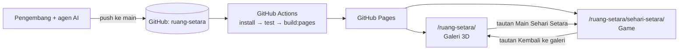
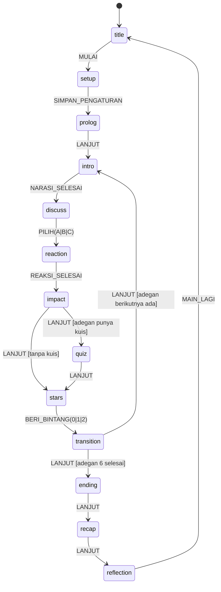

# Architecture — Sehari Setara

| | |
|---|---|
| Versi | 0.11 (draf) |
| Tanggal | 27 Oktober 2026 |
| Repositori | `ruang-setara` (akun GitHub Y4N-D), diterbitkan lewat GitHub Pages |
| Perubahan 0.2 | Aset digambar dengan kode (A8, bagian 8); `pixelize.py` diganti kit `scripts/game/art/`; rumus posisi sprite disesuaikan |
| Perubahan 0.3 | Keputusan A9 (`vitest`); `quizAnswer` di `GameState`; `LANJUT` keluar dari fase `transition`; `history` sebagai sumber kebenaran (F-02) |
| Perubahan 0.4 | Verifikasi rujukan dicatat di `Verifikasi_Rujukan.md`, sehingga `Reference` menjadi `{ id, text }`; `references.ts`; `CharId` ditambah `siswa` dan `warga`; `RoleInfo` (F-03) |
| Perubahan 0.5 | `manifest.ts` dengan kunci nama berkas, `spriteFor`, dan `sceneAssets`; aset game selalu menjadi berkas terpisah (`assetsInlineLimit`); `png.d.ts`; `ikon.py` di kit gambar; uji aset `assets.test.ts` (F-12) |
| Perubahan 0.6 | Keputusan A10 (Playwright) dan A11 (huruf `@fontsource`); tata letak layar, bayangan kaki, ikon emosi, vinyet, busur hari, dan pratinjau panggung (bagian 7); `head` dan `floorShadows` di manifest; pramuat di `ui/preload.ts` (F-04) |
| Perubahan 0.7 | Layar permainan `#main`, tata letak 8u/52u/40u, satu piksel antarmuka (`uiPixel`), sapuan, dan jembatan sementara (bagian 7); berkas layar permainan dan `content/teams.ts` (bagian 3); tombol yang sudah aktif (bagian 9); uji alur permainan (bagian 12) (F-05) |
| Perubahan 0.8 | Panel indikator, kartu dampak, nilai sebelum memilih, dan jembatan yang kini hanya melewati kuis dan bintang (bagian 7); `ui/impact.ts` (bagian 3); `Spasi` dan `Enter` di kartu dampak (bagian 9); fokus dan pengumuman kartu dampak (bagian 10); uji kartu dampak (bagian 12) (F-06) |
| Perubahan 0.9 | `useTimer.ts` pindah ke `ui/`; `turn.ts`, `sound.ts`, `wav.d.ts`, dan folder `sfx/` berisi WAV (bagian 3); `useTimer` menghitung detik dengan `performance.now()` (bagian 6); panel kanan, fase `stars`, jembatan yang kini hanya melewati kuis, panggung tersembunyi selama kartu, `#main-3` dan `#main-4`, serta bunyi (bagian 7); kelompok manifest `sounds`, pola `sfx_{peristiwa}.wav`, format WAV atau MP3 (bagian 8); `P` `T` `S`, `0` `1` `2`, dan `M` (bagian 9); wilayah pengumuman kedua, `role="timer"`, dan fokus di fase bintang (bagian 10); uji F-07 dengan perekam bunyi (bagian 12) (F-07) |
| Perubahan 0.10 | `RoleQuiz.tsx`, `quiz.ts`, dan `kuis-peran.spec.ts` (bagian 3); kuis peran menggantikan jembatan sementara, dan panel bawah hanya memakai `ChoicePanel` di fase `discuss`, `reaction`, dan `stars` (bagian 7); pramuat ikon kuis (bagian 8); `1` `2` `3` `4` di fase kuis dan tombol yang ditahan di dalam dialog kuis (bagian 9); fokus dan pengumuman kuis (bagian 10); uji kuis (bagian 12) (F-08) |
| Perubahan 0.11 | Keputusan A12 (`modern-screenshot` 4.7.0 untuk gambar rekap; PDF dari kode sendiri) (bagian 1); `closing.ts`, `RecapSheet.tsx`, `download.ts`, `pdf.ts`, dan `akhir-rekap-refleksi.spec.ts` (bagian 3); dependensi aplikasi `modern-screenshot` (bagian 4); `HistoryEntry.quizAnswer`, dan `JAWAB_KUIS` yang juga mencatat jawaban di `history` (bagian 5 dan 6); layar akhir, rekap, refleksi, dan unduh rekap menggantikan layar akhir sementara (bagian 7); pramuat ilustrasi akhir dan timbangan (bagian 8); `Spasi`, `Enter`, dan `M` di layar penutup, serta pembatalan tombol yang ditahan (bagian 9); fokus, pengumuman, wilayah pengumuman yang tetap, dan kabar unduhan (bagian 10); uji F-09 (bagian 12); unduhan tanpa data siswa dan tanpa permintaan ke luar situs (bagian 13) (F-09) |
| Dokumen terkait | `PRD.md`, `Design_System.md`, `AGENTS.md`, `Daftar_Aset.md` |

---

## 1. Keputusan utama

| # | Keputusan | Alasan |
|---|---|---|
| A1 | Game menjadi **halaman terpisah** `sehari-setara/` di dalam build GitHub Pages yang sama | Kode galeri (`app/page.tsx`) menganggap jumlah galeri tetap enam di banyak tempat. Halaman terpisah tidak mengganggu galeri, punya bundel sendiri, dan cukup ditautkan. **Sudah diuji:** halaman di `/ruang-setara/sehari-setara/` memuat aset tanpa 404 |
| A2 | **React + TypeScript + CSS (DOM)**, tanpa mesin game atau kanvas | Objek bergerak sedikit; teks HTML tetap tajam dan dapat diakses pembaca layar; tidak perlu dependensi besar baru |
| A3 | **Mesin status eksplisit dengan reducer murni** (`useReducer`) | Alur permainan mudah diuji tanpa browser dan dapat diprediksi |
| A4 | **Konten sebagai data bertipe**, divalidasi dengan `zod` (sudah ada di proyek) | Naskah bisa direvisi tanpa menyentuh logika; kesalahan data tertangkap oleh tes |
| A5 | **Aset diimpor sebagai modul ES**, tidak ditaruh di `public/` | Vite menghasilkan URL relatif yang benar di subfolder GitHub Pages dan memberi nama berhash untuk cache |
| A6 | Reaksi tokoh berupa **animasi sprite** (strip PNG + CSS `steps()`), bukan video | Jauh lebih ringan, sesuai gaya retro, mudah direvisi (lihat PRD bagian 9) |
| A7 | **Tanpa server dan tanpa penyimpanan data siswa** | Hosting statis; privasi siswa di bawah umur |
| A8 | **Aset digambar dengan kode** (Python + Pillow) di `scripts/game/art/`; PNG hasilnya di-*commit* | Gaya dan tokoh konsisten, warna pasti sesuai palet, revisi cukup mengubah kode. Build web tidak membutuhkan Python karena PNG sudah tersedia |
| A9 | **Vitest** untuk uji unit dan uji konten, dengan konfigurasi terpisah `vitest.config.ts` | Cepat dan memakai Vite yang sudah ada; konfigurasi terpisah mencegah vitest memuat `vite.config.ts` milik Vinext. Disetujui pemilik proyek 21 Okt 2026 (F-02) |
| A10 | **`@playwright/test` 1.56.1** untuk uji ujung ke ujung (`test:e2e`), hanya di lingkungan agen | Versi ini cocok dengan Chromium 141 yang tersedia di lingkungan agen. Uji tidak dijalankan di CI (bagian 4) dan tidak perlu dijalankan pemilik proyek. Disetujui 21 Okt 2026 (F-04) |
| A11 | **Huruf dari `@fontsource/press-start-2p` dan `@fontsource/pixelify-sans` 5.3.0**, hanya subset latin berbobot 400 | Huruf ikut terbit dari situs sendiri tanpa layanan luar; berkasnya kecil (woff2 7,7 KB dan 12,5 KB). Disetujui 21 Okt 2026 (F-04) |
| A12 | **`modern-screenshot` 4.7.0** menggambar lembar rekap menjadi PNG; PDF A4 dibuat kode sendiri (`ui/pdf.ts`), tanpa pustaka PDF | Hasilnya sama dengan tampilan layar, tambahannya 9,6 KB gzip, lisensinya MIT tanpa pustaka turunan, dan huruf serta ikon diambil dari situs sendiri. Pembanding: `html-to-image` memenggal baris berbeda dari layar, `html2canvas` mengaburkan ikon piksel, dan `jspdf` (134 KB gzip) melampaui anggaran kode. Disetujui 27 Okt 2026 (F-09) |

## 2. Konteks sistem



## 3. Struktur folder

```
ruang-setara/
├─ AGENTS.md
├─ docs/sehari-setara/
│  ├─ PRD.md · Design_System.md · Architecture.md
│  ├─ Daftar_Aset.md             # status setiap aset gambar
│  ├─ Verifikasi_Rujukan.md      # daftar centang verifikasi rujukan (diisi manusia)
│  ├─ preview/                   # pratinjau aset (adegan x4, lembar pose x6)
│  ├─ PLAN.md                    # backlog dan status (dikelola alur Plan)
│  ├─ specs/F-xx-nama.md         # spesifikasi per fitur
│  └─ tests/F-xx-hasil.md        # laporan uji per fitur
├─ github-pages/
│  ├─ index.html · main.tsx      # galeri (sudah ada)
│  └─ sehari-setara/
│     ├─ index.html              # halaman game
│     └─ main.tsx                # titik masuk game
├─ app/sehari-setara/
│  ├─ Game.tsx                   # komponen akar
│  ├─ engine/
│  │  ├─ types.ts                # tipe data dan status
│  │  ├─ reducer.ts              # transisi status (murni)
│  │  └─ rules.ts                # clamp, efek, akhir, giliran
│  ├─ content/
│  │  ├─ schema.ts               # skema zod
│  │  ├─ scenes.ts               # enam adegan
│  │  ├─ references.ts           # rujukan R-01 dst. (status verifikasi di Verifikasi_Rujukan.md)
│  │  ├─ endings.ts · roles.ts · copy.ts · teams.ts
│  ├─ ui/
│  │  ├─ Stage.tsx · Sprite.tsx · DayArc.tsx · Meters.tsx
│  │  ├─ layout.ts · preload.ts · hooks.ts · StagePreview.tsx   # F-04 (pratinjau, kini alat tinjau)
│  │  ├─ PlayScreen.tsx · controls.ts · SceneWipe.tsx           # F-05 (layar permainan #main sementara)
│  │  ├─ NarrationBox.tsx · ChoicePanel.tsx · ImpactCard.tsx · impact.ts  # impact.ts: hitungan indikator dan kartu (F-06)
│  │  ├─ Teams.tsx · Timer.tsx · StarsAward.tsx · useTimer.ts            # F-07: panel kanan; useTimer: pengatur waktu diskusi
│  │  ├─ turn.ts · sound.ts      # F-07: hitungan panel kanan; aturan bunyi dan pemutar Web Audio
│  │  ├─ RoleQuiz.tsx · quiz.ts  # F-08: dialog kuis peran; quiz.ts: kartu, umpan balik, dan pengumuman
│  │  ├─ Ending.tsx · Recap.tsx · Reflection.tsx · closing.ts   # F-09: layar penutup; closing.ts: timbangan, baris rekap, pengumuman
│  │  ├─ RecapSheet.tsx · download.ts · pdf.ts  # F-09: lembar unduhan, unduh PNG (A12), dan PDF A4 tanpa pustaka
│  │  └─ Title.tsx · Setup.tsx · Settings.tsx
│  ├─ assets/
│  │  ├─ manifest.ts             # satu-satunya pintu masuk aset
│  │  ├─ png.d.ts · wav.d.ts     # tipe impor *.png dan *.wav untuk TypeScript
│  │  ├─ CREDITS.md              # asal-usul setiap aset
│  │  ├─ bg/ · sprites/ · ui/ · end/   # PNG hasil build_assets.py
│  │  ├─ sfx/                    # efek suara WAV (F-07)
│  ├─ styles/game.css            # token, bingkai piksel, garis pindai
│  └─ __tests__/                 # uji unit, konten, dan aset
├─ scripts/game/
│  ├─ art/                       # kit gambar piksel (sumber utama aset)
│  │  ├─ palette.json            # 36 warna resmi (sumber tunggal)
│  │  ├─ pixelart.py · tokoh.py · latar.py · ikon.py
│  │  └─ build_assets.py         # ekspor PNG + pratinjau + pemeriksaan
│  └─ serve-subpath.mjs          # server uji di /ruang-setara/
├─ e2e/                         # uji Playwright: sehari-setara.spec.ts, alur-permainan.spec.ts, kartu-dampak.spec.ts,
│                               #   tim-waktu-bintang.spec.ts, suara.spec.ts, kuis-peran.spec.ts,
│                               #   akhir-rekap-refleksi.spec.ts, bantuan.ts
└─ playwright.config.ts          # webServer: build:pages lalu serve-subpath.mjs
```

Semua kelas CSS game memakai awalan `ss-`.

## 4. Build dan konfigurasi

### `vite.pages.config.ts`

Tambahkan halaman kedua sebagai *input* build (sudah diuji pada Vite 8 proyek ini):

```ts
build: {
  rollupOptions: {
    input: {
      main: root + "github-pages/index.html",
      game: root + "github-pages/sehari-setara/index.html",
    },
  },
  outDir: "../dist-pages",
  emptyOutDir: true,
},
```

Hasil build: `dist-pages/index.html` (galeri) dan `dist-pages/sehari-setara/index.html` (game), keduanya memakai folder `dist-pages/assets/` bersama.

### Skrip `package.json` (tambahan)

| Skrip | Perintah | Kegunaan |
|---|---|---|
| `dev:pages` | `vite --config vite.pages.config.ts` | Server pengembangan untuk galeri dan game. Buka `/sehari-setara/` |
| `test` | `vitest run` | Uji unit mesin dan uji konten |
| `content:check` | `vitest run app/sehari-setara/__tests__/content.test.ts` | Validasi naskah dan status verifikasi rujukan |
| `test:e2e` | `playwright test` | Uji ujung ke ujung di subfolder |
| `assets:build` | `python scripts/game/art/build_assets.py` | Membangun ulang semua aset gambar dari kode dan memeriksanya |

Catatan: `pnpm dev` bawaan (Vinext) **tidak** menyajikan halaman game. Gunakan `dev:pages`.

Dependensi pengembangan baru: `vitest`, `@playwright/test`. Dependensi aplikasi baru: `@fontsource/pixelify-sans`, `@fontsource/press-start-2p`, dan sejak F-09 `modern-screenshot` 4.7.0 (A12), yang hanya diimpor modul unduhan rekap game. Untuk membangun aset: Python 3 dan Pillow (`pip install pillow`), hanya di komputer pengembang; CI tidak memerlukannya.

### GitHub Actions

Tambahkan langkah uji sebelum build di `.github/workflows/deploy-pages.yml`:

```yaml
- name: Uji game
  run: npx -y pnpm@11.25.0 test
```

Uji Playwright dijalankan di komputer pengembang sebelum rilis, tidak di CI, agar alur terbit tetap cepat.

## 5. Model data

```ts
// app/sehari-setara/engine/types.ts
export type TimeOfDay = "pagi" | "siang" | "sore" | "malam";
export type Tier = "tepat" | "kurang" | "berisiko";
export type ChoiceId = "A" | "B" | "C";
export type Flag = "komangDibela";
export type CharId = "nara" | "ibu" | "gita" | "dimas" | "sinta" | "ratih" | "komang" | "made" | "bayu" | "siswa" | "warga";
export type PoseId = "idle" | "talk" | "happy" | "sad" | string; // pose khusus didaftarkan di manifest
export type RoleId = "polisi" | "jaksa" | "advokat" | "hakim";

export interface CastSlot { char: CharId; pose: PoseId; x: number; facing: "left" | "right" }
export interface Reference { id: string; text: string }   // status verifikasi di Verifikasi_Rujukan.md
export interface RoleInfo { id: RoleId; label: string; tugas: string }

export interface Choice {
  id: ChoiceId;
  text: string;
  textIfFlag?: { flag: Flag; text: string };   // varian teks (akibat berantai)
  effects: { hak: number; kewajiban: number }; // bilangan kelipatan 5, −20…+20
  tier: Tier;
  setsFlag?: Flag;
  reaction: CastSlot[];                        // pose tokoh setelah memilih
  emote?: { char: CharId; icon: "hati" | "keringat" | "tanya" | "seru" };
  impact: { terjadi: string; hak: string; kewajiban: string; rujukan: Reference[] };
}

export interface Scene {
  id: "s1" | "s2" | "s3" | "s4" | "s5" | "s6";
  title: string;            // "Pagi di rumah"
  clock: string;            // "06.15"
  timeOfDay: TimeOfDay;
  bg: string;               // kunci di manifest
  altText: string;          // deskripsi adegan untuk pembaca layar
  cast: CastSlot[];
  narration: string[];      // maks. 3 kalimat per layar
  narrationIfFlag?: { flag: Flag; present: string[]; absent: string[] };
  question: string;
  choices: [Choice, Choice, Choice];
  roleQuiz?: { question: string; answer: RoleId };
}

export type Phase =
  | "title" | "setup" | "prolog"
  | "intro" | "discuss" | "reaction" | "impact" | "quiz" | "stars" | "transition"
  | "ending" | "recap" | "reflection";

export interface Team { id: string; name: string; color: string; shape: "lingkaran" | "segitiga" | "persegi" | "bintang"; stars: number }

export interface GameState {
  phase: Phase;
  sceneIndex: number;                       // 0–5
  meters: { hak: number; kewajiban: number }; // 0–100, awal 50
  flags: Flag[];
  teams: Team[];
  history: { sceneId: Scene["id"]; choiceId: ChoiceId; teamId: string; stars: 0 | 1 | 2; quizAnswer?: RoleId }[]; // quizAnswer: jawaban kuis adegan itu (F-09)
  timer: { duration: number; remaining: number; running: boolean };
  settings: { sound: boolean; reducedMotion: boolean; typewriter: boolean; discussSeconds: 30 | 60 | 90 };
  quizAnswer: RoleId | null;                // jawaban kuis peran adegan berjalan; null sebelum dijawab
}
```

Aturan skema (`content/schema.ts`), dicek oleh `content:check`:

- Tepat enam adegan dengan `id` unik, urutan jam naik.
- Setiap adegan punya tepat tiga pilihan A, B, C dan minimal satu pilihan bertingkat `tepat`.
- Efek kelipatan 5 dalam rentang −20…+20.
- Setiap `impact.rujukan` tidak kosong.
- Narasi per layar ≤ 3 kalimat; teks pilihan ≤ 140 karakter.
- Setiap bendera yang dibaca (`textIfFlag`, `narrationIfFlag`) pernah disetel oleh pilihan di adegan sebelumnya.
- Setiap berkas latar, sprite, dan ikon emosi yang dirujuk naskah ada di `app/sehari-setara/assets/`, dan naskah sama dengan PRD bagian 8.
- Laporan berisi daftar rujukan yang belum dicentang di `docs/sehari-setara/Verifikasi_Rujukan.md`. **Rilis diblokir** bila masih ada (pemeriksaan ketat `RILIS=1`).

## 6. Mesin permainan



**Aksi tambahan:** `TICK`, `JEDA_WAKTU`, `TAMBAH_30`, `LEWATI_DISKUSI`, `JAWAB_KUIS(role)`, `ULANGI_ADEGAN` (P1), `KEMBALI` (P1), `UBAH_PENGATURAN`.

**Aturan di `engine/rules.ts`** (fungsi murni, diuji unit):

```ts
export const clamp = (v: number) => Math.max(0, Math.min(100, v));

export const activeTeamIndex = (sceneIndex: number, teamCount: number) =>
  sceneIndex % teamCount;

export function endingFor(m: { hak: number; kewajiban: number }) {
  if (m.hak >= 75 && m.kewajiban >= 75) return "setara";
  if (m.hak < 40 || m.kewajiban < 40) return "berat";
  return "hampir";
}
```

- Saat `PILIH`: terapkan efek dengan `clamp`, tambahkan bendera bila ada, catat ke `history`.
- Pilihan hanya bisa diambil sekali per adegan; tombol dikunci selama `reaction`, `impact`, dan `transition` untuk mencegah klik ganda.
- Pengatur waktu hanya berjalan pada fase `discuss`. `useTimer` mengirim `TICK` setiap detik; reducer tidak memakai `setInterval`. Sejak F-07 `useTimer` berada di `ui/useTimer.ts`, bukan di `engine/`: setiap 250 ms ia menghitung detik utuh sejak titik acuan `performance.now()` dan mengirim `TICK` sebanyak itu. Titik acuan dipasang ulang setiap kali pengatur waktu mulai atau berjalan lagi, sehingga sisa pecahan detik dibuang saat dijeda dan waktu tetap tepat walaupun browser terlambat menjalankan pengatur waktu.
- Saat waktu habis, fase tetap `discuss`; antarmuka menampilkan "Waktunya memilih".
- `LANJUT` di fase `quiz` hanya diterima setelah `JAWAB_KUIS`. Jawaban pertama disimpan di `quizAnswer` dan dikosongkan saat adegan berikutnya dimulai. Sejak F-09, jawaban pertama itu juga dicatat di entri `history` adegan berjalan (`quizAnswer`), dengan objek dan larik baru, sehingga rekap bisa menampilkannya setelah `quizAnswer` dikosongkan. Jawaban kedua tetap ditolak, `MAIN_LAGI` mengosongkannya bersama `history`, dan pemotongan `history` (FR-18) ikut membuangnya. Indikator, bendera, dan bintang tidak berubah karena kuis.
- `history` adalah sumber kebenaran. `meters`, `flags`, dan bintang tim dihitung ulang dari `history` setiap kali isinya berubah, sehingga pembatalan pilihan (FR-18, F-13) cukup memotong `history` lalu menghitung ulang.

## 7. Rendering

### Panggung

- `Stage` membuat kotak logis 320×180 lalu memperbesarnya dengan `transform: scale(k)`.
- Rumus skala:

```ts
function stageScale(availW: number, availH: number) {
  const fit = Math.min(availW / 320, availH / 180);
  const whole = Math.floor(fit);
  return whole >= 1 && whole / fit >= 0.75 ? whole : fit; // bulat bila sisa ruang < 25%
}
```

- Semua posisi di dalam panggung memakai bilangan bulat piksel logis.
- `image-rendering: pixelated` untuk semua gambar.

### Sprite

Setiap animasi berupa strip horizontal dengan lebar bingkai seragam. Baris terbawah bingkai (garis luar di bawah sepatu) berada tepat di garis lantai y = 156, sehingga `top = 157 − tinggi bingkai`. Rumus ini sama dengan `place()` di kit gambar.

```tsx
<div
  className="ss-sprite"
  style={{
    width: frame.w, height: frame.h,
    left: slot.x - Math.floor(frame.w / 2), top: 157 - frame.h,
    backgroundImage: `url(${frame.src})`,
    transform: slot.facing === "left" ? "scaleX(-1)" : undefined,
    animation: reduced ? "none" : `ss-strip ${frame.frames / frame.fps}s steps(${frame.frames}) infinite`,
    ["--ss-strip-end" as string]: `-${frame.w * frame.frames}px`,
  }}
/>
```

```css
@keyframes ss-strip { to { background-position-x: var(--ss-strip-end); } }
```

### Garis pindai

Diletakkan pada pembungkus panggung yang **tidak** ikut diskalakan, supaya garisnya setebal piksel layar:

```css
.ss-stage-frame::after {
  content: ""; position: absolute; inset: 0; pointer-events: none;
  background: repeating-linear-gradient(to bottom,
    transparent 0 2px, rgb(31 42 68 / 0.10) 2px 3px);
}
```

### Antarmuka

Bilah atas, panel samping, dan panel bawah adalah HTML biasa di luar panggung, dengan ukuran huruf berbasis `--u` (lihat Design System bagian 5). Teks tidak pernah digambar ke dalam gambar.

### Tata letak, lapisan, dan efek (F-04)

- **Tata letak:** layar 16:9 dibagi menjadi bilah atas 8u, area panggung 52u, dan panel bawah 40u (F-05; semula 62u dan 30u di F-04). Panel samping (minimal 30u): panel kiri berisi indikator sejak F-06; panel kanan berisi papan tim, pengatur waktu, dan bintang alasan sejak F-07. Skala k = `stageScale((177,78 − 60)u, 52u)`, sehingga k hanya bergantung pada tinggi layar: 2 pada 720p dan 768p, 3 pada 1080p, dan 1,664 pada 1024×768 (`ui/layout.ts`).
- **Lapisan:** latar z 0; bayangan kaki dan tokoh z 20 (semua bayangan sebelum semua tokoh); ikon emosi z 30; vinyet dan garis pindai z 40.
- **Bayangan kaki:** kotak `(w − 6)` × 2 piksel di y 155, berwarna menurut `floorShadows` di manifest, sama dengan pratinjau adegan yang disetujui.
- **Ikon emosi:** 8×8, dua piksel di atas titik kepala strip (`head` di manifest, dicerminkan bila tokoh menghadap kiri).
- **Vinyet:** dua cincin keras 2 dan 4 piksel logis di dalam panggung, masing-masing `ink` 6 %.
- **Busur hari:** gambar logis 136×22 berskala k di bilah atas. Warna bilah mengikuti waktu adegan, dan ikon matahari atau bulan menandai titik berjalan (Design System bagian 7).
- **Pratinjau panggung:** `#adegan-N` dan `#adegan-N-a|b|c` di halaman game menampilkan panggung tanpa mesin permainan (spesifikasi F-04). Sejak F-05 dipertahankan sebagai alat tinjau; nasib tautannya ditinjau lagi di F-10.

### Layar permainan (F-05)

- **Alamat:** `#main` membuka `ui/PlayScreen.tsx`, yang menjalankan reducer F-02 dengan naskah F-03 (`useReducer`). Judul, pengaturan, dan prolog dilewati dengan dua tim bawaan dari `content/teams.ts`, sampai layar judul dibuat di F-10. Meninggalkan `#main` mengakhiri permainan. Sejak F-07, alamat uji `#main-3` dan `#main-4` membuka layar yang sama dengan tiga dan empat tim bawaan pertama (`parseRoute` mengembalikan `{ kind: "main", teams }`); pindah antaralamat memulai permainan baru. Keduanya tidak ditautkan dari layar kerangka.
- **Satu piksel antarmuka:** `uiPixel(k)` = maks(1, bulat(k)) px, disimpan di variabel CSS `--ss-px` pada `.ss-screen` oleh `Game.tsx`. Bingkai piksel memakai garis 2 × `--ss-px`, sudut terpotong dan sorotan 1 × `--ss-px`.
- **Panel bawah:** kotak narasi (`NarrationBox.tsx`) di fase `intro`; pertanyaan dan tiga pilihan (`ChoicePanel.tsx`) di fase `discuss`, `reaction`, dan `stars`; kosong di fase `impact` (F-06) dan `quiz` (F-08). Teks per huruf dihitung dari waktu berlalu (`typedLength`, 40 huruf per detik).
- **Waktu:** reaksi 1.200 ms lalu `REAKSI_SELESAI`; sapuan 400 ms dengan `LANJUT` pada 200 ms, atau pudar 75 + 75 ms bila kurangi gerak aktif. Pengatur waktunya ada di `PlayScreen.tsx`; reducer tetap tanpa `setTimeout`.
- **Sapuan:** `SceneWipe.tsx` menampilkan 144 blok 20×20 piksel panggung berwarna langit adegan berikutnya di atas panggung dan di bawah garis pindai. Jadwalnya `wipeSchedule()` di `ui/controls.ts`.
- **Sesudah adegan 6:** layar akhir, rekap, dan refleksi F-09 (di bawah) menggantikan layar akhir sementara F-05. Jembatan sementara F-05 sampai F-07 (`bridgeActions` dan tombol "Lanjut" di baris status), yang melewati fase yang belum punya tampilan, dihapus di F-08 karena tidak ada lagi fase seperti itu.

### Layar akhir, rekap, refleksi, dan unduh rekap (F-09)

- **Urutan:** fase `ending` (layar akhir), `recap` (empat halaman), lalu `reflection`, semuanya di dalam `<main>` layar permainan yang sama (`PlayScreen.tsx`). Bintang adegan 6 mengirim `BERI_BINTANG` lalu `LANJUT`, sehingga layar akhir tampil tanpa sapuan dan tanpa pudar. Di `recap` dan `reflection`, bilah atas, indikator, panggung, panel bawah, dan panel kanan tidak dipasang. Nomor halaman rekap adalah keadaan tampilan di `PlayScreen`, bukan keadaan mesin; `LANJUT` (`recap` ke `reflection`) baru dikirim dari halaman 4.
- **Layar akhir:** `ui/Ending.tsx`. `EndingStage` memakai bingkai panggung F-04 dengan latar `endings[endingFor(meters)]` dan timbangan `iconStrips.timbangan` 48 × 32 piksel logis di x 232, y 16. Bingkai akhir dan urutan gerak berasal dari `scaleView` (`ui/closing.ts`); gerak berupa animasi CSS `ss-scale-{gerak}` yang hanya dipasang bila kurangi gerak tidak aktif (`data-gerak`). `DayArc` menerima `ending` (tulisan "Akhir hari"), dan `Teams` menerima `activeIndex` −1 serta `topIds` dari `topTeamIds` (tanda "Bintang terbanyak").
- **Rekap:** `ui/Recap.tsx`, dengan `RecapItem` per adegan yang juga dipakai lembar unduhan. Baris berasal dari `recapRows(history, scenes, teams, flags)`, halaman dari `recapPages` (`[[0, 1], [2, 3], [4], [5]]`), dan pilihan yang paling menjaga keseimbangan dari `bestChoice` (pilihan bertingkat `tepat` pertama). Teks pilihan memakai `choiceText` dengan bendera akhir.
- **Refleksi:** `ui/Reflection.tsx`, berisi kalimat pemantik, "Main lagi", "Kembali ke galeri" (`href="../"`), dan kedua tombol unduh. "Main lagi" mengirim `replayActions(tim)`, yaitu `MAIN_LAGI` lalu `startActions` dengan tim bawaan sebanyak alamat (sementara sampai F-10), dan menaikkan `round`, sehingga pengaman sekali per adegan dan isi wilayah status dari permainan sebelumnya tidak berlaku lagi.
- **Masa tunggu:** 600 ms sejak layar atau halaman pertama kali digambar, dihitung dengan `performance.now()` dan diperiksa saat tekanan diterima. Satu pengatur waktu hanya memperbarui `aria-disabled`. Kunci masa tunggu memuat nomor kunjungan halaman, sehingga halaman yang dibuka lagi lewat "Sebelumnya" dihitung lagi. "Sebelumnya" tanpa masa tunggu dan mengabaikan klik kedua dari klik ganda (`event.detail > 1`).
- **Unduh rekap:** saat "Unduh gambar" atau "Unduh PDF" ditekan, `ui/RecapSheet.tsx` dipasang lewat portal ke `document.body` di luar layar, dengan `aria-hidden` dan `inert`. Sesudah satu bingkai gambar dan `document.fonts.ready`, `renderSheet` (`ui/download.ts`) menggambar lembar dengan `domToCanvas` dari `modern-screenshot` (`scale: 1`, `timeout: 10000`, pengaturan huruf bawaan). Pilihan `font.preferredFormat` tidak dipakai, karena di versi 4.7.0 pilihan itu menghapus sumber huruf kedua, sehingga lembar memakai huruf pengganti (laporan uji F-09, Temuan 1). Kanvas dijadikan PNG (`toBlob`) atau PDF A4 (`ui/pdf.ts`: RGB 8 bit dengan `/FlateDecode` lewat `CompressionStream("deflate")`, PDF 1.4 satu halaman dengan tabel `xref`). Berkas diserahkan lewat tautan `blob:` sementara dengan atribut `download` (`rekap-sehari-setara-{YYYY-MM-DD}.png` atau `.pdf`), dan URL-nya dilepas 5 menit kemudian, agar peramban yang lebih dulu bertanya (misalnya Safari iPad) tetap bisa membacanya, atau saat layar ditutup. Batas waktu penyiapan 15 detik; galat apa pun, termasuk saat berkas diserahkan ke peramban, menghasilkan kabar "Rekap gagal dibuat. Coba lagi.". "Main lagi", "Kembali ke galeri", atau meninggalkan layar selama penyiapan membatalkannya, tanpa berkas dan tanpa kabar; penyiapan yang dibatalkan berhenti di langkah berikutnya. Daftar rekap, rujukan, dan kalimat pemantik memakai `role="list"`, karena Safari tidak membacakan daftar tanpa penanda butir sebagai daftar.

### Indikator dan kartu dampak (F-06)

- **Panel indikator:** `ui/Meters.tsx`, diletakkan mutlak di `.ss-play` dari tepi kiri layar sampai tepi kiri bingkai panggung (lebar layar ÷ 2 − 160k), di bawah bilah atas setinggi area panggung. Setiap indikator memakai `role="meter"`; panel adalah grup bernama "Indikator".
- **Nilai yang tampil:** `state.meters` di fase lain; selama reaksi, nilai sebelum memilih (`metersBefore`: `history` tanpa entri adegan berjalan); di fase `impact`, `meterValueAt` bergerak dari nilai sebelum ke nilai sesudah per setengah segmen setiap 100 ms. `engine/` tidak berubah.
- **Kartu dampak:** `ui/ImpactCard.tsx` tampil di fase `impact`, menutupi panggung, panel kanan, dan panel bawah. Ikon tingkat diambil dari `emoteIcons` lewat `TIER_ICON`.
- **Waktu:** waktu berlalu sejak kartu tampil dihitung dengan `performance.now()` dan pengatur waktu 50 ms di `PlayScreen.tsx`. Masa tunggu tombol "Lanjut" (600 ms) juga dihitung dari waktu sebenarnya sejak kartu tampil, sehingga tidak bergantung pada render terakhir.
- **Hitungan murni:** `ui/impact.ts` (segmen, gerak, teks angka melayang, nilai sebelum memilih, dan pengumuman kartu), diuji di `__tests__/impact.test.ts`.

### Kuis peran (F-08)

- **Dialog kuis:** tombol "Lanjut" kartu dampak hanya mengirim `LANJUT`; reducer membuka fase `quiz` di adegan 5 (satu-satunya adegan dengan `roleQuiz`) dan fase `stars` di adegan lain. `ui/RoleQuiz.tsx` tampil di fase `quiz`, di kotak yang sama dengan kartu dampak, berisi pertanyaan naskah, empat kartu peran berurutan `ROLES`, pita umpan balik sesudah dijawab, dan tombol "Lanjut". Selama kuis, `.ss-play[data-kuis] .ss-stage-area { visibility: hidden }` dan panel bawah kosong.
- **Aksi:** kartu peran atau `1` sampai `4` mengirim `JAWAB_KUIS`; hanya jawaban pertama diterima reducer. "Lanjut" kuis mengirim `LANJUT` ke fase `stars`. Kuis tidak mengubah indikator, bintang, giliran, maupun bendera; `quizAnswer` dikosongkan saat adegan 6 dimulai dan saat "Main lagi" (F-02).
- **Waktu:** masa tunggu "Lanjut" kuis 600 ms dihitung dengan `performance.now()` sejak jawaban pertama tampil, dan diperiksa saat tekanan diterima (`continueFromQuiz` di `PlayScreen.tsx`), bukan dari tampilan tombol. Satu pengatur waktu hanya memperbarui `aria-disabled` tombol.
- **Hitungan murni:** `ui/quiz.ts` (peran per nomor, keadaan kartu, umpan balik, nama kartu bagi pembaca layar, dan pengumuman), diuji di `__tests__/quiz.test.ts`.

### Panel kanan, bintang alasan, dan bunyi (F-07)

- **Panel kanan:** `ui/Teams.tsx`, `ui/Timer.tsx`, dan `ui/StarsAward.tsx` di `.ss-side`, diletakkan mutlak di `.ss-play` dari tepi kanan bingkai panggung (lebar layar ÷ 2 + 160k) sampai tepi kanan layar, di bawah bilah atas setinggi area panggung, mencerminkan panel indikator. Di DOM, panel kanan berada sesudah panel bawah, sehingga urutan Tab tetap pertanyaan, A, B, C, lalu tombol pengatur waktu. Pengatur waktu tampil di fase `discuss`, blok bintang alasan di fase `stars`.
- **Fase bintang:** sesudah "Lanjut" kartu, fase `stars` tampil dan fokus pindah ke ajakan bintang. Tombol bintang atau `0` `1` `2` mengirim `BERI_BINTANG` sekali per adegan, lalu sapuan atau pudar (adegan 1–5) atau `LANJUT` langsung ke layar akhir (adegan 6; sampai F-09 layar akhir sementara). Ikon bintang tim penerima dipasang ulang dengan kunci adegan, sehingga animasi pop CSS diputar sekali.
- **Panggung selama kartu:** `.ss-play[data-kartu] .ss-stage-area { visibility: hidden }`, sehingga pita panggung tipis di atas kartu tidak terlihat (Temuan 5 F-06).
- **Hitungan murni:** `ui/turn.ts` (angka menit:detik, durasi tertulis, blok berisi, nada dan keadaan pengatur waktu, batas +30 pada 569 detik, detik yang lewat, dan kalimat pengumuman), diuji di `__tests__/turn.test.ts`.
- **Bunyi:** `ui/sound.ts` berisi aturan bunyi teks (`textBlipDue`: huruf dan angka ke-0, ke-2, ke-4, dan seterusnya, paling banyak sekali per pembaruan) dan pemutar `soundPlayer`. Pemutar membuat satu `AudioContext` untuk seluruh halaman pada `keydown`, `pointerdown`, atau `pointerup` pertama di layar permainan (pendengar fase tangkap di `window`), dengan satu `GainNode` 0,6; kedua berkas diambil dengan `fetch` dari URL manifest lalu di-*decode*. Bunyi yang diminta sebelum siap dilewati, konteks yang `suspended` dilanjutkan dengan `resume()`, dan galat pemuatan membuat permainan berjalan tanpa bunyi. `PlayScreen` memutar klik hanya untuk tekanan yang diterima (reducer mengembalikan keadaan baru, atau layar narasi dan pergantian adegan berubah), dan `NarrationBox` memanggil bunyi teks dari pengatur waktu teks per huruf, bukan dari render.

## 8. Manajemen aset

### Manifest

`assets/manifest.ts` adalah satu-satunya tempat aset diimpor. Komponen hanya memakai kunci.

```ts
import bgS1RumahPagi from "./bg/bg_s1_rumah_pagi.png";
import charNaraIdle from "./sprites/char_nara_idle.png";

export const backgrounds = { bg_s1_rumah_pagi: bgS1RumahPagi /* … */ } as const;

export const sprites = {
  nara: { idle: { src: charNaraIdle, frames: 2, fps: 2, w: 26, h: 62 } /* … */ },
} as const;
```

- **Kelompok:** `backgrounds`, `endings` (per `EndingId`), `sprites`, `icons`, `iconStrips` (bintang dan timbangan), `teamIcons`, `roleIcons`, dan `emoteIcons`. Isi lengkapnya ada di `specs/F-12-integrasi-aset.md`. Sejak F-07 ditambah `sounds` (`klik` dan `teks`, menunjuk `sfx/sfx_{kunci}.wav`).
- **Kunci** mengikuti cara naskah menyebut aset. Latar memakai nama berkas utuh, sama dengan `Scene.bg` (`bg_s1_rumah_pagi`). Kelompok lain memakai bagian `{nama}` dari pola penamaan di bawah, misalnya `roleIcons.hakim` untuk `role_hakim.png`.
- **Fungsi:** `spriteFor(char, pose)` mencari strip tanpa membaca properti bawaan objek. `sceneAssets(scene)` mendaftar aset panggung satu adegan tanpa duplikat, untuk uji dan pramuat.
- Impor `*.png` dikenali TypeScript lewat `assets/png.d.ts`, dan impor `*.wav` lewat `assets/wav.d.ts` (F-07).

### Penamaan file

| Jenis | Pola | Contoh |
|---|---|---|
| Latar | `bg_s{n}_{tempat}_{waktu}.png` | `bg_s5_kampung_sore.png` |
| Sprite | `char_{tokoh}_{pose}.png` | `char_komang_sad.png` |
| Ikon | `ui_{nama}.png` | `ui_star.png` |
| Akhir | `end_{jenis}.png` | `end_setara.png` |
| Suara | `sfx_{peristiwa}.wav` atau `.mp3` | `sfx_klik.wav` |

### Anggaran dan format

| Item | Anggaran |
|---|---|
| Satu latar 320×180 (PNG terindeks) | ≤ 40 KB |
| Satu strip sprite | ≤ 15 KB |
| Seluruh aset game | ≤ 4 MB |
| Kode game (gzip) | ≤ 150 KB |

- Gambar: PNG, hanya warna dari palet 36 warna, tanpa piksel semi-transparan (dicek otomatis oleh `build_assets.py`).
- **Berkas, bukan data URI:** aset game selalu dikeluarkan sebagai berkas berhash di `dist-pages/assets/`. `build.assetsInlineLimit` di `vite.pages.config.ts` mengembalikan `false` untuk berkas di `app/sehari-setara/assets/` (F-12). Tanpa aturan ini, Vite menyelipkan gambar di bawah 4 KB ke JS sebagai data URI, sehingga gambar ikut menghabiskan anggaran kode 150 KB.
- Suara: WAV PCM atau MP3, mono 16 bit, ≤ 1 detik dan ≤ 30 KB per efek, dicek `assets.test.ts`; dimuat setelah interaksi pertama di layar permainan. Kedua bunyi F-07 berformat WAV persis seperti di halaman uji suara pemilik proyek (keputusan Gerbang 2 F-07, S-1).
- Huruf: impor `latin-400.css` dari paket `@fontsource` di `main.tsx` (A11).
- **Pramuat:** saat adegan *n* tampil, aset adegan *n+1* dimuat dan di-*decode* (`img.decode()`) di latar belakang. Fungsinya `preloadScene` di `ui/preload.ts`, memakai `sceneAssets` dari manifest (F-04). Sejak F-08, `preloadScene` juga memuat keempat ikon peran serta ikon hati dan tanda tanya bila adegan itu punya `roleQuiz`, sehingga ikon kuis sudah dimuat sejak adegan 4. Sejak F-09, saat adegan 6 dimulai, `preloadEnding` memuat ketiga ilustrasi akhir dan strip timbangan, karena jenis akhir baru diketahui sesudah pilihan adegan 6.
- **Tambahan manifest (F-04):** setiap strip tokoh punya `head` (titik kepala untuk ikon emosi), setiap latar punya warna bayangan kaki di `floorShadows`, dan `backgroundFor` serta `shadowFor` mencari dengan aman. Uji aset mengukur ulang titik kepala dari PNG.

### Kit gambar (`scripts/game/art/`)

Aset tidak dibuat dengan editor gambar, melainkan **digambar oleh kode**. Kit terdiri atas `palette.json`, `pixelart.py`, `tokoh.py`, `latar.py`, `ikon.py` (ikon antarmuka, ikon peran, ikon emosi, dan timbangan), dan `build_assets.py`. Rincian aturan menggambar ada di `Design_System.md` bagian 12.

```
python scripts/game/art/build_assets.py                 # bangun semua aset + pratinjau
python scripts/game/art/build_assets.py --only char_nara_idle pose_nara
```

Yang dilakukan skrip:

1. Menjalankan setiap fungsi di daftar `ASSETS` dan menyimpan PNG ukuran asli ke `app/sehari-setara/assets/{bg,sprites,ui,end}/`.
2. Membuat pratinjau di `docs/sehari-setara/preview/`: komposisi adegan ×4 dengan garis pindai, dan lembar pose ×6.
3. Memeriksa setiap aset: warna di luar palet, piksel semi-transparan, ukuran latar 320×180, dan total ukuran terhadap anggaran 4 MB.
4. Keluar dengan kode galat bila ada masalah, sehingga bisa dipakai di uji otomatis.

Setelah mengubah kode gambar, jalankan skrip ini lalu *commit* kode dan PNG hasilnya bersama-sama. PNG tidak boleh disunting manual.

Fps animasi diatur di `manifest.ts`: diam dan bicara 2–4 fps, berjalan 6–8 fps.

## 9. Kontrol

| Tombol | Fungsi |
|---|---|
| `1` `2` `3` atau `A` `B` `C` | Memilih (fase diskusi) |
| `Spasi` / `Enter` | Lanjut; menampilkan seluruh teks narasi |
| `P` | Jeda atau lanjutkan pengatur waktu |
| `T` | Tambah 30 detik |
| `S` | Lewati diskusi |
| `0` `1` `2` | Memberi bintang alasan (fase bintang) |
| `1` `2` `3` `4` | Menjawab kuis peran (fase kuis) |
| `F` | Layar penuh |
| `M` | Suara aktif/nonaktif |
| `Esc` | Buka pengaturan |

Semua tombol juga bisa diklik atau disentuh. Fokus keyboard selalu terlihat (latar `sun` dan kursor ▶).

Sejak F-05, di layar `#main` sudah aktif `1` `2` `3`, `A` `B` `C`, `Spasi`, dan `Enter` (`keyCommand` di `ui/controls.ts`). Tekanan bersama Ctrl, Alt, atau Meta, tekanan berulang karena tombol ditahan, dan tekanan di kolom isian diabaikan. `Spasi` dan `Enter` pada tombol yang berfokus ditangani browser sebagai klik, sehingga satu tekanan tidak menjadi dua aksi. Sejak F-06, `Spasi` dan `Enter` saat kartu dampak tampil sama dengan tombol "Lanjut" kartu, sesudah masa tunggu 600 ms. Sejak F-07, `P` `T` `S` (fase `discuss`), `0` `1` `2` (fase `stars`), dan `M` (fase `intro` sampai `transition`) juga aktif, huruf kecil maupun besar. `T` diabaikan bila sisa waktu 570 detik atau lebih. `Spasi` dan `Enter` tidak berlaku sebagai pintasan di fase `stars`, sehingga tekanan kedua dari tekanan ganda pada "Lanjut" kartu tidak memberi bintang. Sejak F-08, `1` `2` `3` `4` menjawab kuis peran di fase `quiz` (peran ke-n di `ROLES`), dan `Spasi` serta `Enter` di fase itu sama dengan tombol "Lanjut" kuis, sesudah dijawab dan sesudah masa tunggu 600 ms. Di dalam dialog kuis, `keydown` `Enter` dan `Spasi` yang berulang karena tombol ditahan dibatalkan, karena browser mengubah setiap pengulangan `Enter` pada tombol yang berfokus menjadi klik. Sejak F-09, `Spasi` dan `Enter` di layar akhir sama dengan "Lihat rekap", dan di rekap sama dengan "Berikutnya" atau "Lanjut ke refleksi", sesudah masa tunggu 600 ms; di refleksi keduanya bukan pintasan dan hanya menekan tombol yang berfokus. `M` aktif di ketiga layar penutup. Di ketiga layar itu, `keydown` `Enter` dan `Spasi` yang berulang dibatalkan di mana pun fokusnya, dan sesudah "Main lagi" pembatalan yang sama berlaku sampai ada `keyup` atau `keydown` baru yang tidak berulang (pendengar `keyup` di `window`), sehingga tombol yang ditahan tidak menekan tombol lagi. `F` dan `Esc` menyusul (F-10, F-13).

## 10. Aksesibilitas

- Narasi dan isi kartu dampak diumumkan melalui wilayah `aria-live="polite"`. Pengumuman kartu memuat tingkat, perubahan kedua indikator, isi kartu, dan rujukan (F-06).
- Pengatur waktu, bintang, dan suara memakai wilayah pengumuman kedua `role="status"` tanpa `aria-live`, terpisah dari wilayah narasi, sehingga pengumuman tidak saling menimpa. Isinya hanya berubah pada peristiwa (diskusi dimulai, sisa 10 detik, waktu habis, jeda, berjalan lagi, tambah 30 detik, lewati, bintang, dan `M`), tidak setiap detik. Angka pengatur waktu memakai `role="timer"` dengan isi "Sisa {durasi}" atau "Waktu habis". Papan tim adalah `<ol>` bernama "Papan tim" dengan satu kalimat per tim; bagian yang terlihat disembunyikan dari pembaca layar (F-07).
- Saat fase bintang dimulai, fokus pindah ke ajakan bintang (`tabIndex=-1`), bukan ke tombol, dan panel pilihan yang dipasang lagi tidak mengambil fokus. Tombol nonaktif memakai `aria-disabled="true"`, sehingga fokus tidak hilang (F-07).
- Kartu dampak, pengaturan, dan kuis memakai `role="dialog"` dengan fokus terkunci di dalamnya; fokus kembali ke tombol pemicu setelah ditutup. Kartu dampak tidak punya tombol pemicu karena muncul sendiri: fokus masuk ke judulnya saat tampil, dan sesudah "Lanjut" pindah ke tombol lanjut kotak narasi adegan berikutnya atau ke judul layar akhir (F-06).
- Kuis peran (F-08) memakai `role="dialog"` bernama "Kuis peran" dengan judul `<h2>`. Kuis tidak punya tombol pemicu: fokus masuk ke judul saat kuis tampil, pindah ke "Lanjut" sesudah jawaban pertama, dan pindah ke ajakan bintang sesudah "Lanjut". Fokus terkunci di dalam dialog (kartu yang belum terkunci, lalu "Lanjut"); dialog sendiri bisa difokus lewat kode, sehingga klik di ruang kosong tidak membuang fokus. Pengumuman pembuka dan hasil memakai wilayah `aria-live="polite"`, bukan wilayah `role="status"`. Keempat kartu berada dalam grup "Peran penegak hukum", nama setiap kartu ditetapkan `aria-label` (`quizCardName`), dan nomor, ikon, "?", serta ikon umpan balik disembunyikan dari pembaca layar.
- Layar penutup (F-09): setiap kali layar atau halaman berganti, fokus pindah ke judulnya (`<h2>` dengan `tabIndex=-1`), dan `<main>` dinamai `<h1>` tersembunyi yang mengikuti layar ("Akhir hari", "Rekap pilihan kelas", atau "Refleksi"). Ketiga layar bukan dialog, jadi fokus tidak dikunci. Wilayah `aria-live="polite"` dan `role="status"` dipasang sekali dan tetap elemen yang sama sejak adegan 1 sampai refleksi, sehingga pengumuman layar akhir, setiap halaman rekap, refleksi, bintang adegan 6, `M`, dan kabar unduhan terbaca. Rekap adalah `<ol>` bernama "Rekap pilihan kelas" dengan awalan tersembunyi ("Adegan {n}: ", "Pilihan kelas {X}: ", "Pilihan yang paling menjaga keseimbangan…", dan "Rujukan: "); kotak nomor, kotak huruf, ikon, timbangan, dan tanda "Bintang terbanyak" disembunyikan dari pembaca layar. Tombol unduh bernama "Unduh gambar rekap (PNG)" dan "Unduh PDF rekap (A4)", dan lembar unduhan tidak terbaca maupun terfokus.
- Setiap adegan punya `altText` yang menggambarkan situasi tanpa bergantung pada gambar. Ilustrasi akhir punya teks alternatif sendiri, disusul kalimat timbangan (F-09).
- Tingkat dampak, tim, hasil kuis, jenis akhir, arah timbangan, waktu halaman rekap, "Bintang terbanyak", dan unduhan yang sedang disiapkan selalu ditandai dengan tulisan, tidak hanya warna.
- `prefers-reduced-motion` dan pengaturan "Kurangi gerak" mematikan sapuan, angka melayang, animasi sprite, pop bintang (F-07), dan gerak timbangan (F-09).
- `<html lang="id">`.

## 11. Integrasi dengan galeri Ruang Setara

Perubahan pada kode galeri dibatasi pada dua titik:

1. Tombol "Main Sehari Setara" di panel galeri Refleksi.
2. Satu baris di menu Daftar materi.

Keduanya berupa tautan biasa `href="sehari-setara/"` (relatif, tanpa garis miring di depan). Di dalam game, tombol "Kembali ke galeri" memakai `href="../"`.

## 12. Pengujian

| Lapisan | Alat | Cakupan |
|---|---|---|
| Unit | Vitest | `rules.ts` (clamp, giliran, ambang akhir), reducer (setiap transisi, kunci klik ganda, bendera); sejak F-06 `ui/impact.ts` (segmen, gerak indikator, pengumuman kartu); sejak F-07 `ui/turn.ts` (angka, blok, pengumuman) dan `ui/sound.ts` (bunyi teks pada naskah asli, pemutar dengan konteks tiruan); sejak F-08 `ui/quiz.ts` (kartu, umpan balik, nama kartu, dan pengumuman pada naskah asli); sejak F-09 `ui/closing.ts` (timbangan untuk ke-729 jalur naskah, baris rekap, halaman, baris kuis, tanda bintang terbanyak, dan pengumuman), `ui/pdf.ts` (struktur PDF, tabel `xref`, dan isi gambar), `ui/download.ts` (nama berkas, tanggal, dan batas waktu), serta jawaban kuis di `history` pada reducer |
| Konten | Vitest + zod | Semua aturan skema di bagian 5; daftar rujukan belum terverifikasi |
| Aset | `build_assets.py` + Vitest (`assets.test.ts`) | `build_assets.py`: palet per piksel, transparansi, ukuran, dan anggaran total. Vitest: token dan warna `game.css` sesuai Design System bagian 4 dan `palette.json`; manifest cocok dengan berkas (nama, ukuran bingkai, fps), `CREDITS.md`, dan naskah; anggaran per aset dan total; aset game sebagai berkas terpisah. Berkas yang belum terdaftar hanya dilaporkan. Sejak F-07: kelompok `sounds` berupa WAV PCM mono 16 bit, ≤ 1 detik, ≤ 30 KB, tercatat di `CREDITS.md` |
| Ujung ke ujung | Playwright (A10) | Main penuh dengan keyboard di `/ruang-setara/sehari-setara/`; ketiga jenis akhir bisa dicapai; tidak ada respons 4xx; tidak ada galat konsol; tangkapan layar setiap adegan di 1280×720 dan 1024×768. Sejak F-04: layar kerangka, ke-24 alamat pratinjau (posisi tokoh, bayangan, ikon emosi, bilah atas), skala di empat ukuran, kurangi gerak, pramuat, keyboard, huruf, dan galeri. Sejak F-05: layar `#main` dimainkan sampai akhir dengan keyboard pada tiga jalur naskah, sapuan pada 100 ms dan 300 ms (jam uji), pudar, aturan keyboard, serta panel bawah tanpa luapan di empat ukuran. Sejak F-06: ke-18 kartu dampak (isi, tingkat, letak, luapan, kontras) dan nilai indikator pada tiga jalur di empat ukuran, gerak per 100 ms dan masa tunggu 600 ms dengan jam uji, fokus dialog, keyboard, dan kurangi gerak. Sejak F-07: panel kanan di empat ukuran dengan dua dan empat tim, giliran dua sampai empat tim, pengatur waktu per detik dan tombolnya dengan jam uji yang dijeda sebelum halaman dimuat, bintang alasan, pop lewat Web Animations API, pengumuman, alamat `#main-3` dan `#main-4`, serta bunyi lewat perekam bunyi di skrip awal halaman uji (pemuatan, klik, bunyi teks, `M`, galat bunyi). Sejak F-08: kuis peran di empat ukuran (letak, isi, kontras), keempat jawaban dengan tiga cara, hanya jawaban pertama, tombol yang ditahan, masa tunggu 599 dan 600 ms dengan jam uji, fokus dan urutan Tab, perubahan ukuran jendela, pramuat dan ikon yang gagal dimuat, pengumuman, kurangi gerak, serta bunyi klik di kuis. Sejak F-09 (`akhir-rekap-refleksi.spec.ts`): isi layar akhir pada enam jalur, gerak timbangan lewat Web Animations API, letak di empat ukuran, papan tim dengan tanda "Bintang terbanyak" untuk dua sampai empat tim, isi dan letak rekap pada tujuh kasus, navigasi, refleksi, masa tunggu 599 dan 600 ms, klik ganda dan tombol yang ditahan, fokus dan urutan Tab, pengumuman, bunyi klik, unduh PNG dan PDF tanpa jam uji (berkas dibaca ulang), galat dan pembatalan unduhan, pramuat, ilustrasi yang gagal dimuat, kontras, dan mode warna paksa. Uji lama melewati ketiga layar penutup dengan `finishDay` dan `playAgain` di `e2e/bantuan.ts` |
| Manual | Daftar periksa | Proyektor dan keterbacaan dari bangku belakang; laptop lama; keyboard saja; kurangi gerak; suara mati |

`scripts/game/serve-subpath.mjs` menyajikan `dist-pages/` di bawah `/ruang-setara/` agar uji Playwright meniru alamat GitHub Pages yang sebenarnya. Konfigurasi `webServer` Playwright menjalankan `build:pages` lalu skrip ini.

## 13. Keamanan dan privasi

- Tidak ada permintaan jaringan selain memuat file situs sendiri. Tidak ada CDN, analitik, atau iklan.
- Tidak ada penyimpanan nama siswa. Nama tim dipilih dari daftar bawaan.
- Unduh rekap (F-09) dibuat seluruhnya di peramban. Lembar hanya memuat nama tim dari daftar bawaan, pilihan kelas, bintang, dan teks naskah, tanpa data siswa. Selama penyiapan, halaman hanya meminta berkas huruf dan ikon dari situs sendiri, dan berkas hasilnya tidak dikirim ke mana pun.
- Status permainan hanya di memori. (Opsional P1: `sessionStorage` untuk melanjutkan bila halaman tidak sengaja dimuat ulang; tanpa data pribadi.)

## 14. Konvensi kode

- TypeScript mode ketat; komponen fungsi; tanpa `any`.
- Logika permainan hanya di `engine/`; komponen `ui/` tidak mengubah status secara langsung, melainkan mengirim aksi.
- Teks yang tampil ke pengguna berasal dari `content/`, bukan ditulis langsung di komponen.
- Tidak ada path aset absolut (`/game/...`). Semua aset melalui `manifest.ts`.
- Dependensi baru memerlukan persetujuan pemilik proyek dan dicatat sebagai keputusan baru di bagian 1.
