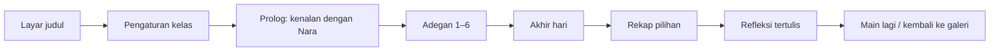
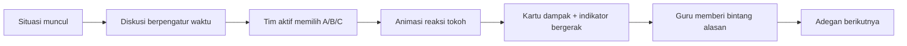

# PRD — Sehari Setara

| | |
|---|---|
| Produk | Sehari Setara, game petualangan bercabang di dalam media Ruang Setara |
| Versi dokumen | 0.2 (draf untuk ditinjau) |
| Tanggal | 19 Oktober 2026 |
| Pemilik | [Nama pengembang] |
| Dokumen terkait | `Design_System.md`, `Architecture.md`, `AGENTS.md`, `Daftar_Aset.md` |

---

## 1. Ringkasan

Sehari Setara adalah game singkat (15–20 menit) bergaya piksel retro yang cerah. Kelas menemani **Nara**, siswa kelas IX, menjalani satu hari: dari pagi di rumah sampai malam di media sosial. Di setiap adegan, tim-tim di kelas berdiskusi lalu memilih tindakan Nara. Setiap pilihan menggeser dua indikator, **Hak orang lain terjaga** dan **Kewajiban dijalankan**, lalu memunculkan kartu dampak yang menjelaskan hak, kewajiban, dan pasal terkait.

Game ini menjadi galeri "bermain dan memutuskan" yang melengkapi galeri 3D Ruang Setara. Galeri 3D tetap berfungsi sebagai ruang "jelajah dan memahami".

## 2. Latar belakang dan masalah

- Siswa mudah menghafal Pasal 28A–28J, tetapi kesulitan menerapkannya ketika dua hak bertemu dalam situasi nyata.
- Galeri Ruang Setara sudah menyajikan kasus satu per satu. Belum ada pengalaman yang menunjukkan bahwa **pilihan-pilihan kecil dalam sehari saling terhubung** dan berdampak pada orang lain.
- Pembelajaran berlangsung dengan satu laptop guru dan proyektor. Siswa tidak memakai gawai pribadi, sehingga game harus bisa dimainkan **bersama di satu layar**.

## 3. Tujuan dan non-tujuan

**Tujuan**

1. Melatih siswa menganalisis dampak pilihan terhadap hak orang lain dan kewajiban diri.
2. Menghubungkan setiap keputusan dengan dasar konstitusional dan peran lembaga penegak hukum.
3. Menghidupkan diskusi kelompok: yang dihargai adalah **alasan**, bukan tebakan cepat.
4. Bisa dijalankan guru tanpa pelatihan khusus, dengan sekali klik dari Ruang Setara.

**Non-tujuan (tidak dikerjakan pada versi ini)**

- Mode individu di gawai siswa, login, atau penyimpanan data siswa.
- Papan skor daring atau leaderboard antarkelas.
- Narasi suara dan klip video. Dampak divisualkan dengan animasi sprite pendek (lihat bagian 9).
- Mengubah galeri 3D yang sudah ada, selain menambah tautan masuk ke game.

## 4. Pengguna dan konteks pemakaian

| Pengguna | Kebutuhan | Peran di dalam game |
|---|---|---|
| Guru Pendidikan Pancasila | Memandu diskusi, mengatur waktu, menilai alasan | Operator: mengklik pilihan tim, memberi bintang alasan, menjeda pengatur waktu |
| Siswa SMP kelas IX (14–15 tahun), berkelompok 3–4 tim | Memahami situasi, berdebat, memutuskan | Tim bergiliran menjadi pengambil keputusan untuk satu adegan |

**Lingkungan:** laptop sekolah (Chrome atau Edge), proyektor 1024×768 atau 1280×720, wifi sekolah yang bisa lambat, ruang kelas yang terang, siswa duduk sampai 8 meter dari layar.

## 5. Kaitan dengan tujuan pembelajaran

| TP | Rumusan singkat | Adegan pendukung |
|---|---|---|
| TP 1 | Mengidentifikasi hak dan kewajiban dalam situasi sehari-hari | Semua adegan |
| TP 2 | Menganalisis dampak pelanggaran hak dan pengabaian kewajiban | Semua adegan, kartu dampak, rekap akhir |
| TP 3 | Menghubungkan hak yang terganggu dengan Pasal 28A–28J | Kartu dampak di setiap adegan |
| TP 4 | Membedakan peran polisi, jaksa, hakim, dan advokat | Adegan 5 dan kuis peran |
| TP 5 | Menentukan sikap yang menyeimbangkan hak dan kewajiban | Pilihan di setiap adegan, layar akhir, refleksi |

## 6. Pengalaman inti

Setiap adegan mengikuti pola yang sama:

## 7. Kebutuhan fungsional

Prioritas: **P0** wajib ada di versi pertama, **P1** sebaiknya ada, **P2** nanti.

| ID | Kebutuhan | Prioritas |
|---|---|---|
| FR-01 | Layar judul dengan tombol "Mulai" dan "Cara bermain" | P0 |
| FR-02 | Pengaturan kelas: jumlah tim (2–4), warna dan nama tim dari daftar pilihan, durasi diskusi (30/60/90 detik), suara aktif/nonaktif | P0 |
| FR-03 | Prolog singkat memperkenalkan Nara dan dua indikator | P0 |
| FR-04 | Enam adegan berurutan sesuai bagian 8, masing-masing dengan tiga pilihan | P0 |
| FR-05 | Pengatur waktu diskusi yang bisa dijeda, ditambah 30 detik, atau dilewati guru | P0 |
| FR-06 | Giliran tim berotasi otomatis per adegan; tim aktif ditandai jelas | P0 |
| FR-07 | Setelah memilih: animasi reaksi tokoh, lalu kartu dampak berisi akibat, hak yang terdampak, kewajiban terkait, dan rujukan pasal | P0 |
| FR-08 | Dua indikator (0–100, awal 50) bergerak sesuai efek pilihan, dengan animasi naik/turun | P0 |
| FR-09 | Bintang alasan: guru memberi 0, 1, atau 2 bintang kepada tim aktif; papan skor tim selalu terlihat | P0 |
| FR-10 | Akibat berantai: pilihan di adegan 4 mengubah teks dan opsi di adegan 6 | P0 |
| FR-11 | Kuis peran penegak hukum di adegan 5 (empat peran, satu jawaban) | P0 |
| FR-12 | Tiga kemungkinan akhir berdasarkan nilai indikator (bagian 9) | P0 |
| FR-13 | Rekap: enam pilihan kelas, pilihan yang paling menjaga keseimbangan, dan rujukannya | P0 |
| FR-14 | Layar refleksi dengan kalimat pemantik untuk ditulis siswa di buku | P0 |
| FR-15 | Tombol "Kembali ke galeri" menuju Ruang Setara dan tombol "Main lagi" | P0 |
| FR-16 | Kontrol keyboard untuk guru (lihat `Architecture.md`) | P0 |
| FR-17 | Tombol layar penuh dan pengaturan "kurangi gerak" | P1 |
| FR-18 | Tombol "Ulangi adegan" dan "Kembali ke adegan sebelumnya" untuk guru | P1 |
| FR-19 | Efek suara chiptune (klik, konfirmasi, dampak positif/negatif, akhir) | P1 |
| FR-20 | Cetak atau unduh rekap kelas sebagai gambar/PDF | P2 |
| FR-21 | Adegan ke-7 bertema lingkungan | P2 |

## 8. Konten adegan (draf naskah)

Keterangan efek: **H** = Hak orang lain terjaga, **K** = Kewajiban dijalankan. Tingkat dampak: *tepat*, *kurang tepat*, *berisiko*.
Semua rujukan berstatus **perlu verifikasi** sampai dicocokkan dengan naskah resmi di JDIH (lihat aturan di `AGENTS.md`).

### Adegan 1 — Pagi di rumah (06.15)

Ibu harus berangkat lebih awal ke pasar. Gita, adik Nara yang kelas 3 SD, belum siap. Ibu meminta Nara mengantar Gita ke sekolahnya yang searah. Nara khawatir terlambat piket kelas.

| | Pilihan | H | K | Tingkat |
|---|---|---|---|---|
| A | Menolak karena "itu tugas Ibu", lalu berangkat sendiri | −10 | −15 | kurang tepat |
| B | Mengantar Gita, lalu memberi tahu ketua kelas akan sedikit terlambat dan mengganti piket saat istirahat | +10 | +15 | tepat |
| C | Mengantar Gita sambil menggerutu dan memarahinya sepanjang jalan | −5 | +5 | kurang tepat |

Hak dan kewajiban: hak anak atas pengasuhan dan perlindungan; kewajiban anak menghormati orang tua dan menyayangi keluarga.
Rujukan: Pasal 28B ayat (2) UUD NRI 1945; UU No. 23 Tahun 2002 jo. UU No. 35 Tahun 2014, Pasal 19.

### Adegan 2 — Perjalanan ke sekolah (06.50)

Dimas, teman sekelas, berhenti dengan motor. Ia belum punya SIM dan tidak membawa helm cadangan. Ia menawarkan boncengan agar Nara tidak terlambat.

| | Pilihan | H | K | Tingkat |
|---|---|---|---|---|
| A | Ikut tanpa helm karena "cuma dekat" | −10 | −20 | berisiko |
| B | Menolak dengan sopan, berjalan cepat atau naik angkot, dan mengingatkan Dimas memakai helm | +10 | +15 | tepat |
| C | Ikut setelah meminjam helm di warung | 0 | −5 | kurang tepat |

Hak dan kewajiban: hak atas pendidikan dan rasa aman; kewajiban menaati aturan lalu lintas.
Rujukan: Pasal 28G ayat (1), Pasal 31 ayat (1), Pasal 27 ayat (1) UUD NRI 1945; UU No. 22 Tahun 2009 tentang LLAJ, Pasal 77 ayat (1) dan Pasal 106 ayat (8).

### Adegan 3 — Diskusi kelompok di kelas (09.00)

Kelompok merencanakan proyek "Kelas Ramah". Nara mengusulkan pojok baca, tetapi Sinta memotong dan menyebut ide itu membosankan. Bu Ratih sedang mendampingi kelompok lain.

| | Pilihan | H | K | Tingkat |
|---|---|---|---|---|
| A | Membalas dengan mengejek usulan Sinta | −15 | −10 | kurang tepat |
| B | Meminta kesempatan menyelesaikan penjelasan, lalu mempersilakan Sinta memaparkan usulannya; kelompok memutuskan dengan alasan | +15 | +10 | tepat |
| C | Diam dan mengalah walau punya alasan kuat | 0 | −5 | kurang tepat |

Hak dan kewajiban: kebebasan menyampaikan pendapat; kewajiban menghormati hak orang lain dalam musyawarah.
Rujukan: Pasal 28E ayat (3) dan Pasal 28J ayat (1) UUD NRI 1945.

### Adegan 4 — Jam istirahat (10.15)

Komang, adik kelas VII, ditertawakan sekelompok siswa karena sepatunya robek. Salah satu dari mereka merekamnya.

| | Pilihan | H | K | Tingkat | Bendera |
|---|---|---|---|---|---|
| A | Ikut tertawa agar tidak dianggap aneh | −20 | −10 | berisiko | — |
| B | Mendekati Komang, mengajaknya menjauh, lalu melapor kepada Bu Ratih (guru BK) | +20 | +10 | tepat | `komangDibela` |
| C | Pura-pura tidak melihat | −10 | −5 | kurang tepat | — |

Hak dan kewajiban: hak anak atas perlindungan dari kekerasan dan diskriminasi; kewajiban tidak merendahkan orang lain.
Rujukan: Pasal 28B ayat (2), Pasal 28G ayat (1), Pasal 28J ayat (1) UUD NRI 1945.

### Adegan 5 — Sore di lingkungan rumah (16.30)

Sepeda Pak Made hilang dari depan warung. Beberapa warga langsung menuduh Bayu, pemuda yang baru pindah, dan ingin mendatanginya beramai-ramai. Nara ingat warung itu punya kamera CCTV.

| | Pilihan | H | K | Tingkat |
|---|---|---|---|---|
| A | Ikut menyebarkan foto Bayu ke grup warga dengan tulisan "pencuri" | −20 | −15 | berisiko |
| B | Menyarankan Pak Made melapor kepada Ketua RT dan polisi dengan membawa rekaman CCTV, serta mengingatkan warga agar tidak main hakim sendiri | +15 | +15 | tepat |
| C | Pulang saja karena merasa bukan urusannya | −5 | −5 | kurang tepat |

**Kuis peran (setelah kartu dampak):** "Jika perkara ini sampai ke pengadilan, siapa yang memeriksa, mengadili, dan memutusnya?" Pilihan: Polisi, Jaksa, Advokat, Hakim. Jawaban: Hakim. Setelah dijawab, tampil kartu empat peran: polisi menerima laporan dan menyidik, jaksa menuntut, advokat mendampingi, hakim memutus. Kuis tidak memengaruhi indikator.

Hak dan kewajiban: hak atas kepastian hukum yang adil dan perlakuan yang sama di hadapan hukum; kewajiban menghormati proses hukum.
Rujukan: Pasal 28D ayat (1), Pasal 28G ayat (1), Pasal 24 UUD NRI 1945; UU No. 2 Tahun 2002, Pasal 13 dan Pasal 14 ayat (1) huruf g; UU No. 48 Tahun 2009, Pasal 8 ayat (1) (asas praduga tak bersalah).

### Adegan 6 — Malam, media sosial (20.00)

Video Komang tadi siang beredar di grup kelas dengan stiker ejekan. Banyak yang membalas dengan tawa.

- **Jika `komangDibela`:** Komang mengirim pesan pribadi, "Kak, videonya disebar. Aku malu besok ke sekolah." Pilihan B berbunyi "Membalas pesan Komang, meminta video dihapus di grup, dan melapor bersama Komang besok pagi."
- **Jika tidak:** narasi menambahkan, "Malam itu Komang tidak membalas pesan siapa pun."

| | Pilihan | H | K | Tingkat |
|---|---|---|---|---|
| A | Meneruskan video ke grup lain karena "sudah viral" | −20 | −15 | berisiko |
| B | Tidak menyebarkan, meminta video dihapus, mendukung Komang, dan melapor kepada wali kelas atau guru BK besok pagi | +20 | +15 | tepat |
| C | Keluar dari grup tanpa berbuat apa-apa | −5 | 0 | kurang tepat |

Hak dan kewajiban: hak atas rasa aman, kehormatan, dan martabat; kewajiban menghormati privasi dan tidak merendahkan orang lain.
Rujukan: Pasal 28E ayat (3), Pasal 28G ayat (1), Pasal 28J ayat (1) UUD NRI 1945.

## 9. Aturan permainan

- **Indikator:** H dan K dimulai dari 50, berkisar 0–100, dan dibatasi di kedua ujung. Kedua indikator bersifat **milik seluruh kelas**: semua tim bekerja sama menjaga hari Nara.
- **Bintang alasan:** diberikan guru (0–2) kepada tim aktif berdasarkan kualitas alasan, bukan benar-salahnya pilihan. Ini satu-satunya unsur kompetitif.
- **Akhir hari:**

| Akhir | Syarat | Pesan inti |
|---|---|---|
| Warga Setara | H ≥ 75 dan K ≥ 75 | Hak orang lain terjaga dan kewajiban dijalankan; timbangan seimbang |
| Hampir Seimbang | Selain dua kondisi lain | Banyak pilihan baik, tetapi ada yang masih bisa diperbaiki |
| Hari yang Berat | H < 40 atau K < 40 | Pilihan kecil berdampak besar; ini kesempatan untuk belajar |

- **Tidak ada "kalah".** Setiap akhir langsung diikuti rekap yang menunjukkan alternatif yang lebih baik.
- **Visualisasi dampak:** reaksi tokoh berupa animasi sprite 2–6 bingkai (misalnya Komang tersenyum lega atau menunduk), bukan file video. Alasannya: jauh lebih ringan, sesuai gaya retro, dan mudah direvisi.

## 10. Kebutuhan non-fungsional

| Aspek | Kebutuhan |
|---|---|
| Kinerja | Total aset game ≤ 4 MB; kode game ≤ 150 KB (gzip); adegan pertama siap ≤ 3 detik pada koneksi 10 Mbps |
| Kompatibilitas | Chrome dan Edge versi dua tahun terakhir di Windows; tetap layak di Safari iPad |
| Layar | Rasio 16:9 dengan bingkai untuk 4:3; uji pada 1024×768, 1280×720, 1366×768, 1920×1080 |
| Keterbacaan | Teks dialog terbaca dari jarak 8 meter di proyektor; kontras teks minimal 4,5:1 |
| Aksesibilitas | Dapat dimainkan dengan keyboard; makna tidak hanya disampaikan lewat warna; menghormati `prefers-reduced-motion` |
| Privasi | Tidak ada login, analitik, pelacakan, atau data siswa yang disimpan. Nama tim dipilih dari daftar, bukan nama siswa |
| Hosting | Statis di GitHub Pages bersama Ruang Setara, tanpa server dan tanpa layanan pihak ketiga |
| Bahasa | Bahasa Indonesia baku yang ramah untuk siswa SMP; kalimat pendek |

## 11. Aset yang dibutuhkan (ringkas)

Semua aset gambar **digambar dengan kode oleh Claude** dan disetujui pengembang. Rincian ukuran, palet, dan aturan menggambar ada di `Design_System.md`; status setiap aset ada di `Daftar_Aset.md`.

- 6 latar adegan, 1 latar judul, 3 ilustrasi akhir.
- 9 tokoh utama: Nara, Ibu, Gita, Dimas, Sinta, Bu Ratih, Komang, Pak Made, Bayu, ditambah tokoh pendukung (dua siswa di adegan 4, dua warga di adegan 5). Setiap tokoh memiliki pose diam, bicara, senang, dan sedih/khawatir sesuai kebutuhan adegan. Polisi tampil sebagai ikon di kartu peran.
- Ikon antarmuka: dua indikator, bintang, pengatur waktu, bentuk tim, suara, layar penuh.
- Empat ikon peran penegak hukum.
- Efek suara chiptune (opsional, P1).

## 12. Ukuran keberhasilan

| Ukuran | Target |
|---|---|
| Sesi selesai dalam 20 menit | ≥ 80% sesi uji coba |
| Alasan tim menyebut hak, kewajiban, atau pasal yang tepat | ≥ 75% giliran (rubrik guru) |
| Guru menjalankan game tanpa bantuan setelah membaca panduan satu halaman | Ya, pada uji coba dengan minimal 2 guru/teman sejawat |
| Bug yang menghentikan permainan di kelas | 0 |
| Siswa di barisan belakang dapat membaca dialog | Ya, dicek saat uji proyektor |

## 13. Ruang lingkup rilis

- **Versi 1.0 (MVP):** semua kebutuhan P0.
- **Versi 1.1:** P1 (layar penuh, kurangi gerak, ulangi adegan, efek suara).
- **Nanti:** P2 (rekap yang bisa diunduh, adegan lingkungan).

## 14. Risiko dan mitigasi

| Risiko | Mitigasi |
|---|---|
| Gaya aset tidak konsisten antar-tokoh atau antar-adegan | Semua aset digambar dari kit kode yang sama: palet, proporsi, dan fungsi tokoh dipakai ulang; pemeriksaan otomatis palet dan ukuran |
| Adegan ramai (jalan raya, kerumunan warga) sulit digambar dengan gaya sederhana | Batasi paling banyak 4 tokoh per adegan; sederhanakan komposisi panggung; perbaiki lewat beberapa putaran pratinjau |
| Aset tanpa sengaja mirip karakter game yang sudah ada | Tokoh dan latar dirancang orisinal; hanya ciri gaya yang diambil dari acuan; setiap aset ditinjau dengan daftar periksa |
| Rujukan pasal keliru | Gerbang verifikasi: konten tidak dirilis sebelum semua rujukan dicentang manusia di `Verifikasi_Rujukan.md` setelah dicek di JDIH |
| Huruf piksel sulit dibaca di proyektor | Uji keterbacaan sejak minggu pertama; siapkan huruf cadangan yang lebih jelas |
| Waktu pengembangan mepet dengan tenggat 20 November | Kerjakan P0 dulu; P1 hanya bila jadwal aman |
| Penggambaran tokoh memuat stereotip (misalnya "pendatang") | Tinjauan naskah dan visual; tokoh Bayu digambarkan netral dan ternyata tidak bersalah |

## 15. Jadwal usulan

| Tahap | Tanggal | Hasil |
|---|---|---|
| M0 | 19–24 Okt 2026 | Dokumen disetujui; naskah adegan final dan rujukan diverifikasi |
| M1 | 25 Okt–1 Nov | Semua tokoh digambar (Claude) dan disetujui; mesin permainan dasar |
| M2 | 2–8 Nov | Latar adegan 2–6, layar judul, layar akhir, dan ikon; semua fitur P0; integrasi dengan Ruang Setara |
| M3 | 9–13 Nov | Uji coba kelas/teman sejawat dan perbaikan |
| M4 | 14–18 Nov | Rilis di GitHub Pages; flipbook diperbarui |
| — | 20 Nov 2026 | Pengumpulan tugas |

## 16. Pertanyaan terbuka

1. Apakah nama tokoh lain perlu bernuansa lokal Bali? (Komang dan Pak Made sudah.)
2. Di mana pintu masuk game: tombol di galeri Refleksi, di menu Daftar materi, atau keduanya?
3. Apakah durasi diskusi bawaan 60 detik sudah sesuai dengan alokasi waktu di RPM?
4. Apakah rekap akhir perlu bisa dicetak sejak versi 1.0?

## 17. Catatan keputusan

| Tanggal | Keputusan |
|---|---|
| 19 Okt 2026 | Konsep "Sehari Setara" dipilih: petualangan bercabang satu hari, mode tim di satu layar |
| 19 Okt 2026 | Dampak divisualkan dengan animasi sprite, bukan video |
| 19 Okt 2026 | Gaya visual: retro 8-bit seperti gambar acuan, tetapi cerah dan ramah; hanya ciri gaya yang diambil |
| 19 Okt 2026 | Game dibangun sebagai halaman terpisah `sehari-setara/` di build GitHub Pages yang sama |
| 19 Okt 2026 | **Aset digambar dengan kode oleh Claude**, bukan dengan Gemini; contoh adegan 1 (Nara, Ibu, Gita, dapur pagi) disetujui sebagai acuan gaya |
| 21 Okt 2026 | Rujukan adegan 5 menjadi UU No. 2 Tahun 2002, Pasal 13 dan Pasal 14 ayat (1) huruf g; rujukan Pasal 28J di adegan 6 menjadi Pasal 28J ayat (1). Keduanya tetap perlu verifikasi |
| 21 Okt 2026 | Verifikasi rujukan dicatat pemilik proyek di daftar centang `docs/sehari-setara/Verifikasi_Rujukan.md` |
| 26 Okt 2026 | Durasi diskusi bawaan tetap 60 detik (balasan `Setuju: F-07`, usulan 7 rencana F-07), menjawab pertanyaan terbuka bagian 16 nomor 3; pilihan 30, 60, atau 90 detik tetap dibuat di pengaturan kelas (F-10) |
| 26 Okt 2026 | Bunyi klik (gaya A) dan bunyi teks per huruf (gaya B, setiap 2 huruf, nada tinggi, volume 60%) dikerjakan lebih awal di F-07 atas pilihan pemilik proyek lewat halaman uji suara. Sisa efek suara FR-19 tetap di F-13 |
