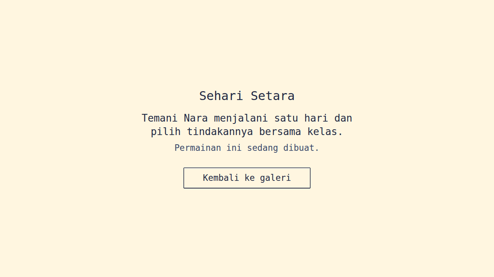
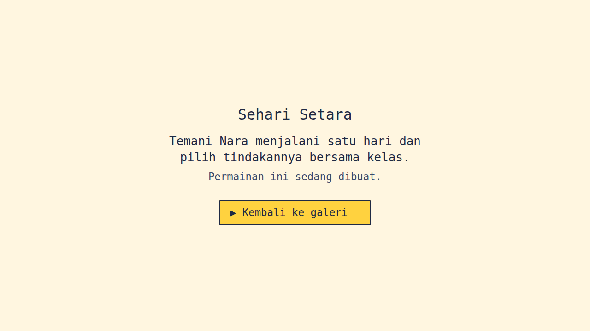
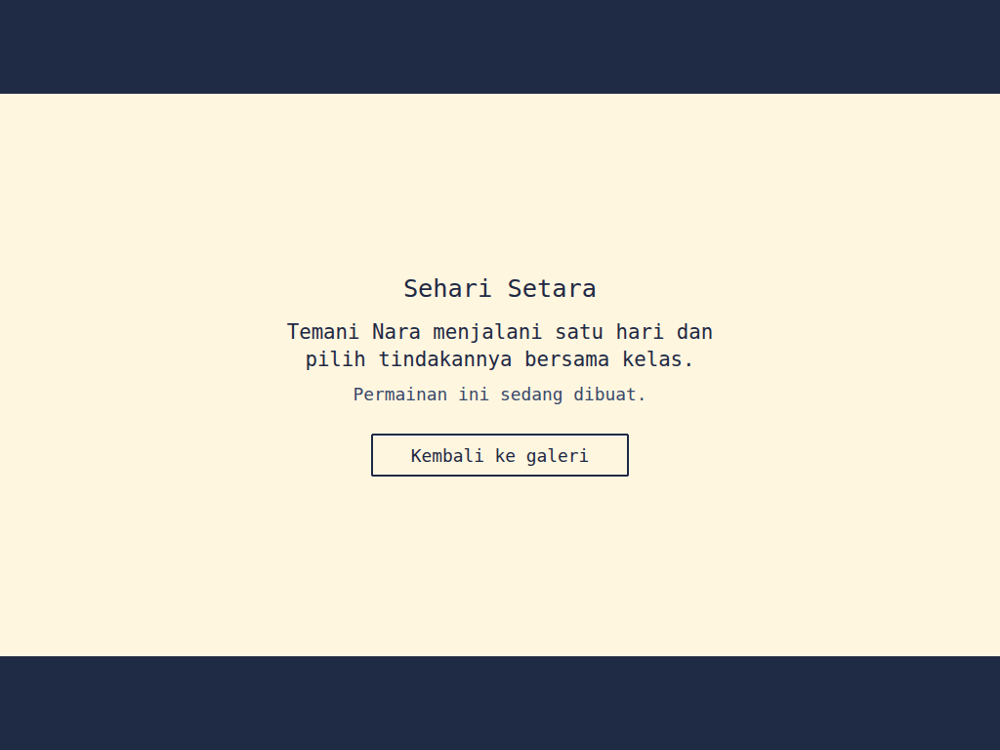
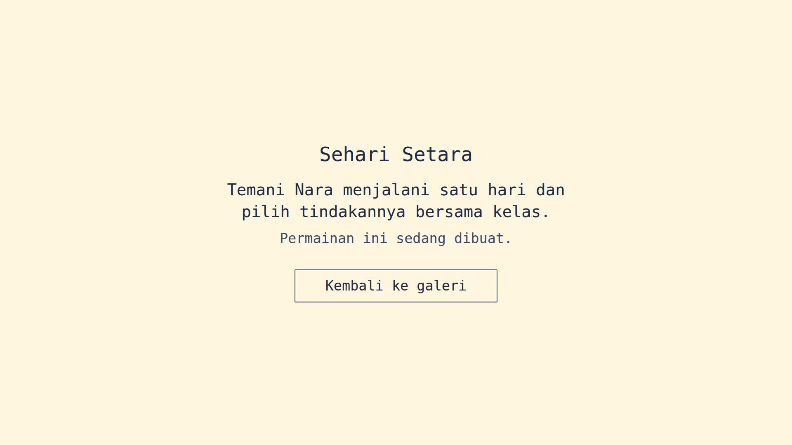

# Hasil uji F-01 — 21 Oktober 2026

Spesifikasi: [`specs/F-01-kerangka-halaman.md`](../specs/F-01-kerangka-halaman.md). Lingkungan: Node 22.22.2, pnpm 11.25.0, Vite 8.0.13, Chromium 141.0.7390.37 (headless, lewat Playwright untuk Python 1.56 di lingkungan agen, di luar repositori).

| Kriteria | Hasil | Bukti |
|---|---|---|
| AC-1 | Lulus | `build:pages` berakhir dengan kode 0 (9 detik); `dist-pages/index.html` dan `dist-pages/sehari-setara/index.html` ada |
| AC-2 | Lulus | Empat rujukan di HTML permainan, semuanya relatif dan berkasnya ada: `../favicon.svg`, `../assets/game-CXNfzINz.js`, `../assets/jsx-runtime-CmKW-gyo.js`, `../assets/game-DTKYZGGf.css` |
| AC-3 | Lulus | Pada 1280×720, 1366×768, 1920×1080, dan 1024×768: 0 galat konsol, 0 respons 4xx/5xx, 0 permintaan gagal |
| AC-4 | Lulus | `lang="id"`, judul tab, deskripsi, dan empat teks layar sama persis dengan tabel "Teks yang tampil" |
| AC-5 | Lulus | `<a href="../">`; klik membuka `/ruang-setara/`; galeri: 0 galat konsol, 0 respons 4xx/5xx, lembar gaya galeri (`main-Bp-7VtNx.css`) tidak memuat `--ss-ink`, `#root` galeri terisi. Lihat Temuan 2 |
| AC-6 | Lulus | Satu kali Tab memfokuskan `.ss-button`; latar `rgb(255, 210, 63)`; kursor ▶ `hidden` → `visible`; lebar 329,12 px → 329,12 px; Enter membuka `/ruang-setara/`. [Tangkapan layar](F-01/kerangka_fokus_1280x720.png) |
| AC-7 | Lulus | Layar 1280×720 → 1280×720; 1366×768 → 1365,33×768; 1920×1080 → 1920×1080; 1024×768 → 1024×576 di y = 96 dengan sisa `rgb(31, 42, 68)`; tanpa bilah gulir di keempat ukuran |
| AC-8 | Lulus | Ukuran terhitung di 1280×720: 31,68 / 25,92 / 22,32 / 22,32 px. Warna judul, pengantar, dan tombol `ink`; keterangan `dusk`. Kontras: `ink`/`cream` 13,2:1, `dusk`/`cream` 8,2:1, `ink`/`sun` 9,9:1 |
| AC-9 | Lulus | 20 token `--ss-` di `game.css` sama persis dengan Design System bagian 4; 11 warna dasar sama dengan `palette.json`; `--u: min(1vh, 0.5625vw)` |
| AC-10 | Lulus | JS halaman permainan: dua berkas, total 59,82 kB gzip (laporan Vite: 0,46 + 60,18 kB) dari anggaran 150 KB. Tanpa penanda `__THREE__`; sebagai pembanding, penanda itu terdeteksi di JS galeri |
| AC-11 | Lulus | 301 untuk folder tanpa garis miring; 404 di luar `/ruang-setara/`, untuk berkas tidak ada, dan untuk empat bentuk path traversal; Range 206 (dan 416 di luar ukuran berkas); keluaran lengkap di bawah |
| AC-12 | Lulus | `dev:pages` siap dalam 376 ms; `GET /sehari-setara/` 200; di browser judul "Sehari Setara" dan tombol tampil, 0 galat konsol, 0 respons 4xx |
| AC-13 | Lulus | `tsc --noEmit` seluruh proyek: kode 0, 0 galat; ESLint lima file baru/diubah dengan `--max-warnings 0`: kode 0; tidak ada `any` |
| AC-14 | Lulus | `document.getAnimations()` = 0 saat biasa dan saat berfokus; durasi transisi tombol `0s`; sama saat `prefers-reduced-motion: reduce` |
| AC-15 | Lulus | 15 berkas berubah termasuk laporan ini: 13 baru, 2 diubah (`package.json` +1 baris, `vite.pages.config.ts` +9 baris). Tidak ada berkas galeri, workflow, atau lockfile yang berubah; `install --frozen-lockfile` kode 0 |

## Perintah yang dijalankan dan hasilnya

Sesuai keputusan Gerbang 1, langkah `content:check`, `test`, dan `test:e2e` tidak dijalankan untuk F-01 karena alatnya belum dipasang (jadwalnya ada di `PLAN.md`). Penggantinya langkah 2 sampai 6 di bawah.

1. `npx pnpm@11.25.0 build:pages`: kode 0. Keluaran:

   ```
   dist-pages/sehari-setara/index.html          0.72 kB │ gzip:   0.42 kB
   dist-pages/index.html                        0.82 kB │ gzip:   0.49 kB
   dist-pages/assets/game-DTKYZGGf.css          2.51 kB │ gzip:   0.94 kB
   dist-pages/assets/main-Bp-7VtNx.css        203.06 kB │ gzip:  34.76 kB
   dist-pages/assets/game-CXNfzINz.js           0.94 kB │ gzip:   0.46 kB
   dist-pages/assets/jsx-runtime-CmKW-gyo.js  190.84 kB │ gzip:  60.18 kB
   dist-pages/assets/main-CC47J1DW.js         896.32 kB │ gzip: 246.98 kB
   ```

2. Pemeriksa statis (AC-1, AC-2, AC-9, AC-10): keempat kriteria lulus. Rinciannya ada di tabel di atas.

3. `node scripts/game/serve-subpath.mjs`, lalu diuji dengan `curl` (AC-11):

   ```
   /ruang-setara/sehari-setara        → 301, Location: /ruang-setara/sehari-setara/
   /ruang-setara                      → 301, Location: /ruang-setara/
   /                                  → 302, Location: /ruang-setara/
   /ruang-setara/sehari-setara?x=1    → 301, Location: /ruang-setara/sehari-setara/?x=1
   /ruang-setara/sehari-setara/       → 200 text/html
   /assets/game-CXNfzINz.js           → 404 (di luar /ruang-setara/)
   /ruang-setara/tidak-ada.js         → 404
   /ruang-setara/favicon.svg/         → 404
   /ruang-setara/../package.json, ..%2Fpackage.json, %2e%2e/package.json,
   assets/..%2F..%2Fpackage.json, %00 → 404 "404 Tidak ditemukan"
   Range bytes=0-99 (stories/3-motion.mp4)  → 206, bytes 0-99/405661, isi identik dengan berkas
   Range bytes=-100 / bytes=1000-     → 206
   Range bytes=405661-                → 416, Content-Range: bytes */405661
   Range tidak terbaca ("abc")        → 200, berkas utuh
   POST                               → 405, Allow: GET, HEAD
   HEAD                               → 200 tanpa badan
   MIME: svg image/svg+xml, glb model/gltf-binary, wasm application/wasm, css text/css
   Pesan galat (kode keluar 1): port terpakai, --port abc, --port=70000, dist-pages/ belum ada
   ```

4. Chromium headless lewat server uji (AC-3 sampai AC-8, AC-14): semua lulus. Pemeriksaan tambahan sesuai bagian "Status antarmuka":
   - Tetikus di atas tombol: latar `sun` dan kursor ▶ tampil.
   - Perangkat sentuh: `(hover: hover)` bernilai salah, jadi status arah tidak lengket.
   - Mode warna paksa: `clip-path` mati dan garis fokus 2 px terlihat.
   - Kurangi gerak: tidak ada animasi.

5. Tangkapan layar:

   
   
   
   

6. `npx pnpm@11.25.0 dev:pages --port 5199 --strictPort --host 127.0.0.1`: Vite siap; `/sehari-setara/` 200 dan tampil di browser (AC-12).

7. `npx tsc --noEmit -p tsconfig.json --incremental false`: kode 0, 0 galat, tanpa menulis `tsconfig.tsbuildinfo`. `npx eslint --max-warnings 0` pada lima file kode baru/diubah: kode 0 (AC-13).

8. `git diff --name-status` terhadap commit dasar dan `npx pnpm@11.25.0 install --frozen-lockfile`: lihat AC-15.

9. Daftar periksa manual AGENTS bagian 9:
   - [x] Tampilan rapi di 1024×768 dan 1920×1080 (tangkapan layar di atas).
   - Butir lain belum berlaku, karena belum ada dialog, permainan, gerak, atau suara.

## Temuan

1. **Keluaran galeri berubah bentuk, sesuai risiko di `PLAN.md`.** React kini menjadi berkas bersama `jsx-runtime-*.js` (60,18 kB gzip), sehingga galeri memuat `main-*.js` (246,98 kB gzip) ditambah berkas bersama itu. Sebelumnya galeri memuat satu `index-*.js` (307,97 kB gzip), jadi totalnya hampir sama. Galeri lulus AC-5.
2. **Fetch yang dibatalkan di galeri sudah ada sebelum F-01.** Galeri membatalkan satu fetch `gallery/ruang-setara.glb` (`net::ERR_ABORTED`). Hal yang sama muncul pada build sebelum F-01, yang dibangun ulang di worktree sementara untuk pembanding. Ini bukan respons 4xx, bukan galat konsol, dan berada di kode galeri, jadi di luar cakupan.
3. **Hierarki judul masih lemah.** Dengan huruf cadangan `monospace`, judul (31,68 px) hanya sedikit lebih besar daripada pengantar (25,92 px). Hierarki akan jauh lebih tegas setelah Press Start 2P terpasang di F-04.
4. **Garis bingkai 2 px CSS terlihat tipis di 1920×1080.** Ini masukan untuk keputusan satuan bingkai piksel saat Plan F-05.
5. **Belum diuji:** proyektor sungguhan, Edge, Safari iPad, dan terbitan GitHub Pages yang sebenarnya (subfolder diuji dengan `serve-subpath.mjs`).

## Keputusan: Lulus

Kelima belas kriteria lulus. Halaman permainan tanpa galat konsol dan tanpa respons 4xx, dan anggaran ukuran terpenuhi. `content:check`, `test`, dan `test:e2e` dikecualikan untuk F-01 sesuai keputusan Gerbang 1.
