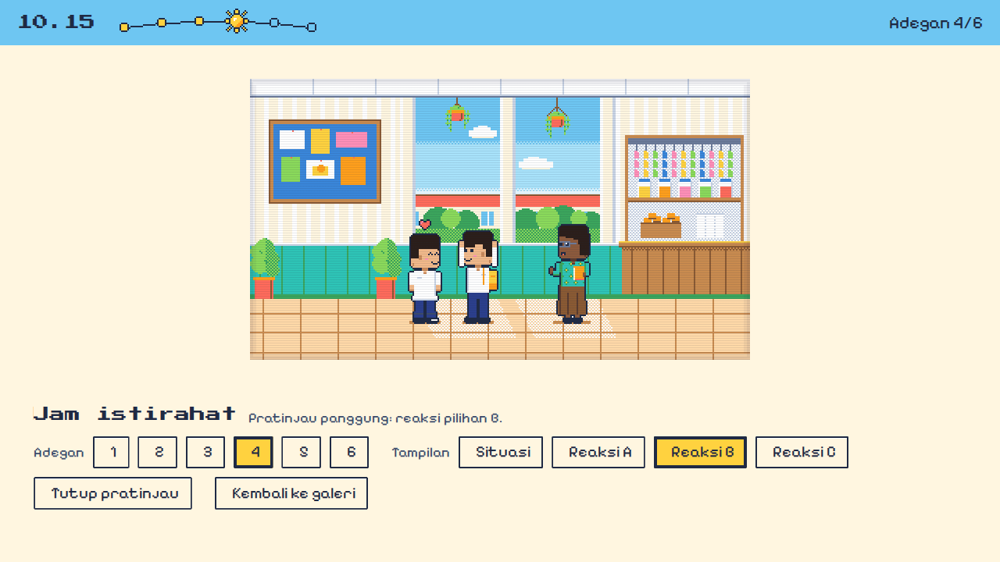

# Hasil uji F-04 — 22 Oktober 2026

Spesifikasi: [`specs/F-04-panggung.md`](../specs/F-04-panggung.md).

Lingkungan:

- Node 22.22.2, pnpm 11.25.0, Vite 8.0.13, Vitest 5.0.4, dan TypeScript 5.9.3;
- `@playwright/test` 1.56.1 dengan Chromium 141.0.7390.37 di lingkungan agen;
- Python 3.12.3 dengan Pillow 12.1.1.

| Kriteria | Hasil | Bukti |
|---|---|---|
| AC-1 | Lulus | `package.json` hanya bertambah `@fontsource/pixelify-sans` 5.3.0, `@fontsource/press-start-2p` 5.3.0, `@playwright/test` 1.56.1 (versi persis), dan skrip `test:e2e`. `install --frozen-lockfile` kode 0, dan lockfile lolos kebijakan rantai pasok. Lockfile bertambah 66 baris dan berkurang 11, sama dengan percobaan saat Plan (Temuan 3) |
| AC-2 | Lulus | Di halaman permainan, `document.fonts.check` benar untuk kedua huruf. Berkas huruf dimuat dari `/ruang-setara/assets/`, dengan 0 permintaan ke host lain. Galeri tidak meminta berkas huruf itu |
| AC-3 | Lulus | Teks F-01 tetap. Ada tombol "Lihat pratinjau panggung" (`#adegan-1`) sesudah "Kembali ke galeri", Tab pertama memfokuskan "Kembali ke galeri", dan `getAnimations()` kosong. [Tangkapan layar](F-04/kerangka_1280x720.png) |
| AC-4 | Lulus | Ke-24 alamat sah menampilkan judul dan keterangan yang benar. `#adegan-0`, `#adegan-7`, `#adegan-1-d`, `#lain`, dan alamat kosong menampilkan layar kerangka. Penanda di `window` bertahan selama tanda pagar berganti, termasuk saat tombol Kembali browser dipakai. Fokus berpindah ke judul pratinjau dan ke tombol pratinjau sesuai spesifikasi |
| AC-5 | Lulus | Bilah atas 8u dan panel bawah 30u (±1 px). Bingkai panggung berukuran 320k × 180k, dengan k = 2 (1280×720), 2 (1366×768), 3 (1920×1080), dan 1,984 (1024×768). Bingkai berada di tengah area (±1 px), tanpa bilah gulir dan tanpa luapan panel bawah |
| AC-6 | Lulus | Di ke-24 alamat, pada 1280×720 dan 1024×768 (48 keadaan): urutan `data-char`/`data-pose` sama dengan naskah, tepi bawah di 157k, tepi kiri di `(x − floor(w/2))·k`, cermin `matrix(-1, 0, 0, 1, 0, 0)` untuk tokoh yang menghadap kiri, serta bayangan di 155k selebar `(w − 6)·k` dengan warna per latar |
| AC-7 | Lulus | Ke-18 ikon emosi cocok dengan tabel spesifikasi (±1 px setelah dibagi k). Tampilan situasi tanpa ikon emosi. [Reaksi 2B](F-04/adegan_2_reaksi_b_1280x720.png), [reaksi 4B](F-04/adegan_4_reaksi_b_1280x720.png) |
| AC-8 | Lulus | Urutan z: latar 0, bayangan dan tokoh 20, ikon emosi 30, garis pindai dan vinyet 40. Garis pindai `repeating-linear-gradient(… rgba(31, 42, 68, 0.1) 2px, … 3px)`. Vinyet berupa dua cincin `inset` 2 dan 4 px `rgba(31, 42, 68, 0.06)`. Sprite memakai `image-rendering: pixelated` |
| AC-9 | Lulus | Adegan 1 berjalan dengan tiga animasi: `ss-pulse` dan dua `ss-strip`. Nara diam 1 s `steps(2)`, Ibu bicara 0,5 s `steps(2)`, dan Gita (satu bingkai) tanpa animasi. Dengan kurangi gerak, `getAnimations()` kosong di adegan 1, 4, dan reaksi 6B |
| AC-10 | Lulus | Di keenam adegan, warna bilah, warna teks, jam, "Adegan n/6", label pembaca layar, jumlah titik lewat dan berikutnya, serta ikon matahari atau bulan sesuai spesifikasi. Kontras terukur ≥ 4,5:1 di semua adegan |
| AC-11 | Lulus | Saat `#adegan-1` dibuka, latar adegan 2 diminta. Saat pindah ke `#adegan-2`, latar adegan 3 diminta. 0 galat konsol |
| AC-12 | Lulus | Titik kepala ke-33 strip sama dengan hasil pengukuran PNG. `floorShadows` lengkap untuk 7 latar, dan keempat nada bayangan punya aturan CSS. Pencarian aman mengembalikan `undefined` untuk `bg_tidak_ada`, `constructor`, dan `toString`. Contoh pelanggaran tertangkap dengan pesan spesifikasi, termasuk titik kepala setengah piksel "(13,5, 3)" |
| AC-13 | Lulus | Dengan salinan PNG `ui/zz_uji_sementara.png` yang belum terdaftar, `test` tetap lulus (138 lulus) dan ringkasan mendaftar berkas itu. Salinannya dihapus sesudahnya. Contoh dalam uji tidak lagi bergantung pada isi folder (Temuan 1) |
| AC-14 | Lulus | `build_assets.py`: "Semua pemeriksaan lulus.", `ui_matahari.png` 252 B dan `ui_bulan.png` 169 B (16×16). PNG lain tidak berubah. Keduanya terdaftar di manifest (65 berkas terdaftar, 61,8 KB) dan `CREDITS.md`, dan berstatus Disetujui (22 Okt) di Daftar_Aset |
| AC-15 | Lulus | `layout.test.ts`: 12 uji lulus. Cakupannya: skala dan batas 0,75, posisi sprite, bayangan, dan ikon emosi (termasuk Dimas menghadap kanan dan kiri), titik dan garis busur, serta pembaca alamat |
| AC-16 | Lulus | `test:e2e`: 16 dari 16 lulus. Halaman permainan di empat ukuran dan galeri: 0 galat konsol dan 0 respons 4xx/5xx. Navigasi dengan Tab dan Enter berjalan, dengan tombol fokus berlatar `sun` dan kursor ▶ terlihat |
| AC-17 | Lulus | `build:pages` kode 0. JS permainan 9,4 KB ditambah React 59,3 KB (gzip -9), jauh di bawah 150 KB; 0 penanda `__THREE__`. Semua `src`/`href` HTML permainan relatif (`../`). `index.html`, `main-Bp-7VtNx.css`, `main-CC47J1DW.js`, dan `jsx-runtime-CmKW-gyo.js` identik byte dengan keadaan F-12 (Temuan 2) |
| AC-18 | Lulus | `tsc --noEmit` seluruh proyek: 0 galat. ESLint `--max-warnings 0` pada semua file kode baru dan yang diubah, termasuk `e2e/` dan `playwright.config.ts`: kode 0. Tidak ada `any` |
| AC-19 | Lulus | Architecture 0.6, Design System 0.4, Daftar_Aset (D-11), `CREDITS.md`, `PLAN.md`, dan catatan ralat di laporan F-12 sesuai spesifikasi. `git diff --name-status` terhadap keadaan F-12 memuat 44 berkas (26 baru, 18 diubah), tanpa penghapusan, dan semuanya disebut spesifikasi atau berupa tangkapan layar bukti |

## Perintah yang dijalankan dan hasilnya

1. `npx pnpm@11.25.0 install --frozen-lockfile`: kode 0, "Lockfile passes supply-chain policies", "Lockfile is up to date".

2. `npx pnpm@11.25.0 content:check`: kode 0, "Verifikasi rujukan: 0 dari 12 terverifikasi." (36 lulus, 1 dilewati).

3. `npx pnpm@11.25.0 test --reporter=verbose`: kode 0.

   ```
   Aset game: 65 berkas terdaftar, 61,8 KB dari anggaran 4 MB.
   Belum terdaftar di manifest: tidak ada.
   Tercatat di CREDITS.md tetapi belum terdaftar: tidak ada.
   Test Files  5 passed (5)
        Tests  138 passed | 1 skipped (139)
   ```

   Rinciannya: reducer 45, rules 21, content 36 (ditambah 1 dilewati), assets 24, dan layout 12.

4. Ralat F-12: dengan `ui/zz_uji_sementara.png` di folder aset, `test` kode 0 dan ringkasannya memuat "- ui/zz_uji_sementara.png".

5. `python scripts/game/art/build_assets.py`: kode 0, "Total aset: 61.8 KB (anggaran 4 MB)", "Semua pemeriksaan lulus.". Sesudahnya `git status` bersih.

6. `npx pnpm@11.25.0 build:pages`: kode 0.

   ```
   dist-pages/sehari-setara/index.html                                 0.72 kB │ gzip:   0.42 kB
   dist-pages/assets/press-start-2p-latin-400-normal-…woff2           12.51 kB
   dist-pages/assets/pixelify-sans-latin-400-normal-…woff2             7.69 kB
   dist-pages/assets/game-…css                                         7.12 kB │ gzip:   1.96 kB
   dist-pages/assets/game-…js                                         27.43 kB │ gzip:   9.43 kB
   dist-pages/assets/jsx-runtime-CmKW-gyo.js                         190.84 kB │ gzip:  60.18 kB
   ```

7. `npx pnpm@11.25.0 test:e2e`: kode 0, 16 lulus dalam sekitar 30 detik, termasuk build dan server di `/ruang-setara/`. Dijalankan dua kali, dan tangkapan layar kedua identik byte dengan yang pertama.

8. `npx tsc --noEmit -p tsconfig.json --incremental false`: kode 0. ESLint: kode 0, sesudah satu peringatan di `e2e/sehari-setara.spec.ts` diperbaiki. Variabel k yang belum terpakai kini dipakai untuk memeriksa skala di setiap alamat.

## Tangkapan layar

Semua tangkapan diambil dengan kurangi gerak aktif, agar hasilnya tetap sama di setiap uji.

| Berkas | Isi |
|---|---|
| [kerangka_1280x720.png](F-04/kerangka_1280x720.png) | Layar kerangka dengan huruf piksel; tombol pertama terfokus |
| [adegan_1_1280x720.png](F-04/adegan_1_1280x720.png) sampai [adegan_6_1280x720.png](F-04/adegan_6_1280x720.png) | Keenam adegan, situasi awal |
| [adegan_1_1024x768.png](F-04/adegan_1_1024x768.png), [adegan_6_1024x768.png](F-04/adegan_6_1024x768.png) | Layar 4:3 dengan bingkai `ink` dan skala pecahan 1,984 |
| [adegan_3_1920x1080.png](F-04/adegan_3_1920x1080.png) | Skala 3 |
| [adegan_2_reaksi_b_1280x720.png](F-04/adegan_2_reaksi_b_1280x720.png), [adegan_4_reaksi_b_1280x720.png](F-04/adegan_4_reaksi_b_1280x720.png) | Ikon emosi di atas Dimas dan Komang |



## Daftar periksa manual (AGENTS bagian 9)

| Butir | Hasil |
|---|---|
| Tampilan rapi di 1024×768 dan 1920×1080 | Lulus, dari tangkapan layar |
| Mode kurangi gerak mematikan sapuan dan animasi sprite | Lulus untuk animasi sprite dan denyut busur; sapuan baru dibuat di F-05 |
| Bisa dimainkan sampai akhir hanya dengan keyboard | Belum berlaku; navigasi pratinjau dengan keyboard lulus |
| Teks terbaca dari jarak sekitar 8 meter di proyektor | **Belum diuji.** Perlu dicek pemilik proyek di kelas |
| Berjalan lancar di laptop kelas bawah dengan suara mati | **Belum diuji** |
| Tidak ada istilah hukum keliru dan tidak ada nada menghakimi | Tidak ada teks naskah baru |

## Temuan

1. **Ralat uji F-12.** Tiga uji F-12 mewajibkan "tidak ada berkas yang belum terdaftar", dan satu contoh anggaran total bergantung pada jumlah aset terdaftar. Masalah ini muncul ketika ikon D-11 dibangun sebelum didaftarkan. Keempatnya diperbaiki (AC-13), dan laporan F-12 mendapat catatan ralat.
2. **Tailwind galeri membaca seluruh repositori, termasuk dokumen.**
   - Saat Build, satu kata bahasa Inggris untuk "penyaring" yang juga nama kelas Tailwind sempat muncul sebagai kata lepas di kode uji dan spesifikasi. Akibatnya CSS galeri bertambah satu aturan, dan nama berkas JS galeri ikut berubah.
   - Kata itu sudah diganti, dan berkas galeri kembali identik byte.
   - Uji build membandingkan berkas galeri, jadi kejadian serupa akan tertangkap.
   - Bila ingin dicegah sepenuhnya, konfigurasi Tailwind galeri bisa diberi pengecualian folder. Itu menyentuh berkas galeri, sehingga perlu keputusan pemilik proyek.
3. **Kenaikan paket transitif.** Pemasangan menaikkan tiga paket transitif dalam rentangnya:
   - `es-module-lexer` 2.1.0 → 2.3.2;
   - `tinyglobby` 0.2.16 → 0.2.17;
   - `@jridgewell/sourcemap-codec` 1.5.5 → 1.6.0.

   Dengan lockfile baru, semua uji lulus dan hasil build galeri identik.
4. **Skala pecahan di 1024×768.** k = 1,984 membuat lebar piksel sedikit tidak seragam, sesuai yang diterima Design System bagian 3. Lihat [adegan_1_1024x768.png](F-04/adegan_1_1024x768.png).
5. **Temuan lama keranjang Ibu** (Daftar_Aset, Batch A1) terlihat di pratinjau adegan 1. Perbaikannya masih menunggu keputusan pemilik proyek. Bila ukuran kanvas Ibu berubah, manifest harus diperbarui di commit yang sama.
6. **Pratinjau bisa dibuka publik** lewat alamat `sehari-setara/#adegan-1` dan seterusnya, tetapi belum ditautkan dari galeri (F-11).
7. **Tanggal.** Spesifikasi dan ikon D-11 disetujui pada 22 Oktober 2026; tanggal di dokumen sudah disesuaikan.
8. **Belum diuji:** keterbacaan di proyektor, laptop kelas bawah, build sungguhan di Windows, dan jalannya uji baru di GitHub Actions (terlihat pada push berikutnya). Playwright tidak dijalankan di CI (Architecture bagian 4).

## Keputusan: Lulus

Kesembilan belas kriteria lulus. `content:check`, `test`, `build:pages`, dan `test:e2e` lulus. Halaman permainan dan galeri tanpa galat konsol dan tanpa respons 4xx, dan anggaran ukuran terpenuhi. Dua butir manual menunggu pengecekan pemilik proyek.
