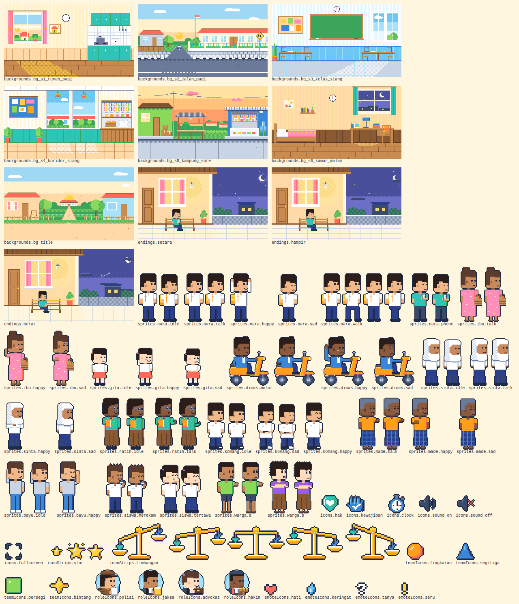

# Hasil uji F-12 — 21 Oktober 2026

Spesifikasi: [`specs/F-12-integrasi-aset.md`](../specs/F-12-integrasi-aset.md). Lingkungan: Node 22.22.2, pnpm 11.25.0, Vite 8.0.13, Vitest 5.0.4, TypeScript 5.9.3, Python 3.12.3 dengan Pillow 12.1.1, dan Chromium 141.0.7390.37 (headless, lewat Playwright untuk Python 1.56 di lingkungan agen, di luar repositori).

| Kriteria | Hasil | Bukti |
|---|---|---|
| AC-1 | Lulus | Uji sementara membuang isi manifest ke JSON, lalu skrip pembanding mencocokkannya dengan bagian "Aset" di spesifikasi. Hasilnya 63 entri di kedua sisi, 0 selisih. Yang dibandingkan: kelompok, kunci, dan berkas untuk semua entri, ditambah jumlah bingkai, ukuran bingkai, dan fps untuk 33 strip tokoh dan 2 strip antarmuka. Uji dan skrip sementara sudah dihapus |
| AC-2 | Lulus | Token dan warna `game.css` sekarang: 0 masalah. Pelanggaran yang tertangkap dengan pesan sesuai spesifikasi: token berbeda dari Design System (`--ss-focus`), token Design System hilang (`--ss-leaf`), token tambahan (`--ss-sky`), token berbeda dari palet (`--ss-sun` → `palette.json SUN`), token tanpa pasangan palet (`--ss-gold`), hex dan `rgb()` di luar palet (baris 5 dan 6), serta `hsl()` dan `rgb()` berpersen (baris 7 dan 8). Komentar, pemilih ID, `transparent`, dan `rgb(31 42 68 / 0.10)` tidak dianggap pelanggaran |
| AC-3 | Lulus | Keadaan sekarang: 0 masalah manifest, kelompok, kredit, dan naskah. Pelanggaran yang tertangkap: berkas tidak ada (`sprites.nara.terbang`), nama tidak sesuai kunci, berkas terdaftar dua kali, ukuran gambar tunggal (`icons.star` 48×16, seharusnya 16×16), ukuran strip (5 bingkai × 26×62), fps 12 dan 5 di luar rentang, fps 2.5 bukan bilangan bulat, `CREDITS.md` tanpa `char_nara_walk`, aset naskah `char_sinta_marah`, dan kelompok tanpa `hakim`, tanpa `bayu`, serta `warga` yang kosong |
| AC-4 | Lulus | Keadaan sekarang: berkas belum terdaftar "tidak ada", baris kredit tanpa entri "tidak ada". Contoh `ui/ui_baru.png` dan baris kredit `ui/ui_lama.png` muncul di ringkasan, sedangkan pemeriksaan manifest, anggaran, dan kredit tetap 0 masalah |
| AC-5 | Lulus | 0 masalah anggaran. Latar atau ilustrasi akhir terbesar 4,2 KB (`end/end_setara.png`) dari 40 KB; strip tokoh terbesar 1,2 KB (`sprites/char_dimas_motor.png`) dari 15 KB; total 61,4 KB dari 4 MB. Contoh 41,2 KB, 15,5 KB, dan total 4,2 MB tertangkap. Ringkasan tercetak (lihat langkah 1) |
| AC-6 | Lulus | `spriteFor("nara", "walk")` = 4 bingkai, 8 fps, 26×62; `terbang`, `constructor`, dan `toString` → `undefined`. `sceneAssets` adegan 1 menghasilkan 11 butir berurutan sesuai spesifikasi. Keenam adegan asli tanpa `src` kosong; adegan tiruan menghasilkan `char_nara_terbang` dengan `src` `undefined` |
| AC-7 | Lulus | `assetsInlineLimit` yang diimpor dari `vite.pages.config.ts` memberi `false` untuk `…/app/sehari-setara/assets/bg/bg_title.png` dan untuk path Windows `C:\…\app\sehari-setara\assets\ui\ui_star.png`, serta `undefined` untuk `public/stories/0-scene.jpg` dan `styles/game.css` |
| AC-8 | Lulus | Build percobaan di salinan sementara: 63 PNG berhash di `dist-pages/assets/`; 0 `data:image/png` di JS game; 63 rujukan PNG semuanya berbentuk `new URL(…, import.meta.url)` dan 0 path `"/assets/`; 104 berkas galeri dan bersama identik dengan build biasa. Di Chromium: 63 gambar, 63 `decode()` berhasil, 63 respons PNG berstatus 200, 0 galat konsol, 0 galat halaman, 0 respons 4xx/5xx. [Tangkapan layar](F-12/percobaan_aset_1280x720.png) |
| AC-9 | Lulus | `build:pages` kode 0. `diff -r` terhadap salinan `dist-pages/` sebelum F-12: identik, 107 berkas. Halaman permainan di 1280×720, 1366×768, 1920×1080, dan 1024×768: 0 galat konsol, 0 galat halaman, 0 respons 4xx/5xx, 0 permintaan gagal. Galeri: 0 galat konsol dan 0 respons 4xx/5xx (lihat Temuan 6) |
| AC-10 | Lulus | `content:check` dan `test` kode 0. `install --frozen-lockfile` kode 0. `package.json` hanya bertambah skrip `assets:build` (+2 −1 baris karena koma). `pnpm-lock.yaml` tidak berubah |
| AC-11 | Lulus | `npx pnpm@11.25.0 assets:build` kode 0 dalam 6 detik: "Total aset: 61.4 KB (anggaran 4 MB)" dan "Semua pemeriksaan lulus.". Sesudahnya `git status --short` untuk `app/`, `scripts/`, dan `docs/sehari-setara/preview/` kosong. `scripts/game/art/__pycache__/` ada di disk, tetapi diabaikan git (`git check-ignore`) |
| AC-12 | Lulus | `tsc --noEmit` seluruh proyek: kode 0, 0 galat, tanpa menulis `tsconfig.tsbuildinfo`. ESLint `--max-warnings 0` pada `manifest.ts`, `png.d.ts`, `asset-checks.ts`, `assets.test.ts`, dan `vite.pages.config.ts`: kode 0. Tidak ada `any` |
| AC-13 | Lulus | Architecture 0.5 (kepala, bagian 3, 8, 12), Design System 0.3 (kepala, tabel kit bagian 12), catatan `ikon.py` di Daftar_Aset, dan `PLAN.md` sesuai spesifikasi. `git diff --name-status` terhadap commit dasar memuat 14 berkas, semuanya disebut spesifikasi |

## Perintah yang dijalankan dan hasilnya

`test:e2e` belum ada; Playwright dijadwalkan di F-04 (keputusan Gerbang 1 nomor 6). Penggantinya langkah 4 dan 5.

1. `npx pnpm@11.25.0 install --frozen-lockfile`, `content:check`, dan `test --reporter=verbose`: semuanya kode 0.

   ```
   ✓ Lockfile passes supply-chain policies
   Lockfile is up to date, resolution step is skipped
   Verifikasi rujukan: 0 dari 12 terverifikasi.          (content:check: 36 lulus, 1 dilewati)
   Aset game: 63 berkas terdaftar, 61,4 KB dari anggaran 4 MB.
   Belum terdaftar di manifest: tidak ada.
   Tercatat di CREDITS.md tetapi belum terdaftar: tidak ada.
   ✓ app/sehari-setara/__tests__/reducer.test.ts (45 tests)
   ✓ app/sehari-setara/__tests__/rules.test.ts (21 tests)
   ✓ app/sehari-setara/__tests__/content.test.ts (37 tests | 1 skipped)
   ✓ app/sehari-setara/__tests__/assets.test.ts (18 tests)
   Test Files  4 passed (4)
        Tests  120 passed | 1 skipped (121)
   ```

   `RILIS=1 npx pnpm@11.25.0 content:check` tetap kode 1 dengan pesan "Rilis diblokir: 12 rujukan belum terverifikasi.", sama seperti sebelum F-12.

2. Pembanding isi manifest (AC-1): 63 entri di spesifikasi dan di manifest; tidak ada entri yang hanya ada di salah satunya; urutan kelompok sama.

3. `npx pnpm@11.25.0 build:pages`: kode 0 dalam 6 detik. Keluarannya sama persis dengan F-03:

   ```
   dist-pages/sehari-setara/index.html          0.72 kB │ gzip:   0.42 kB
   dist-pages/assets/game-DTKYZGGf.css          2.51 kB │ gzip:   0.94 kB
   dist-pages/assets/game-CXNfzINz.js           0.94 kB │ gzip:   0.46 kB
   dist-pages/assets/jsx-runtime-CmKW-gyo.js  190.84 kB │ gzip:  60.18 kB
   diff -r dist-pages-sebelum-F12 dist-pages  → tidak ada perbedaan (107 berkas)
   ```

4. `node scripts/game/serve-subpath.mjs --port 4185`, lalu pemeriksaan browser:

   ```
   permainan 1280x720:  galat konsol 0, galat halaman 0, 4xx/5xx 0, gagal 0, layar 1280×720
   permainan 1366x768:  galat konsol 0, galat halaman 0, 4xx/5xx 0, gagal 0, layar 1365,33×768
   permainan 1920x1080: galat konsol 0, galat halaman 0, 4xx/5xx 0, gagal 0, layar 1920×1080
   permainan 1024x768:  galat konsol 0, galat halaman 0, 4xx/5xx 0, gagal 0, layar 1024×576
   galeri 1280x720:     galat konsol 0, galat halaman 0, 4xx/5xx 0, permintaan batal 1 (gallery/ruang-setara.glb)
   ```

5. Build percobaan di salinan sementara (`/tmp`, `node_modules` ditautkan). Di salinan itu, `Game.tsx` sementara menampilkan ke-63 gambar dari manifest. Hasilnya:

   ```
   dist-pages/assets/game-BNdPlzJB.js   6.39 kB │ gzip: 2.22 kB   (halaman percobaan)
   PNG berhash: 63 · data:image/png di JS game: 0 · rujukan new URL(…, import.meta.url): 63
   berkas galeri dan bersama: 104 identik, 0 berbeda · total PNG 62.871 byte
   Chromium: 63 gambar, 63 decode() berhasil, 63 respons PNG 200, 0 galat konsol, 0 respons 4xx/5xx
   ```

   

   Salinan sementara dihapus sesudahnya. `Game.tsx` di repositori tidak berubah.

6. `npx tsc --noEmit -p tsconfig.json --incremental false`: kode 0, 0 galat. `npx eslint --max-warnings 0` pada lima file kode baru dan yang diubah: kode 0.

7. `npx pnpm@11.25.0 assets:build`, lalu `git status --short`: lihat AC-11.

8. `git diff --name-status` terhadap commit dasar (ekspor ZIP 21 Okt 2026), termasuk laporan ini: 14 berkas, 7 baru dan 7 diubah.

   ```
   A  app/sehari-setara/__tests__/asset-checks.ts
   A  app/sehari-setara/__tests__/assets.test.ts
   A  app/sehari-setara/assets/manifest.ts
   A  app/sehari-setara/assets/png.d.ts
   A  docs/sehari-setara/specs/F-12-integrasi-aset.md
   A  docs/sehari-setara/tests/F-12-hasil.md
   A  docs/sehari-setara/tests/F-12/percobaan_aset_1280x720.png
   M  .gitignore
   M  docs/sehari-setara/Architecture.md
   M  docs/sehari-setara/Daftar_Aset.md
   M  docs/sehari-setara/Design_System.md
   M  docs/sehari-setara/PLAN.md
   M  package.json
   M  vite.pages.config.ts
   ```

9. Daftar periksa manual AGENTS bagian 9: belum ada butir yang berlaku, karena halaman yang terbit tidak berubah.

## Temuan

1. **Halaman yang terbit tidak berubah sama sekali.** `dist-pages/` identik byte dengan build sebelum F-12, karena manifest baru diimpor uji. Anggaran kode permainan tetap 60,6 kB gzip dari 150 KB.
2. **Aturan aset sebagai berkas terpisah terbukti.** Pada build percobaan, JS halaman percobaan hanya 2,22 kB gzip. Bandingkan dengan 56,2 kB gzip bila gambar diselipkan, sesuai percobaan saat Plan. Galeri tidak terpengaruh.
3. **Uji aset kini ikut menahan terbitan.** Langkah "Uji game" di CI menjalankan `assets.test.ts`. Bila ukuran kanvas aset terdaftar diubah tanpa memperbarui manifest, atau aset didaftarkan tanpa dicatat di `CREDITS.md`, situs tidak terbit sampai hal itu diperbaiki. Berkas yang belum terdaftar hanya dilaporkan di log.
4. **`assets:build` di komputer lain.** Di lingkungan agen, PNG dan pratinjau hasilnya identik byte dengan repositori. Di komputer dengan versi Pillow lain, byte PNG bisa berbeda walau gambarnya sama, sehingga GitHub Desktop menampilkan PNG sebagai berubah. Saran: commit PNG hanya bila kode gambarnya memang diubah.
5. **Ketergantungan pada bentuk URL impor di Vitest.** Uji memetakan URL seperti `/app/sehari-setara/assets/bg/bg_title.png` ke berkas. Bila versi Vitest lain mengubah bentuk ini, uji gagal dengan pesan "berkas yang tidak ada", tidak lolos diam-diam.
6. **Fetch yang dibatalkan di galeri sudah ada sejak sebelum F-01.** Satu fetch `gallery/ruang-setara.glb` dibatalkan (`net::ERR_ABORTED`), sama seperti F-01 Temuan 2. Ini bukan respons 4xx dan bukan galat konsol.
7. **Belum diuji:** build sungguhan di Windows (aturan path Windows hanya diuji unit) dan jalannya uji baru di GitHub Actions. Hasil CI pertama terlihat pada push berikutnya.

## Keputusan: Lulus

Ketiga belas kriteria lulus. `content:check`, `test`, dan `build:pages` lulus; halaman permainan tanpa galat konsol dan tanpa respons 4xx; anggaran ukuran terpenuhi. `test:e2e` dikecualikan sesuai keputusan Gerbang 1 nomor 6.
